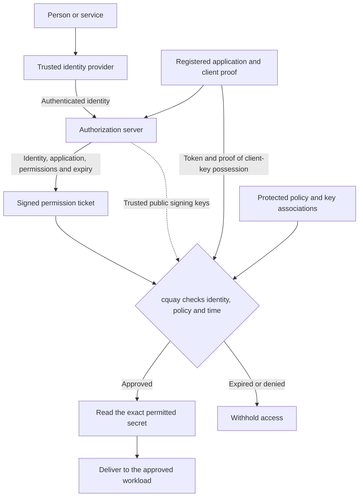
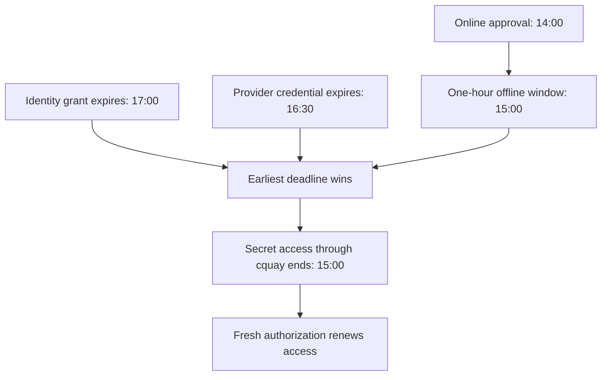

# CircularQuay

**Portable secrets delivery, with explicit trust boundaries.**

A shell profile once made a developer's environment feel simple: open a
terminal, inherit the right variables, and get on with the job. Services,
containers, Windows sessions, CI runners, and hosted applications introduced
different startup and identity boundaries. Multiple AI providers and agent
workflows added more keys, scopes, and places to configure them.

CircularQuay grew out of the frustration of joining those pieces repeatedly. It
connects existing providers, established encryption, and native runtime
delivery through one workload-scoped policy. You choose where online
authorization is required and where an encrypted offline copy is appropriate.

CircularQuay’s app, command, and operations skill are named `cquay` (pronounced “c-key”).

CircularQuay gets the right secrets to the right apps, wherever they run.
Keep your existing secret stores, choose what each app can access, and manage
it all from one configuration.

Use it on its own, or connect an **optional identity provider** to tie access
to a person or service and a time limit. An **optional MCP connector** brings
the same controls to AI assistants and agents.

An optional [managed key service](docs/managed-key-service.md) returns the age
key mapped to your verified identity. Administrators manage who may fetch it
and when through the service's authorized UI and API, reusing Netlify or
Cloudflare capabilities. Revocation stops future fetches; a key already copied
can still decrypt its matching ciphertext.

Your enterprise identity server can give an AI tool a short, approved window
to use the credentials it needs. CircularQuay checks who is asking, which
application is acting, which secrets it may access, and whether that window
is still open. Its [identity-linked access model](#identity-key-access-and-expiry)
lets you put that into practice:

- **An incident teammate:** let an on-call assistant run approved diagnostics
  for the duration of an incident.
- **A deployment copilot:** make deployment credentials available to an
  approved tool only during an authorized change window.
- **A visiting specialist:** give a contractor's assistant temporary access
  to one project's tools, without pasting keys into a chat.
- **A scheduled reporting assistant:** let an agent use a read-only reporting
  tool during its approved reporting window.
- **Safer AI automation:** keep credentials inside the approved tool process
  and return task results to the model instead of handing it the raw secrets.


[](https://github.com/maldous/CircularQuay/actions/workflows/security.yml)

[](docs/qualification.md#bounded-receipts)
[](docs/qualification.md#bounded-receipts)
[](docs/qualification.md#bounded-receipts)
[](docs/qualification.md#bounded-receipts)
[](docs/qualification.md#bounded-receipts)
[](docs/qualification.md#bounded-receipts)
[](docs/qualification.md#bounded-receipts)

## Quick start

Until the first qualified release, build `cquay` from this development source
with Go 1.27.3. The following creates only a local synthetic fixture; it does
not contact a provider, read credentials, or start a service. Future verified
native downloads will appear on the [GitHub Releases page](https://github.com/maldous/CircularQuay/releases). Consumer installation, verification, release-candidate, and publisher procedures belong in [RELEASE.md](RELEASE.md).

### Linux and macOS

```sh
umask 077
cd -P "$(mktemp -d)"
git clone --branch feature/initial-implementation https://github.com/maldous/CircularQuay.git
cd CircularQuay
go version # requires Go 1.27.3
go build -o ./cquay ./cmd/cquay

./cquay init --output cquay.json
./cquay --config cquay.json doctor
./cquay --config cquay.json plan
./cquay --config cquay.json run --workload demo -- /usr/bin/printf '%s\n' 'Synthetic workload completed.'
```

### Windows PowerShell

```powershell
git clone --branch feature/initial-implementation https://github.com/maldous/CircularQuay.git
Set-Location CircularQuay
go version # requires Go 1.27.3
go build -o .\cquay.exe .\cmd\cquay

.\cquay.exe init --output cquay.json
.\cquay.exe --config cquay.json doctor
.\cquay.exe --config cquay.json plan
.\cquay.exe --config cquay.json run --workload demo -- C:\Windows\System32\cmd.exe /d /c 'echo Synthetic workload completed.'
```

The final command runs an explicitly named, trusted operating-system program
with a synthetic value. Do not use environment-dumping commands when a policy
contains credentials. A declared workload command has access to values that
policy delivers to it.

For policy editing, conditional updates, doctor behavior, and all command
flags, see the [v1 command reference](#v1-command-reference) below.

<picture>
  <source media="(prefers-color-scheme: dark)" srcset="docs/assets/architecture-overview-dark.svg">
  
</picture>

<picture>
  <source media="(prefers-color-scheme: dark)" srcset="docs/assets/environment-evolution-dark.svg">
  
</picture>

## What it delivers

- **Explicit interoperability:** select exact provider resources and string fields; keep existing stores authoritative.
- **Optional enterprise identity:** connect trusted IdP identities and registered applications to configurable contexts, workloads, operations, and exact secret keys.
- **Time-bound access:** respect provider and offline deadlines; with identity integration enabled, also verify signed access grants and client-key possession.
- **Workload isolation:** reject duplicate names and undeclared resource access; keep provider bootstrap credentials out of application environments.
- **Complete generations:** resolve required inputs before activation instead of applying a partial refresh.
- **Portable encryption:** use upstream SOPS and age rather than a new encryption format.
- **Native delivery:** use process environments, protected files, OS credential interfaces, and declared deployment targets.
- **Optional MCP:** expose authorized status and named actions, with a separate permission for each raw secret disclosure.
- **Inspectable assurance:** source, tests, a policy model, release identities, and a reproducible audit route.

The [qualification matrix](docs/qualification.md) records tested platforms,
providers, release artifacts, and operational evidence.

## Start with a configuration repository

A shared GitHub repository is a straightforward starting point for a developer
or a CI job. Its public configuration describes providers, resource references,
workloads, and policy; secret values and bootstrap credentials stay outside it.
Give `cquay` a repository, tree, or file URL and select the configuration:

```sh
cquay bootstrap \
  --config-source https://github.com/example-org/cquay-config/tree/main/github \
  --config-path cquay.json \
  --output ./cquay.json
```

Replace the example organization, repository, and path with your own. A tree URL
selects a directory; `--config-path` selects the file within it. A file URL can
select the file directly. `--config-ref FULL_COMMIT_SHA` pins an exact revision.
When a branch or tag is supplied, `cquay` resolves and records its commit and
configuration digest before use. Updates are revalidated against the enrolled
repository and signing policy. Public readability does not grant permission to
change local trust, retrieve secrets, execute a workload, or install a service.

### Use the same configuration in GitHub Actions

With a verified `cquay` binary on the runner's PATH, a job can select its
configuration through the environment and run a declared workload:

```yaml
permissions:
  contents: read
  id-token: write

jobs:
  build:
    runs-on: ubuntu-latest
    env:
      CQUAY_CONFIG_SOURCE: https://github.com/example-org/cquay-config/tree/main/github
      CQUAY_CONFIG_PATH: cquay.json
    steps:
      - name: Run the configured build
        run: cquay flow run --workload ci-build --non-interactive
```

The configuration declares `ci-build` and its approved command. The job's
workload identity is verified against the configured issuer, audience,
repository, ref, and environment before any protected value is delivered.
[`id-token: write`](https://docs.github.com/en/actions/how-tos/secure-your-work/security-harden-deployments/oidc-in-cloud-providers) permits requesting an identity token; access still requires
the receiving authority's explicit policy. An optional identity integration
uses that token; standalone configurations use their declared provider trust.

The source URL can also come from a GitHub repository or environment variable,
or from an earlier step that writes `CQUAY_CONFIG_SOURCE` to `$GITHUB_ENV`.
GitHub [makes that file's entries available to subsequent steps](https://docs.github.com/en/actions/reference/workflows-and-actions/workflow-commands#setting-an-environment-variable). For an
immutable configuration, also set `CQUAY_CONFIG_REF` to its full commit SHA.
`cquay bootstrap --non-interactive --output ./cquay.json` materializes the
selected configuration for later commands without putting secret values in it.

Without an explicit source, `cquay` checks local configuration, then uses
administrator-enrolled discovery. An authenticated configuration service or
GitHub App can associate verified job claims with an approved configuration
reference. A configured repository convention can supply the same reference.
This enrollment is explicit: there is no universal GitHub configuration-service
endpoint, and a public repository or runner environment is not its own trust
anchor. DNS, device provisioning, and cloud metadata can supply verified hints;
they cannot authorize access by themselves.

[GitLab CI](https://docs.gitlab.com/ci/secrets/id_token_authentication/) and
[Azure Pipelines](https://learn.microsoft.com/en-us/azure/devops/pipelines/library/service-endpoints?view=azure-devops) use the same `cquay flow run` command and
configuration settings with their respective job identities and environment
mechanisms. Provider adapters detect the runner context, preserve explicit
overrides, and support extensible discovery. Publishing values to later steps
is an explicit policy-controlled operation through the CI provider's supported
mechanism; the pipeline and subsequent steps then have access to those values.

Explicit command options take precedence over `CQUAY_` configuration settings,
then local configuration, then enrolled discovery. With no override, an
existing local configuration is used before discovery. Provenance diagnostics
show which source won without printing credentials. Overrides cannot widen an
identity grant or bypass the enrolled trust policy. `cquay bootstrap` offers
a text interface and browser or displayed-URL authentication when interaction
is needed, and starts only services authorized by the selected enrollment.

## How CircularQuay fits with existing secret systems

CircularQuay brings provider access, session setup, CI automation, native
delivery, and agent permissions into one workload policy. The rows below show
the capabilities together, including where existing tools already overlap.

**✓** = available in the described scope; **❌** = a documented gap, explained
in its footnote; **—** = unknown, not established as equivalent, or outside the
compared product's scope. A dash is not a claim that a feature is absent.
Vendor features may require a particular edition, integration, or subscription.

| Capability | CircularQuay | OpenBao[^compare-bao] | Vault[^compare-vault] | Infisical[^compare-infisical] | Doppler[^compare-doppler] | 1Password[^compare-onepassword] | SOPS + age[^compare-sops] |
| --- | :---: | :---: | :---: | :---: | :---: | :---: | :---: |
| Read multiple existing providers without migrating their values | ✓ | — | — | — | — | — | — |
| Bind selected fields or secret references to workload variables | ✓ | ✓ | ✓ | — | — | ✓ | ✓ |
| Resolve every required input before activating a complete generation | ✓ | — | — | — | — | — | — |
| One-command configuration, authentication, and scoped shell bootstrap | ✓ | — | — | — | — | — | — |
| Bootstrap from a public/private Git repository, tree, or file URL | ✓ | — | — | — | — | — | — |
| Verify configuration revisions, signatures, and update provenance | ✓ | — | — | — | — | — | — |
| Discover enrolled configuration through enterprise/device/cloud context | ✓ | — | — | — | — | — | — |
| Explicit overrides with deterministic precedence and safe diagnostics | ✓ | — | — | — | — | — | — |
| Schema-backed configuration CRUD and a validation/repair doctor | ✓ | — | — | — | — | — | — |
| Scoped machine identities and noninteractive authentication | ✓ | ✓ | ✓ | ✓ | ✓ | ✓ | — |
| Federate CI-issued identity tokens without a stored provider token | ✓ | ✓ | ✓ | ✓ | ✓ | — | — |
| One flow command detects GitHub Actions, GitLab CI, or Azure Pipelines | ✓ | — | — | — | — | — | — |
| Discover CI configuration from job context or an enrolled service | ✓ | — | — | — | — | — | — |
| Policy-controlled delivery to the job process and optional later steps | ✓ | — | — | — | — | — | — |
| Deliver credentials through a child-process environment | ✓ | ✓ | ✓ | ✓ | ✓ | ✓ | ✓ |
| Deliver through declared protected OS credential interfaces | ✓ | — | — | — | — | — | — |
| One policy spans native services, containers, CI, and cloud targets | ✓ | — | — | — | — | — | — |
| Encrypted offline configuration or fallback artifact | ✓ | — | — | — | ✓ | — | ✓ |
| Offline approval binds identity, application, workload, and expiry | ✓ | — | — | — | ❌[^compare-offline-expiry] | — | — |
| Hybrid fallback limited to approved availability failures | ✓ | — | — | — | — | — | — |
| Optional managed age-key access with identity-based grants and administration | ✓ | — | — | — | — | — | — |
| Optional enterprise IdP alongside standalone local-policy operation | ✓ | — | — | — | — | — | — |
| Configurable contexts, scopes, roles, clients, and access windows | ✓ | — | — | — | — | — | — |
| MCP integration for AI tools or secret administration | ✓ | — | ✓ | ✓ | ✓ | — | — |
| Hosted remote MCP endpoint | ✓ | — | ❌[^compare-vault-remote] | — | — | — | — |
| Run tool processes with credentials supplied outside prompt text | ✓ | ✓ | ✓ | ✓ | ✓ | ✓ | ✓ |
| Separate MCP action permissions and exact-key raw-read grants | ✓ | — | — | — | — | — | — |
| MCP configuration CRUD, policy, grants, revocation, and audit | ✓ | — | — | — | — | — | — |
| Audited agent-to-agent runtime delegation with scope and a deadline | ✓ | — | — | — | — | — | — |
| Independent audit command and reproducible qualification evidence | ✓ | — | — | — | — | — | — |

The combination is CircularQuay's value: one configuration connects an approved
identity and workload to existing providers, online or authorized offline use,
and the right runtime delivery path. Stopping future delivery does not recall
an already issued credential; its original provider controls revocation and
expiry. Process injection describes how credentials reach a tool; it does not
prevent that tool from disclosing them. Authorized raw-secret reads deliberately
return plaintext. Release, implementation, and test receipts are recorded
separately in the [qualification evidence](docs/qualification.md).

[^compare-bao]: OpenBao documents [JWT/OIDC authentication](https://openbao.org/docs/auth/jwt/), [field-selecting templates and process environments](https://openbao.org/docs/agent-and-proxy/agent/template/), and [agent caching](https://openbao.org/docs/agent-and-proxy/agent/caching/). Its cache covers managed tokens and leased secrets; this is not evidence of an equivalent portable, identity-bound offline approval.

[^compare-vault]: Vault documents [JWT/OIDC federation](https://developer.hashicorp.com/vault/docs/auth/jwt), [agent field selection and runtime delivery](https://developer.hashicorp.com/vault/docs/agent-and-proxy/agent/template), and an [MCP server](https://developer.hashicorp.com/vault/ai/mcp-server). Its separate [Enterprise Agentic IAM](https://developer.hashicorp.com/vault/ai) also governs agent identities and delegated workflows; the dash in Vault's delegation cell does not deny that capability.

[^compare-infisical]: Infisical documents [OIDC machine identities](https://infisical.com/docs/documentation/platform/identities/oidc-auth/general) and [credential injection into MCP servers](https://infisical.com/blog/managing-secrets-mcp-servers). The MCP mark includes this integration route; it does not imply that the example custom server provides every administration feature in this table.

[^compare-doppler]: Doppler documents [scoped service tokens](https://docs.doppler.com/docs/service-tokens), [CI OIDC identities](https://docs.doppler.com/docs/service-account-identities), [encrypted fallback and runtime delivery](https://docs.doppler.com/docs/automatic-fallbacks), and an [experimental MCP server](https://docs.doppler.com/docs/mcp). OIDC identities require its Team or Enterprise plan. Its MCP interface includes raw-value reads and configuration writes.

[^compare-onepassword]: This column compares 1Password Secrets Automation and CLI: [scoped service accounts](https://www.1password.dev/service-accounts) and [runtime secret references](https://www.1password.dev/cli/secrets-scripts). [SaaS Manager MCP](https://support.1password.com/saas-manager-mcp-server/) is a separate product/API and is not counted as a Secrets Automation MCP endpoint.

[^compare-sops]: [SOPS](https://getsops.io/) supports encrypted files with offline age identities or online key services. Its CLI documents [selected-value extraction](https://getsops.io/docs/usage/common-operations/#extract-a-sub-part-of-a-document-tree) and [process injection](https://getsops.io/docs/usage/advanced/#passing-secrets-to-other-processes) with `exec-env`; these are encryption/runtime utilities, not evidence of a hosted policy or delegation service. The original key or provider still controls decryption authority.

[^compare-offline-expiry]: Doppler's [fallback FAQ](https://docs.doppler.com/docs/automatic-fallbacks#faq) states that a fallback file can be used indefinitely and has no built-in expiry; an expiry check or cleanup needs additional work. This cross concerns that built-in offline deadline, not Doppler's online token lifetimes or an external enforcement layer.

[^compare-vault-remote]: Vault's [MCP transport documentation](https://developer.hashicorp.com/vault/ai/mcp-server/reference/protocols) explicitly limits the documented server to local use. This cross describes that server's deployment scope, not Vault's remote APIs or Enterprise Agentic IAM.

## Choose an availability policy

| Mode | Intended use | Boundary |
| --- | --- | --- |
| Offline | Provisioned static values from local, approved artifacts | No central per-read audit or immediate remote revocation. |
| Online | Fresh provider retrieval or unwrap at each launch | Startup depends on the provider; auditing depends on the actual backend configuration. |
| Hybrid | Online retrieval with an explicitly approved encrypted fallback | Only qualifying availability failures permit fallback. Denial, TLS failure, malformed data, and expiry do not. |

A deployed snapshot is a delivery workflow for an offline or hybrid workload,
not a fourth availability mode. One-way publication into a platform's native
store gives the destination's permissions, rotation, and audit behavior to the
copy.

To use online, hybrid, snapshot, or publication operations, start with the
[complete Linux reference](examples/linux-deployment.json) and the
[configuration reference](docs/configuration.md). Copy it to an operator-owned
path and replace only its fabricated resource selectors and protected file
paths; keep actual credentials in the selected provider or protected identity
file. After that policy and its prerequisites are valid, use its declared
workload ID with the normal lifecycle commands:

```sh
CONFIG=/absolute/operator-owned/cquay.json
cquay --config "$CONFIG" plan
cquay --config "$CONFIG" run --workload reference-api -- /absolute/path/to/your/workload
cquay --config "$CONFIG" snapshot --workload reference-api
cquay --config "$CONFIG" sync --once --workload reference-api
```

The reference itself names nonexistent synthetic paths and cannot be run until
an operator supplies those external prerequisites. `snapshot` needs a completed
offline or hybrid snapshot declaration; `sync` needs at least one declared
target and only publishes values explicitly permitted by each binding.

Already delivered values cannot be recalled from process memory, old ciphertext, or an authorized client. Removing a recipient is not a substitute for rotating a compromised credential at its issuer.

## Identity, key access, and expiry

**Our v1 north star: the right identity, using the right application, receives
only its approved secrets, for exactly the permitted time.**

Use CircularQuay on its own with local policy, or add an optional identity
provider for centrally approved access. The MCP connector is optional too;
apps and services can use CircularQuay directly.

With identity integration enabled, think of CircularQuay as a collection desk:
your identity provider establishes who you are, a signed permission ticket
states what you may collect and when, and CircularQuay checks that ticket
against the exact key and workload before handing anything over.

### One identity, explicit permissions

When identity integration is enabled, a person or service authenticates through
the organization's identity provider (IdP). Its OAuth authorization server
issues a signed, time-limited access
grant for the registered application and CircularQuay service. These roles
can belong to the same existing enterprise provider or to a self-hosted
service such as Keycloak. The policy selects the trusted authority and its
supported authentication profile.

Permissions describe the organization's own contexts: projects, teams,
environments, workloads, operations, and individual secret keys. For example,
`invoice-reporting` in `warehouse-eu` can receive its approved database key
without receiving the authority assigned to another workload. Context names
and associations are defined in configuration.



### Use an existing IdP or a self-hosted authority

The **identity provider** answers "Who are you?" The **authorization server**
answers "What may this application do on your behalf, and until when?" One
enterprise identity platform can perform both roles. CircularQuay uses its
OAuth and OpenID Connect integration to connect verified identities with
explicitly configured permissions for the CircularQuay service.

An organization can use its existing provider's API authorization service or
operate its own authority, such as [Keycloak](https://www.keycloak.org/).
The configuration identifies the trusted issuer, verification keys, service
audience, registered clients, identity associations, and permission mappings.
Trust is established by that explicit configuration and verification of the
authority's signatures. Teams choose the authority and policy that fit their
environment; the same access model applies to hosted and self-hosted services.

### A cryptographic chain of trust

The permission ticket binds the issuing authority, stable identity,
application, intended service, permitted operations, and expiry. CircularQuay
verifies the issuer's digital signature using its trusted public key and
checks the complete association against local policy. Editing a signed
identity, permission, or deadline invalidates the ticket. The foundation is
the standard [OAuth access-token model](https://www.rfc-editor.org/rfc/rfc9068.html).

Three keys have distinct jobs:

- The **issuer's signing key** authenticates the permission ticket.
- The **client's private key** proves possession by the enrolled application.
- The **application secret** is the API key, password, or credential delivered
  to the approved workload.

[DPoP](https://www.rfc-editor.org/rfc/rfc9449.html) or
[certificate-bound mutual TLS](https://www.rfc-editor.org/rfc/rfc8705.html)
connects the access token to the client's key. Each request proves possession
of the matching private key. Private-key JWT authentication establishes the
application's identity when it obtains its grant from the authorization server.
The configured profile keeps issuance, request authentication, and secret
access tied to their respective authorities.

### Online and offline, one expiry policy

Online access uses current authorization and fresh provider retrieval. Approved
offline access uses an encrypted snapshot accompanied by a signed approval
for that exact snapshot, identity, application, policy, workload, and key set.
The issuing authority approves the complete association. Encryption protects
the contents; the signature authenticates who may release them and for how long.

The effective access deadline is the **earliest** of:

1. The signed identity authorization's expiry.
2. The end of the approved offline window.
3. Any expiry imposed by the original credential provider.

For example, an approval obtained at 14:00 with a one-hour offline window ends
at 15:00, even if the identity grant lasts until 17:00 and the provider
credential lasts until 16:30.



Reads and file copies retain the original deadline. Renewal requires a fresh
authorization decision. Reconnection applies the issuer's current account
status, policy, and revocations before granting another window. Protected local
state and clock-rollback checks preserve the deadline across restarts.

### A clear, verifiable security contract

| Control | End-state behavior |
| --- | --- |
| Identity and application association | Verify the trusted issuer, stable subject, registered client, and intended CircularQuay service. |
| Exact permission | Match the configured context, workload, operation, and key before retrieving a value. |
| Client key binding | Verify possession of the private key associated with the access token. |
| Offline approval | Verify the signed association to the exact encrypted snapshot and policy. |
| Permission lifetime | Enforce the earliest authorization, offline-window, or provider deadline for new access through CircularQuay. |
| Credential lifetime | Preserve the original provider's expiry, rotation, and revocation policy. |
| Protected enforcement | Use OS access controls, protected state, and clock checks at the local trust boundary. |
| Decision checks | Recheck authorization and value expiry before disclosure or workload launch; deny failed checks. |
| Auditability | Record identity, application, policy decision, and outcome without recording secret values. |

This is the v1 product contract. The [identity architecture](docs/hosted-identity.md),
[configuration reference](docs/configuration.md), and
[security model](docs/threat-model.md) describe its trust relationships and
policy boundaries.

## Try a credential-free workload

The `examples/` directory contains fabricated values only. From the repository root, with a built `cquay` executable:

```sh
cquay --config examples/demo.json plan
cquay --config examples/demo.json run --workload demo -- /usr/bin/env
```

The second command deliberately demonstrates the child's environment using **synthetic data**. Do not use environment-dumping commands with real credentials. Normal workload commands should consume their assigned values without printing them.

On Windows, use an absolute native executable rather than assuming Bash exists. The CLI does not implicitly evaluate a shell command string. A program named by a workload still has the authority to read values delivered to it.

Native archives and verified offline bundles are the intended consumer installation route. Only enabled features need their dependencies. The normal CLI does not require an installed Go, Python, Node, Java, or Docker runtime. Source builds require the pinned Go toolchain; the independent audit environment has additional prerequisites.

## Provider and platform boundaries

SOPS can use cloud KMS or OpenBao Transit to protect a document key. That is different from retrieving existing application values from a secret manager.

| Integration | Scope |
| --- | --- |
| JSON / literal dotenv / selected process variables | Explicit local configuration; no interpolation or shell-profile execution. |
| SOPS / age / approved Transit endpoint | Upstream encryption and scoped key release. |
| OpenBao / Vault KV | Exact mount, path, field, and supported version. |
| AWS SM/SSM, Azure Key Vault secrets, GCP Secret Manager | Native provider identities and explicit resource references. |
| Doppler, Infisical, Bitwarden, Akeyless, optional 1Password | Connector-specific identity, lifecycle, audit, dependency, and platform limits. |
| systemd / Windows / Termux / containers | Native startup and credential boundaries; actual devices require qualification. |
| Windmill / Workers / Netlify / cloud applications | Native one-way delivery where implemented; no inherited source-audit guarantee. |

Use `cquay providers` and the qualification matrix for the current executable's capabilities. Unsupported combinations must fail explicitly. Provider and platform support does not imply a free subscription, official Android support, or an upstream security endorsement.

Termux startup occurs after Android permits access following the first unlock. Multiple Termux processes share an application UID. Windows DPAPI machine protection relies on ACLs for service separation. Root or Administrator compromise defeats endpoint protections.

## MCP and AI agents

CircularQuay's MCP interface is optional. Local stdio uses the OS-user/launcher boundary. Separately configured HTTP requires a qualified OAuth issuer, the correct resource audience, and current authorization on each operation.

- List/status results are filtered by current grants.
- Named actions do not accept arbitrary commands or provider URLs.
- `read_secret` requires a separate grant for an exact configured key.
- Bootstrap keys, refresh credentials, and server identities must not be exposed as readable aliases.
- Raw action stdout/stderr is not an authorized substitute for a secret-read permission.

**An authorized raw read deliberately releases plaintext to the MCP client.** It can enter model context, transcripts, or the client's retention systems. CircularQuay cannot control that value after delivery. Grants prevent future toolkit access; they cannot erase previous disclosures.

Self-reported agent names are not identity. Strong separation between agents sharing one OS user requires an additional OS or authenticated-service boundary. A coding agent running caller-controlled code with injected credentials has disclosure-capable authority.

## Design and evidence

- [Configuration reference](docs/configuration.md) and [complete Linux deployment example](examples/linux-deployment.json)
- [Platform and architecture matrix](docs/platform-support.md)
- [Credential and native-store boundaries](docs/credential-boundaries.md)
- [Hosted identity and application connections](docs/hosted-identity.md)
- [Architecture and trust boundaries](docs/architecture.md)
- [Security model](docs/threat-model.md)
- [Assurance contract](docs/assurance.md)
- [Qualification matrix](docs/qualification.md)
- [Provider interoperability](docs/providers.md)
- [Security reporting](SECURITY.md)

The target is clean first-party analysis, meaningful coverage, and reproducible evidence. The receipt badges above link to exact bounded results; they do not represent a release gate, a complete audit, or current-head qualification. Published metrics must identify the commit, tools, rules, platform scope, and remaining upstream advisories.

## Related work

[SOPS](https://getsops.io/) supplies encryption, [age](https://age-encryption.org/) supplies portable recipients, and [OpenBao](https://openbao.org/) supplies established authorization and key-management capabilities. [Teller](https://github.com/tellerops/teller), [vals](https://github.com/helmfile/vals), and [Chamber](https://github.com/segmentio/chamber) already make provider retrieval and environment injection easier. [sops-nix](https://github.com/Mic92/sops-nix) and [Flux](https://fluxcd.io/flux/guides/mozilla-sops/) demonstrate native lifecycle integration.

CircularQuay focuses on their operational intersection: explicit inheritance and export policy, lifecycle-aware offline copies, native service delivery, optional authenticated disclosure, and evidence-backed recovery. It does not claim to invent provider interoperability or to replace those projects.

## License

Apache-2.0 for CircularQuay's own code and documentation. Dependencies retain their own licenses and notices.

## v1 command reference

This is the intended v1 interface for review. Implementation and production
qualification are incomplete. Use synthetic data only; see the
[qualification evidence](docs/qualification.md).

All commands accept `--config PATH` (default `cquay.json`) and `--state-dir
PATH` before the command. `help`, `--help`, `-h`, `version`, and `providers`
need no policy. `bootstrap` and `flow run` can resolve configuration before a
local policy exists. `version` identifies this working build as `1.0.0-dev`; it is
not a release assertion.

| Command | Usage and behavior |
| --- | --- |
| Bootstrap | `cquay bootstrap [--config-source URL] [--config-ref REF] [--config-path PATH] [--config-sha256 SHA256] [--output PATH] [--non-interactive]` selects local or enrolled configuration, verifies remote references, and configures the authorized session. Equivalent source settings are `CQUAY_CONFIG_SOURCE`, `CQUAY_CONFIG_REF`, `CQUAY_CONFIG_PATH`, and `CQUAY_CONFIG_SHA256`. Unattended first enrollment pins the full commit and a configuration digest obtained through a trusted maintainer channel. |
| CI flow | `cquay flow run --workload ID [--non-interactive]` detects the supported runner, resolves configuration and workload identity, then executes the approved workload. Explicit configuration-source options override discovery. |
| Create | `cquay init [--output PATH]` or `cquay config init [--output PATH]` creates a protected synthetic JSON policy and fixture, refusing to overwrite either. |
| Inspect configuration | `cquay config validate`; `cquay config get --pointer RFC6901`; `cquay config list [--pointer RFC6901]`. `get` and `list` return the whole-document SHA-256. The returned policy literal is visible to an authorized configuration reader. |
| Edit configuration | `cquay config set --pointer RFC6901 (--value-json JSON\|--value-file PATH\|-) [--expect-sha256 HEX]`; `cquay config delete --pointer RFC6901 [--expect-sha256 HEX]`; `cquay config replace --file PATH\|- [--expect-sha256 HEX]`. Values are JSON; `-` reads standard input; inputs are capped at 1 MiB. |
| Doctor | `cquay doctor [--fix\|--identity-only]`. A missing or unsafe selected policy is non-zero. `--identity-only` reports the local kernel-derived subject without checking policy. `--fix` canonically formats a valid protected JSON policy only; it does not alter grants, provider settings, services, or deployment state. |
| Plan and status | `cquay plan`; `cquay status --workload ID [--json]`. |
| Workload lifecycle | `cquay run --workload ID [--target ID] [-- ABSOLUTE-PROGRAM ARGS…]`; `cquay snapshot --workload ID [--target ID]`; `cquay apply --workload ID --target ID`; `cquay sync --workload ID [--target ID] [--once]`. `apply` requires an explicit target; only `run` accepts arguments after `--`. |
| MCP | `cquay mcp serve [--transport stdio\|http] [--tls-cert PATH --tls-key PATH]`. HTTP uses the policy listener address (or loopback `127.0.0.1:8080`); a non-loopback listener requires both TLS paths. |

Configuration operations are cooperative: each writer takes the private local
configuration lock, validates a candidate, then re-reads the current digest
before atomically replacing the file. `--expect-sha256` adds an optimistic
review check; it is not an external distributed CAS. Configuration editing and
`doctor --fix` accept protected JSON only. YAML may be loaded for normal policy
execution but is intentionally not mutated. A repeated `set` or `replace` with
the same value produces the same canonical document; a repeated `delete` fails
after the node is absent.

The separate assurance binary is for evidence generation, not workload
delivery: `cquay-audit run --profile source|enterprise --output DIR` with
optional `--source`, `--go`, `--sonar-url`, `--sonar-token-file`, and
`--sonar-project-key`. Its enterprise inputs and evidence handling are
documented in [RELEASE.md](RELEASE.md).

### Configuration CRUD

These examples edit public configuration declarations. They never supply a
provider token or private key. Start with the synthetic policy from the quick
start; `set` creates a missing object member or replaces an existing node.

```sh
# Create a synthetic policy and validate it.
cquay config init --output cquay.json
cquay --config cquay.json config validate

# List workloads and read one declaration. Both responses include sha256.
cquay --config cquay.json config list --pointer /workloads
cquay --config cquay.json config get --pointer /workloads/demo

# Create or update a complete non-secret environment object.
cquay --config cquay.json config set --pointer /workloads/demo/environment --value-json '{"APP_MODE":"development"}'

# Read a replacement node from stdin or a protected JSON file.
printf '%s\n' '{"APP_MODE":"test"}' | cquay --config cquay.json config set --pointer /workloads/demo/environment --value-file -
cquay --config cquay.json config set --pointer /workloads/demo/environment --value-file environment.json

# Delete that optional object; invalid or referenced-object deletions fail.
cquay --config cquay.json config delete --pointer /workloads/demo/environment

# Replace the complete policy with a validated, operator-prepared document.
cquay --config cquay.json config replace --file replacement-policy.json
```

Add `--expect-sha256` with the digest returned by the preceding `get` or `list`
to reject an edit based on an out-of-date document. For example, PowerShell can
read the JSON response without another utility:

```powershell
$review = .\cquay.exe --config cquay.json config get --pointer /workloads/demo | ConvertFrom-Json
.\cquay.exe --config cquay.json config set --pointer /workloads/demo/environment --value-json '{"APP_MODE":"development"}' --expect-sha256 $review.sha256
```

An empty pointer selects the complete document; `~0` escapes `~` and `~1`
escapes `/` in a member name. Array elements use numeric indices. Replace a
complete array to add entries. Parents must exist, and the resulting complete
policy must remain valid. Errors do not replace the previous policy.

### Diagnostics, planning and execution

```sh
cquay help
cquay --help
cquay version
cquay providers
cquay --config cquay.json doctor
cquay --config cquay.json doctor --fix
cquay doctor --identity-only
cquay --config cquay.json plan
cquay --config cquay.json --state-dir /absolute/private/state status --workload demo --json
cquay --config cquay.json run --workload demo -- /usr/bin/printf '%s\n' 'Synthetic workload completed.'
```

`doctor --fix` only formats valid protected JSON; it does not choose identities
or change permissions and grants. `doctor --identity-only` reports identity,
not workload readiness. A configured command can also be run without an
override: `cquay --config deployed-policy.json run --workload api`.

### Snapshots and native delivery

Use these commands with a fully provisioned policy such as the Linux reference,
with eligible bindings and declared snapshots/targets. They write configured
destinations; native activation occurs only when explicitly declared.

```sh
cquay --config deployed-policy.json snapshot --workload reference-api
cquay --config deployed-policy.json apply --workload reference-api --target systemd-credential
cquay --config deployed-policy.json sync --workload reference-api --once
cquay --config deployed-policy.json sync --workload reference-api --target systemd-credential --once
```

### Local and hosted MCP

```sh
cquay --config local-mcp.json mcp serve --transport stdio
cquay --config hosted-mcp.json mcp serve --transport http
cquay --config hosted-mcp.json mcp serve --transport http --tls-cert /absolute/tls/server.crt --tls-key /absolute/private/server.key
```

Hosted HTTP requires the exact configured issuer, resource, client and grants.
A listener is not an IdP or a managed multi-tenant service. The
[hosted identity boundary](docs/hosted-identity.md) describes that distinction.

### Independent assurance

```sh
cquay-audit run --profile source --source . --output audit-results/source --go /absolute/path/to/go
cquay-audit run --profile enterprise --source . --output audit-results/enterprise --go /absolute/path/to/go --sonar-url http://127.0.0.1:9000 --sonar-token-file /absolute/private/scanner.token --sonar-project-key circularquay
cquay-audit sonar-init --directory .local/sonar
cquay-audit sonar-bootstrap --directory .local/sonar --url http://127.0.0.1:9000 --project circularquay
```

The Sonar commands are for a new isolated audit instance. Follow the prerequisite,
bootstrap and evidence-custody instructions in [RELEASE.md](RELEASE.md); do not
point them at an operational instance. A failing or unexecuted gate remains a
failing or unexecuted gate.
