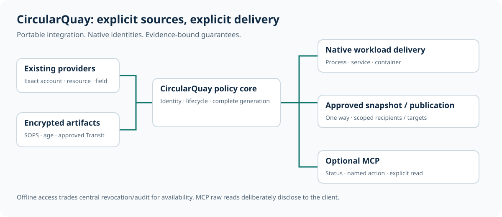

# CircularQuay

**The right secrets, ready for your apps.**

A shell profile once made a developer's environment feel simple: open a
terminal, inherit the right variables, and get on with the job. Services,
containers, Windows sessions, CI runners, and hosted applications introduced
different startup and identity boundaries. Multiple AI providers and agent
workflows added more keys, scopes, and places to configure them.

CircularQuay grew out of the frustration of joining those pieces repeatedly. It
connects existing providers, established encryption, and native runtime
delivery through one workload-scoped policy. You choose where online
authorization is required and where an encrypted offline copy is appropriate.

CircularQuay gets the right secrets to the right apps, wherever they run.
Keep your existing secret stores, choose what each app can access, and manage
it all from one configuration. The app and command are **`cquay`**, pronounced
**“see-key.”**

Use it on its own, or connect an **optional identity provider** to tie access
to a person or service and a time limit. An **optional MCP connector** brings
the same controls to AI assistants and agents.

[](LICENSE)
[](https://github.com/maldous/CircularQuay/actions/workflows/source.yml)
[](https://github.com/maldous/CircularQuay/actions/workflows/security.yml)
[](https://github.com/maldous/CircularQuay/actions/workflows/integration.yml)
[](https://github.com/maldous/CircularQuay/actions/workflows/sonar.yml)
[](https://github.com/maldous/CircularQuay/actions/workflows/sdk.yml)

[Testing and audit results](docs/verification.md) · [Downloads](https://github.com/maldous/CircularQuay/releases) · [Documentation](docs/README.md)

## Try it in a minute

[Install or build `cquay`](docs/getting-started.md), then create a local example
with fabricated values. It needs no provider account, identity server or MCP
connection.

**Linux and macOS**

```sh
umask 077
cquay init --output cquay.json
cquay --config cquay.json doctor
cquay --config cquay.json run --workload demo -- /usr/bin/printf '%s\n' 'Hello from cquay.'
```

**Windows PowerShell**

```powershell
.\cquay.exe init --output cquay.json
.\cquay.exe --config cquay.json doctor
.\cquay.exe --config cquay.json run --workload demo -- C:\Windows\System32\cmd.exe /d /c 'echo Hello from cquay.'
```

From there, [connect a provider and choose online, offline or hybrid access](docs/getting-started.md#choose-an-availability-policy),
[start from a Git configuration repository](docs/configuration-repositories.md),
or [edit your JSON policy with the CLI](docs/commands.md#configuration-crud).

<picture>
  <source media="(prefers-color-scheme: dark)" srcset="docs/assets/architecture-overview-dark.svg">
  
</picture>

## One policy, wherever you work

- **Keep the stores you trust.** Connect existing secret managers and encrypted
  files without moving every secret into another vault.
- **Give each app what it needs.** Select its secrets, deliver them together,
  and keep provider sign-in credentials out of the app's environment.
- **Choose when a connection is required.** Use fresh online values, approved
  encrypted offline copies, or a controlled hybrid fallback.
- **Bring the same setup to your team.** Use a shared configuration across
  terminals, native services, containers and CI pipelines.
- **Add central access controls when you need them.** Connect an enterprise
  identity server or the optional managed key service, with explicit scopes
  and access windows.

Explore [how it works](docs/product-guide.md), [providers and platforms](docs/runtime-boundaries.md),
and the [feature comparison](docs/comparison.md).

## Build and operate with your team

Bootstrap a scoped session from local configuration or an authenticated,
trusted discovery source. Use the same policy in GitHub Actions, GitLab CI
and Azure Pipelines, with explicit overrides and workload identity. The
[bootstrap and CI guide](docs/configuration-repositories.md) explains trust,
precedence and non-interactive operation.

Integrate applications through the official [Go, TypeScript and Python
SDKs](docs/sdks.md). Configure [metrics, traces and structured
diagnostics](docs/operational-configuration.md) for your monitoring platform;
keep required security audit independently durable. Release notices continue
without consuming application input, while an explicit minimum-version policy
controls which runtimes may perform sensitive operations.

The [enterprise contract](docs/enterprise-integration.md) brings together
identity lifecycle, access reviews, audit export and retention, recovery,
compatible extensions and controlled upgrades. These controls support your
organisation's security programme without claiming ISO 27001 certification.
The guides describe the complete v1 end state; [qualification
evidence](docs/qualification.md) records what each exact revision has proved.

## Make AI access deliberate

Your enterprise identity server can let an approved AI tool use selected
credentials for a limited time. For example:

- Let an on-call assistant run approved diagnostics during an incident.
- Give a deployment copilot access only during a change window.
- Let a contractor's assistant use one project's tools for the agreed period.
- Run a reporting agent with read-only access during its scheduled window.

A tool can use credentials inside its own process and return results to the
model. Raw secret reads have a separate permission. Learn about
[identity and expiry](docs/identity-and-expiry.md), [MCP and AI boundaries](docs/runtime-boundaries.md#mcp-and-ai-agents),
and the [optional managed key service](docs/managed-key-service.md).

Access controls stop future delivery; they cannot recall a secret or private
key that an authorized application has already copied.

## Find your next step

| I want to… | Start here |
| --- | --- |
| Run my first workload or choose an availability mode | [Getting started](docs/getting-started.md) |
| Configure sources, permissions and delivery | [Configuration guide and schema](docs/configuration.md) · [Complete Linux example](examples/linux-deployment.json) |
| Automate setup and policy changes | [Command reference with examples](docs/commands.md) · [Git and CI setup](docs/configuration-repositories.md) |
| Connect identity, providers or hosting platforms | [Integration guide](docs/integrations.md) · [Platform matrix](docs/platform-support.md) |
| Integrate an application or enterprise monitoring | [Go, TypeScript and Python SDKs](docs/sdks.md) · [Enterprise integration](docs/enterprise-integration.md) |
| Configure monitoring and release awareness | [Operational configuration](docs/operational-configuration.md) |
| Understand the security and test evidence | [Security model](docs/threat-model.md) · [Testing and verification](docs/verification.md) |
| Contribute, ask for help or report a problem | [Contributing](CONTRIBUTING.md) · [Support](SUPPORT.md) · [Private security reporting](SECURITY.md) |

[All documentation](docs/README.md) · [Release and operator guide](RELEASE.md)

CircularQuay is licensed under [Apache-2.0](LICENSE). Dependencies retain their
own licenses and notices.
