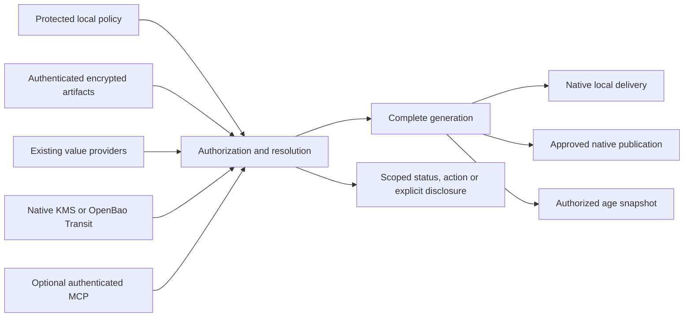

# Architecture and trust boundaries

CircularQuay is an integration layer, not a vault, an identity provider, or a cryptographic implementation. Policy maps exact upstream values to one workload and separately authorizes offline export, native publication, and MCP disclosure.

## Distinct authorities

Human administration, repository download, age decryption, provider authentication, destination publication, and recovery custody are distinct. A Git read key does not decrypt a document. A Google/passkey login does not automatically authenticate a service. A publisher does not need every runtime grant.

Keep source declarations and identities in protected local policy. Fetched values cannot select endpoints, credentials, commands, grants, or destinations. A signed mapping authenticates the mapping; it does not independently attest which mutable value a remote provider returned.

## Modes

Offline uses approved local artifacts. Online requires fresh retrieval or unwrap on every launch, including native crash restarts. Hybrid permits only a complete, explicitly authorized snapshot during typed availability failures. Denial, invalid TLS, malformed values, trust failure, and expiry never authorize fallback.

OpenBao Transit protects a SOPS data key. OpenBao KV stores application values. These are separate interfaces. A SOPS backend for Azure Key Vault keys does not imply it can read existing Azure Key Vault secrets.

Do not put a normal local age recipient beside a Transit recipient and describe the result as mandatorily online-audited: either ordinary recipient can unlock the file. Separate artifacts/policy must express that trade-off. `SOPS_HC_VAULT_ALLOWLIST` is always explicitly restricted.

## Complete generations

Resolve every required binding and validate its lifecycle before activation. Track declarations, source versions, projected state, and active state separately. Cross-provider reads and writes are not a transaction. A failed required input does not create a new partially refreshed workload.

String-field selection minimizes injection, but upstream permission may cover the entire object. Put values with distinct access boundaries in separate upstream records.

## Publication and recovery

Publication is one-way and requires separate mapping authority. Never write a local snapshot back over provider-native rotation. Native store publication is a deployed snapshot: the destination's permissions and audit behavior control the copy.

Recovery keeps canonical encrypted configuration, policy/trust material, and OpenBao seal/data backups independent. A machine-bound systemd or DPAPI blob is not the only backup. A replacement host receives a fresh identity; the offline custodian's private identity is not installed on it.

## MCP boundary

An HTTP caller is identified by verified issuer/subject/client claims, not `clientInfo` or a model name. Local stdio relies on the OS-user/launcher boundary. Discovery, invocation, read, status, and cancellation require current operation-specific authorization.

`read_secret` deliberately discloses one approved alias. It is separate from workload invocation and native provider retrieval. An arbitrary coding-agent action with injected keys is disclosure-capable; hiding raw reads behind a mutable script is not a confidentiality boundary.

Implementation and live qualification status are recorded in [qualification.md](qualification.md).
