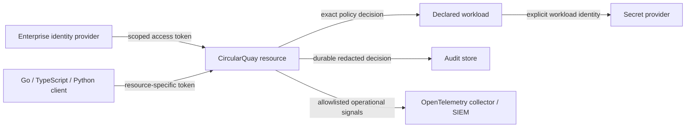

# Enterprise integration

CircularQuay is designed to fit an enterprise identity, audit and observability
estate without becoming the identity provider, SIEM, vault, key-management
service or compliance assessor. It accepts a configured authorization authority,
uses a declared provider identity for a workload, and releases only the exact
values and operations approved by policy.

This is the complete v1 enterprise integration contract. Every capability in
this document describes the finished v1 product behaviour. Qualification status
and release evidence are kept separately in [qualification.md](qualification.md)
so that the product contract stays clear while evidence remains truthful. An
operator relies on a capability only when the corresponding implementation and
qualification receipts are published.

## Integration model

Identity proves who or what presents a request. Policy decides whether that
identity may perform one operation on one workload or binding. A provider
identity authorizes the upstream secret read. These roles remain separate: an
inbound access token never becomes a provider credential, and an upstream
provider credential never authorizes a user or AI client.

## Identity lifecycle and scoped access

| Capability | v1 contract | Acceptance evidence |
| --- | --- | --- |
| Enterprise identity provider | Support a configured OAuth 2.0/OIDC authorization server that issues access tokens for the CircularQuay protected resource. Keycloak, Entra ID, Okta, Auth0, Cloudflare Access and other conforming servers are optional operator choices. | Wrong issuer, signature, key, algorithm, token type, audience, client, subject, time claim, scope or role is denied before a source read. |
| Resource-specific tokens | Configure a resource/audience that identifies CircularQuay and verify it exactly. OAuth resource indicators and JWT access-token validation prevent a token minted for another API from being replayed here. [RFC 8707](https://www.rfc-editor.org/rfc/rfc8707.html) and [RFC 9068](https://www.rfc-editor.org/info/rfc9068/) define the interoperable basis. | A token for a different resource, tenant or client reaches no workload, source, raw read or audit-success path. |
| Identity lifecycle | Authorities, grants, clients, subjects, roles, scopes, active windows and tenant mappings are explicit policy data. SCIM/directory sync may provision managed-service user/group metadata, but does not itself authorize a request. | Create/update/expiry/revocation/reconciliation and stale-directory tests prove that removed or changed membership cannot use an old mapping beyond the configured token/freshness boundary. |
| Scoped access review | Effective access is reviewable by authority, tenant, subject/client, workload, operation, binding and active window. Review data names policy objects and decisions, never values or credentials. | Export and UI/API views agree with current policy; unauthorized reviewers cannot enumerate other tenants or hidden bindings. |
| Tenant separation | Each authority/tenant domain, namespace, mapping, audit stream and storage partition is explicitly selected and checked server-side. A display name, request header or client-selected tenant is never an authorization boundary. | Cross-tenant names, IDs, tokens, host/path aliases, cache keys and concurrent updates fail closed with no value or metadata disclosure. |
| Native custody | Native key stores, TPM/Secure Enclave, PIV/YubiKey and OS user presence may protect a selected local credential or perform a bounded operation. They do not convert a copied plaintext, age recipient or provider value into non-exportable custody. | Platform-specific enrollment, authorization, recovery, unattended operation, removal and rotation qualification records the actual device boundary. |

CircularQuay supports dynamic organization-specific scopes and associations; it
does not impose `dev` or `prod` as a security model. An organization defines
its own environments, workload identities, groups, operation scopes, source
connections and review cadence. Ambiguous, missing or unknown mappings grant
nothing.

## Governed lifecycle and exposure policy

[One canonical configuration](configuration-governance.md) supplies typed
hierarchy, defaults, locks and deterministic group resolution to every
administrative interface. [SCIM provisioning/deprovisioning](credential-lifecycle.md#provision-and-deprovision-where-supported)
is optional where the selected directory profile supports it; it updates
metadata and triggers the declared offboarding response without itself granting
runtime access. Reconciliation, token validity and local/offline revocation
have separately measured propagation bounds.

The [lifecycle contract](credential-lifecycle.md) defines separately authorized
provider-native rotation/revocation, GitHub scanning and optional GitGuardian
block/warn/approved-exception policy. Incident closure is not issuer revocation,
verified replacement or permission to resume use. Each connector has distinct
credentials, exact account/version binding, scopes, freshness and safe metadata
outputs; unknown capabilities fail closed rather than inheriting a broad token.

[Workload federation, SPIFFE, device-posture/Conditional Access and optional
external policy engines](credential-lifecycle.md#workload-identity-posture-and-external-decisions)
intersect the same policy ceiling. Enroll exact trust, signal/bundle revisions,
bounded metadata and freshness; unavailable required decisions deny. Qualify
headless versus user-device applicability independently, and deliver the
necessary [forward migrations](credential-lifecycle.md#forward-migrations-and-complete-delivery).

Secret-free OpenTelemetry lifecycle events support operations. They do not
establish immutable storage, exactly-once delivery or required-audit durability.
The audit boundary below remains independently enforced.

Configuration may be a self-contained file or a master with explicitly trusted
department-owned includes, resolved through the same canonical contract. Source
order, namespace/ownership, pins and typed conflict rules cannot weaken locked
enterprise policy or let an include self-authorize. The
[corporate GitHub/personal local case](configuration-repositories.md#corporate-github-and-personal-local-configuration)
keeps grants, keys, cache and provenance partitioned; personal content is not
uploaded for management, explain or telemetry. Optional offline cache and
refresh/freshness rules are explicit, and full validation precedes atomic
activation across every interface.

The [hosted key service baseline](managed-key-service.md) remains minimal
authenticated identifier-to-age-private-key registration/retrieval, not a default
enterprise orchestration subscription. Enterprise features here are separately
chosen capabilities and costs. [First run](management-and-discovery.md#first-run-and-minimal-managed-registration)
initializes that hosted key service after resolved configuration and identity
unless explicitly disabled via CLI or configuration; both opt-outs and locked
policy conflicts are evaluated before hosted network. A new personal enrollment
cannot claim an enterprise tenant or grant. Self-hosted/offline operation and
noninteractive workload enrollment preserve the same authorization ceiling.

All client configuration, including enterprise/corporate sources, is read,
resolved/validated and saved client-side through the user's network/VPN and
credentials. Neither contents nor source credentials go to hosted backend,
proxy, analytics or logs. Hosted administration covers profile/key associations
and necessary enrollment/window/usage/billing metadata only. Optional enterprise
integrations cannot turn it into a config orchestration service; required
source/identity/scanner policies still apply on the approved client boundary.

Production safeguards for the minimal hosted service are not optional feature
scope: [WAF/bot/DDoS, strict admission, durability/recovery and geographic SLOs](managed-key-service.md#production-protection-and-service-objectives)
need exact infrastructure/plan evidence and costs. Headless automation cannot
be indiscriminately challenged. The confirmed client-SPA OTel design queries
only user-selected authorized endpoints; it implies no hosted config/telemetry
backend or custom UI implementation approval.

## Audit contract

Audit is a durable authorization and release-decision record, not a debug log
or telemetry export. A workload that requires audit cannot release a value
when its selected audit durability requirement is unavailable.

| Field | Requirement |
| --- | --- |
| `event_id` | Globally unique, opaque event identifier; no secret-derived value. |
| `time` | RFC 3339 UTC instant generated by the service; ingestion time may be retained separately. |
| `correlation_id` | Opaque request/execution correlation identifier. It may link audit, support and trace records without embedding a token, value, email address or provider body. |
| actor and authority | Verified subject/client, configured authority name/fingerprint and tenant namespace. Caller-supplied labels are never substituted. |
| decision | Requested operation, workload, binding alias, policy revision/fingerprint, outcome and safe fault category. |
| source provenance | Declared source name, resource/version identifiers where approved for audit, and non-secret provider/adapter category. Values, values hashes and raw responses are excluded. |
| integrity and durability | Append-only or equivalent tamper-evident storage selected by the deployment profile; restricted writer/reader identities; tested ordering, concurrency, retry, retention and backup/restore semantics. |

The record schema is versioned. Schema evolution is additive or uses a new event
version; consumers must reject or quarantine malformed events rather than
silently reinterpret them. A correlation ID is not a security credential and
must not be accepted as identity or authorization input.

### Privacy, redaction and export

No audit, application log, trace, metric, exception, health endpoint or SDK
hook may emit plaintext values, value hashes, bearer tokens, refresh tokens,
private keys, credential-file contents, authentication headers, DPoP proofs,
raw provider bodies or decrypted configuration. Human identity fields are
minimized and operator-configurable under applicable privacy obligations.

Operators choose retention, residency, legal hold, export destination and
access controls. CircularQuay records the configured retention/export policy
and delivery result; it cannot make an external archive immutable or satisfy an
organization's legal-retention obligation by itself.

SIEM export uses a scoped collector/export credential that may write the named
audit/telemetry stream only. It is never a secret-provider credential. Delivery
is at-least-once unless a qualified profile documents stronger semantics, so
consumers de-duplicate on `event_id`. Success responses require the local
required-audit durability contract before a value release; asynchronous SIEM
replication may retry independently. A deployment profile must explicitly
choose its failure policy for a downstream exporter outage, backlog bound,
alerting and manual recovery. It may not silently drop required audit events.

[CloudEvents](https://cloudevents.io/) may carry exported decision notifications
when an operator needs event-bus interoperability. The CloudEvents envelope
adds routing metadata; it does not replace the durable audit record or loosen
redaction rules.

## Mandatory runtime observability and reporting

CircularQuay exposes configurable remote operational telemetry through OpenTelemetry from the initial release, using allowlisted resource attributes and semantic conventions. [OpenTelemetry
semantic conventions](https://opentelemetry.io/docs/concepts/semantic-conventions/)
provide the shared vocabulary for traces, metrics, logs and events. Telemetry
is best-effort and never becomes an authorization, audit-success or value
release dependency.

| Signal | Safe content | Forbidden content |
| --- | --- | --- |
| Traces | Operation category, outcome category, policy revision fingerprint, bounded latency, retry count and opaque correlation ID. | Request/response bodies, values, provider URLs with credentials, tokens, raw errors and full external identifiers where they reveal tenant data. |
| Metrics | Aggregated request/decision counts, latency histograms, audit/export health, queue depth and expiry/revocation outcomes with bounded-cardinality labels. | Subject, token, secret name, repository URL, per-request identifier or unbounded tenant label. |
| Logs | Structured lifecycle and failure category, versioned schema, UTC timestamp and correlation ID. | Any material prohibited from audit plus stack traces or errors that embed sensitive inputs. |
| Reports | Aggregated posture, policy coverage, denied/allowed/error trends, integration health and evidence links. | Secret inventory/value, raw identities beyond the reviewer’s scope, or claims of provider/compliance status without evidence. |

OpenTelemetry warns that telemetry can capture sensitive or personal data; data
minimization and collector-side allowlisting/redaction are operator and
implementation responsibilities. See the [OpenTelemetry sensitive-data
guidance](https://opentelemetry.io/docs/security/handling-sensitive-data/).
Collectors and exporters require TLS, least-privilege credentials, egress policy
and independent availability monitoring.

Remote metrics, monitoring, traces and diagnostic logging are mandatory runtime capabilities from the initial release, configured through protected deployment configuration. The configuration
names the collector origin, TLS trust material, export credential reference,
signal allowlist, sampling, batching, timeout and bounded queue/backpressure.
Collector-side policy controls retention. It rejects URL credentials, insecure transport, unknown
signals and unbounded attributes. An exporter outage is observable through
local health metrics and a redacted diagnostic event, then follows its explicit
bounded buffer/drop policy; it must never delay a security decision indefinitely
or turn off the required audit path.

Diagnostic verbosity changes only approved operational detail, never the
redaction boundary. A lower verbosity may reduce detail; a higher verbosity
cannot enable request bodies, headers, values, tokens, credential files, raw
provider errors or unsafe stack data. Performance and trend reports use
aggregated latency, throughput, decision, retry, queue-depth and error-category
signals over a configured time window. They are diagnostic evidence, not a
source of authorization or a substitute for a durable security audit.

## Official SDK contract

CircularQuay's Go core uses official OpenTelemetry APIs/SDKs. Its Go,
TypeScript and Python client SDKs expose safe observation hooks that
applications connect to their own instrumentation and context propagation.
These are the initial language set; OpenTelemetry publishes documentation for each.
SDK feature maturity must be rechecked at each release, especially for logs and
browser instrumentation. [Language SDK guidance](https://opentelemetry.io/docs/languages/)
and the [OTLP exporter specification](https://opentelemetry.io/docs/specs/otel/protocol/exporter/)
are the interoperability references.

| SDK obligation | Contract |
| --- | --- |
| Distribution | Go: `github.com/maldous/CircularQuay/sdk/go`; npm: `@maldous/cquay-sdk`; PyPI: `cquay-sdk`, imported as `cquay`. These package coordinates identify the release targets; registry availability, signatures and provenance are separately qualified. |
| Authentication | Accept explicit, resource-specific credentials supplied by the caller or selected platform identity integration. Do not scan shell profiles, default credential chains, browser sessions or unrelated cloud CLI caches. |
| Authorization | Treat scopes/roles/claims as server-verified input only. SDK convenience methods cannot grant access or select a hidden tenant/workload. |
| Observability hooks | Expose hooks for traces, metrics and structured logs with documented safe attributes and correlation propagation. Hooks are additive, bounded and disabled/no-op safely when no provider is configured. |
| Privacy | Default deny for arbitrary attributes. SDKs must not automatically record request/response payloads, headers, tokens, values or full exceptions. Instrumentation consumers can only add allowlisted attributes. |
| Error model | Return stable, safe error categories and request/correlation identifiers. Do not serialize provider bodies or credentials into exceptions. |
| Cancellation and deadlines | Propagate caller cancellation and the earliest authorized deadline. Do not retry after caller cancellation or authorization expiry. |
| Compatibility | Publish a versioned API contract, supported runtime matrix, deprecation period and migration guide. Pin and test supported dependency ranges; breaking wire/schema changes require a new major SDK/API version. |
| Conformance | Run the same cross-language request/denial/expiry/revocation/redaction/trace-context suite against Go, TypeScript and Python SDKs before a release. Test a real collector with synthetic data separately from production telemetry. |

An OpenTelemetry environment variable or exporter endpoint is not permission to
send sensitive data to an arbitrary collector. The deployment profile controls
export endpoints and credentials, validates them as protected configuration and
applies an allowlist before data leaves the process.

## Update awareness and supported releases

CircularQuay provides policy-controlled release awareness, independently of
artifact installation and publisher verification. A release-feed response is
advisory metadata; it cannot authenticate an executable or authorize its use.
The [operational guide](operational-configuration.md#release-awareness) defines
the policy fields, bounds and explicit `cquay update check --json` command.

| Operating mode | Update behaviour |
| --- | --- |
| Interactive | A bounded notice identifies a newer release and upgrade instructions, then continues without reading application input. |
| Automation, SDK and MCP | No startup prompt or interactive wait. Automation can request structured state through the explicit update-check command. |
| Air-gapped or offline | Disable network checks and use an independently governed installation policy, including an optional local minimum version. Unavailable release metadata establishes no freshness or installation trust. |

Protected policy selects stable or release-candidate channels, an approved
enterprise feed, trust and credential references, timeouts and check intervals.
Advisory feed failure does not block an otherwise authorized workload. An
explicit minimum version is enforced locally before sensitive effects; it does
not depend on a successful feed check. Installation verifies the exact release
artifact separately and requires an explicit operator action. Runtime settings
also define the managed UI integration contract; runtime monitoring and update
controls do not depend on that UI.

## Lifecycle, resilience and extension contract

The complete v1 acceptance scope includes the operational needs of a long-lived
deployment. These requirements share the same end-state release gate as the
SDK, identity and observability capabilities; they do not define smaller
releases. Configuration is versioned, validated and explicit. A declared option
requires enforcement and revision-bound evidence before it is qualified.

| Area | End-state behaviour and acceptance |
| --- | --- |
| Configuration evolution | Version policy, schema, API, event and adapter contracts; reject unsupported versions and validate migrations before replacing protected state. Document compatible upgrades and deprecations. |
| Policy rollout and drift | Review exact policy revisions, compare effective state with declared state, and expose safe drift and activation outcomes. A failed required input cannot activate a partial generation. |
| Rotation and identity lifecycle | Apply credential, signing-key and certificate changes under explicit authority; test expiry, revocation, renewal failure and recovery. Issuer-side rotation contains credentials already disclosed. |
| Backup and recovery | Preserve independently restorable encrypted configuration, trust and audit state with scoped recovery identities. Exercise restore and migration failure without reactivating revoked or expired grants. |
| Health and capacity | Distinguish liveness, readiness, provider availability and audit/export health. Bound concurrency, queues, request size, deadlines and shutdown; test overload, cancellation and dependency failure. |
| Audit retention and reporting | Configure retention, scoped review/export, integrity, residency and downstream outage handling. Preserve required audit before release; diagnostic sampling cannot discard mandatory security evidence. |
| Extensions and partnerships | Declare adapter identity, supported versions, trust, scopes, endpoints, capabilities and lifecycle. Apply the same conformance, supply-chain and tenant-isolation gates to first-party and partner integrations; no implicit credential inheritance or arbitrary executable from downloaded policy. |
| Change and support | Promote immutable verified artifacts, document registry enrollment and clean installation, and preserve incident and compatibility guidance. Fix forward with a newly identified candidate and its own evidence. |

Operational repair never grants a new scope or authorizes a BAU change.
[Recovery procedures](operators/recovery.md), [incident response](operators/incident-response.md)
and [release/operator directions](../RELEASE.md) provide the detailed contracts.

## ISO/IEC 27001 alignment

[ISO/IEC 27001:2022](https://www.iso.org/standard/27001) specifies requirements
for an information security management system based on risk management. It
applies to an organization and its ISMS, not to a standalone binary, SDK or
feature. CircularQuay does **not** claim ISO/IEC 27001 certification,
conformance or that a customer will satisfy the standard by deploying it.

The product can supply technical evidence that supports a customer’s ISMS:

| ISMS-supporting capability | Product evidence | Organizational responsibility outside CircularQuay |
| --- | --- | --- |
| Access control and least privilege | Explicit authority/audience, scoped grants, tenant isolation, source/provider identity separation and access-review export. | Risk treatment, joiner/mover/leaver process, account governance, approval and periodic review decisions. |
| Logging and monitoring | Versioned redacted audit decisions, integrity/durability selection, SIEM export, OpenTelemetry health and correlation. | Retention, review, incident response, evidence handling, SOC operation and legal/regulatory obligations. |
| Secure engineering and change | Immutable release artifacts, provenance/SBOM/qualification evidence, SDK compatibility policy and conformance suite. | Secure-development process, supplier assessment, vulnerability management, training, independent assurance and release authorization. |
| Resilience and recovery | Explicit backup/restore, rollback, failure and provider-qualification requirements. | Business-continuity objectives, recovery exercises, environment capacity, account ownership and disaster-response governance. |
| Data protection | No-value telemetry/audit design, minimization, redaction, scoped export and customer-selected residency. | Data classification, privacy impact assessment, lawful basis, retention schedule, data-subject process and processor agreements. |

This division avoids a misleading control checklist: the product offers
technical capabilities and evidence, while the organization defines scope,
risk appetite, people/process controls, operating evidence and any independent
certification.

## Agent and client administration

The [management contract](management-and-discovery.md) defines the same typed
enrollment, configuration, identity/grant, delegation and audit lifecycle across
UI/API/CLI/SDK and optional management MCP. [Administration security](administration-security.md)
defines mandatory signature, approval, tenant, replay and recovery controls.
The product-wide [default and strict profiles](security-profiles.md) enforce
additional enterprise requirements without weakening the universal baseline.

The [portable skill and client-plugin contract](agent-integrations.md) uses the
same exact workload/operation boundaries as CLI, SDK and optional MCP. Client
installation and catalog discovery do not establish a grant. Versioned plugin
metadata identifies resources, runtime prerequisites, supported transports and
privacy/disclosure behavior; no synthetic server address or broad credential
is supplied to make installation appear complete.

Review grantor and recipient associations, administrative changes, refresh and
revocation through the same configured tenant/authority ceiling. Updates use
revision preconditions and redacted audit. Required operational evidence spans
package installation, native executable trust, client/server compatibility and
positive/negative authorization; one component's pass cannot qualify the others.

## Acceptance gates

An enterprise integration is accepted only when it has a typed configuration,
explicit owner, least-privilege authority, threat model and qualification
receipt. The receipt demonstrates positive use and failure cases for identity,
tenant isolation, scope, expiry, revocation, policy change, audit durability,
export retry, redaction, cancellation, concurrency and recovery.

A provider, IdP, SIEM, OpenTelemetry collector, SDK language or reporting
destination is not added merely because it can exchange HTTP or JSON. It must
preserve CircularQuay's exact-map, explicit-identity and no-secret-diagnostics
boundaries, and it must be documented with its supported version, operational
owner, rollback approach and evidence before a release makes it available.
