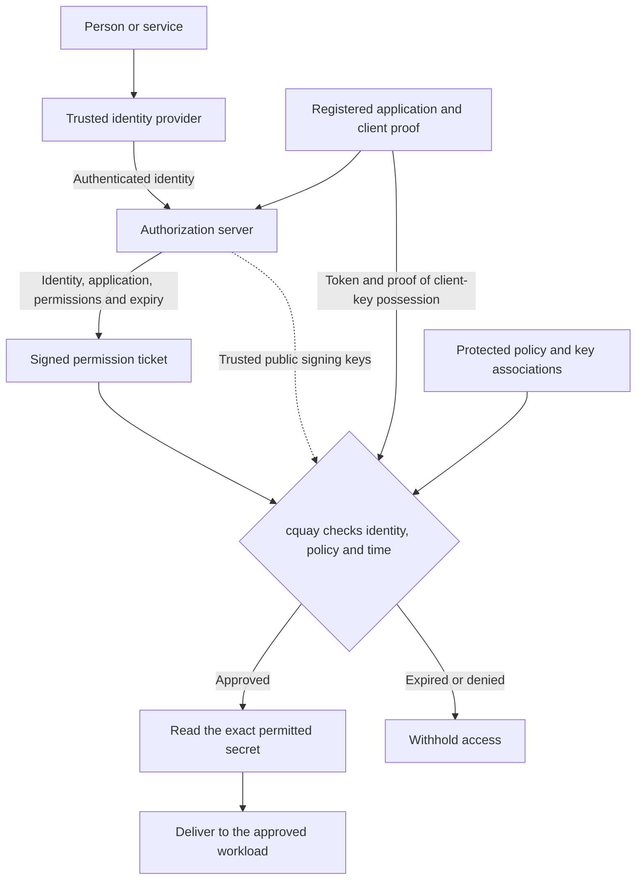
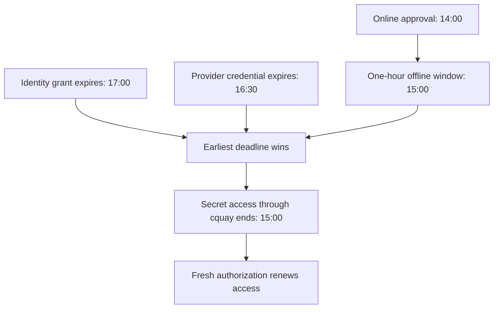

# Identity, key access, and expiry

The right identity, using the right application, receives only its approved
secrets, for the permitted time.

Use CircularQuay on its own with local policy, or add an optional identity
provider for centrally approved access. The MCP connector is optional too;
apps and services can use CircularQuay directly.

With identity integration enabled, think of CircularQuay as a collection desk:
your identity provider establishes who you are, a signed permission ticket
states what you may collect and when, and CircularQuay checks that ticket
against the exact key and workload before handing anything over.

### One identity, explicit permissions

When identity integration is enabled, a person or service authenticates through
the organization's identity provider (IdP). Its OAuth authorization server
issues a signed, time-limited access
grant for the registered application and CircularQuay service. These roles
can belong to the same existing enterprise provider or to a self-hosted
service such as Keycloak. The policy selects the trusted authority and its
supported authentication profile.

Permissions describe the organization's own contexts: projects, teams,
environments, workloads, operations, and individual secret keys. For example,
`invoice-reporting` in `warehouse-eu` can receive its approved database key
without receiving the authority assigned to another workload. Context names
and associations are defined in configuration.

### Use an existing IdP or a self-hosted authority

The **identity provider** answers "Who are you?" The **authorization server**
answers "What may this application do on your behalf, and until when?" One
enterprise identity platform can perform both roles. CircularQuay uses its
OAuth and OpenID Connect integration to connect verified identities with
explicitly configured permissions for the CircularQuay service.

An organization can use its existing provider's API authorization service or
operate its own authority, such as [Keycloak](https://www.keycloak.org/).
The configuration identifies the trusted issuer, verification keys, service
audience, registered clients, identity associations, and permission mappings.
Trust is established by that explicit configuration and verification of the
authority's signatures. Teams choose the authority and policy that fit their
environment; the same access model applies to hosted and self-hosted services.

### Applications, automation and delegated agents

The CLI, official SDK and optional MCP apply the same exact identity, client,
workload and time-window checks. An SDK session, CI marker, skill/plugin
installation or authenticated UI does not add a grant. A delegated operation
identifies grantor and recipient and stays within the original authority ceiling;
its audit records the scope and timing without the delivered value.

[Managed administration](managed-key-service.md) manages associations and
revocation through separately scoped UI/API/CLI/MCP operations. Required audit
precedes release; telemetry and diagnostic hooks are redacted operational
signals, not a substitute for that decision record. See [SDKs](sdks.md) and
[agent integration](agent-integrations.md) for their execution boundaries.

### A cryptographic chain of trust

The permission ticket binds the issuing authority, stable identity,
application, intended service, permitted operations, and expiry. CircularQuay
verifies the issuer's digital signature using its trusted public key and
checks the complete association against local policy. Editing a signed
identity, permission, or deadline invalidates the ticket. The foundation is
the standard [OAuth access-token model](https://www.rfc-editor.org/rfc/rfc9068.html).

Three keys have distinct jobs:

- The **issuer's signing key** authenticates the permission ticket.
- The **client's private key** proves possession by the enrolled application.
- The **application secret** is the API key, password, or credential delivered
  to the approved workload.

[DPoP](https://www.rfc-editor.org/rfc/rfc9449.html) or
[certificate-bound mutual TLS](https://www.rfc-editor.org/rfc/rfc8705.html)
connects the access token to the client's key. Each request proves possession
of the matching private key. Private-key JWT authentication establishes the
application's identity when it obtains its grant from the authorization server.
The configured profile keeps issuance, request authentication, and secret
access tied to their respective authorities.

### Online and offline, one expiry policy

Online access uses current authorization and fresh provider retrieval. Approved
offline access uses an encrypted snapshot accompanied by a signed approval
for that exact snapshot, identity, application, policy, workload, and key set.
The issuing authority approves the complete association. Encryption protects
the contents; the signature authenticates who may release them and for how long.

The effective access deadline is the **earliest** of:

1. The signed identity authorization's expiry.
2. The end of the approved offline window.
3. Any expiry imposed by the original credential provider.

For example, an approval obtained at 14:00 with a one-hour offline window ends
at 15:00, even if the identity grant lasts until 17:00 and the provider
credential lasts until 16:30.

Reads and file copies retain the original deadline. Renewal requires a fresh
authorization decision. Reconnection applies the issuer's current account
status, policy, and revocations before granting another window. Protected local
state and clock-rollback checks preserve the deadline across restarts.

### A clear, verifiable security contract

| Control | End-state behavior |
| --- | --- |
| Identity and application association | Verify the trusted issuer, stable subject, registered client, and intended CircularQuay service. |
| Exact permission | Match the configured context, workload, operation, and key before retrieving a value. |
| Client key binding | Verify possession of the private key associated with the access token. |
| Offline approval | Verify the signed association to the exact encrypted snapshot and policy. |
| Permission lifetime | Enforce the earliest authorization, offline-window, or provider deadline for new access through CircularQuay. |
| Credential lifetime | Preserve the original provider's expiry, rotation, and revocation policy. |
| Protected enforcement | Use OS access controls, protected state, and clock checks at the local trust boundary. |
| Decision checks | Recheck authorization and value expiry before disclosure or workload launch; deny failed checks. |
| Auditability | Record identity, application, policy decision, and outcome without recording secret values. |

The [identity architecture](hosted-identity.md),
[configuration reference](configuration.md), and
[security model](threat-model.md) describe its trust relationships and
policy boundaries.

[Documentation](README.md) · [CircularQuay](../README.md)
