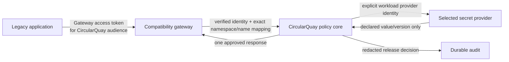

# Compatibility gateway

CircularQuay can optionally present a narrow compatibility endpoint for a
legacy application that already speaks Azure Key Vault Secrets or Google Secret
Manager. The endpoint is a CircularQuay resource: it authorizes the caller
against an approved workload policy, reads one declared binding through that
workload's configured provider identity, and records a redacted release
receipt before returning a value.

It is not a vault, key-management service, IAM implementation, provider
emulator, recovery system or general cloud-control-plane proxy. It never stores
provider keys, accepts provider administration calls, creates/updates/deletes
secrets, issues cloud tokens, forwards caller credentials upstream, or claims
provider availability, HSM/KMS, retention, recovery or audit properties.

Actual implementation and qualification status is recorded in
[qualification.md](../qualification.md). This document defines the optional v1
read-compatibility contract. Runtime configuration and commands come only from
the selected version's schema and CLI reference; the contract alone does not
authorize a deployment or prove an endpoint is qualified.

## One gateway, two independent trust paths

The gateway validates the client token for its own configured issuer, audience,
client, subject, expiry and any selected sender constraint. An Azure or Google
bearer token is never accepted simply because the request looks like a cloud
API. Where an operator needs an existing enterprise authorization server, it
is configured as a CircularQuay authority; any token exchange is explicit,
scoped and independently qualified.

The upstream provider sees only the declared workload's provider identity. The
gateway never forwards inbound authorization headers, DPoP proofs, cookies,
client certificates or arbitrary request headers to the secret provider.

## Exact mapping and isolation

A named gateway namespace maps one external identifier to one declared
CircularQuay workload binding. The mapping is exact: there are no wildcards,
prefix searches, provider discovery, default workload, nearest-name fallback
or cross-tenant lookup. The namespace is selected by a verified authority and
configured host policy, never by a caller-controlled vault name, Google project
name, host header or path.

The effective permission is the intersection of the gateway authority,
configured tenant namespace, verified subject/client, current grant, `read`
operation, workload and binding. CircularQuay checks authorization before the
provider read, bounds the operation by the earliest relevant expiry, rechecks
after the provider returns, writes the required durable audit receipt, and
rechecks before plaintext release. A token or binding revoked while a provider
read is in progress cannot authorize the resulting response.

Unknown names fail without an upstream lookup. Responses and audit records do
not disclose the existence of neighbouring mappings, values, tokens, provider
response bodies or value hashes.

## Supported read shapes

The first compatibility scope is deliberately small.

| Compatibility shape | Approved first read operation | Excluded surface |
| --- | --- | --- |
| Azure Key Vault Secrets | The documented read shape `GET /secrets/{name}/{version?}` with a fixed supported API-version profile. It maps the exact configured name/version to one binding. [Azure Get Secret](https://learn.microsoft.com/rest/api/keyvault/secrets/get-secret/get-secret) | Keys, certificates, Managed HSM, secret writes/deletes/lists/backup/recovery/purge, access policies/RBAC, tenant discovery and token issuance. |
| Google Secret Manager REST | `AccessSecretVersion` for an exact configured `projects/.../secrets/.../versions/...` mapping. The response names the resolved version and includes CRC32C calculated for the released payload. [Google AccessSecretVersion](https://cloud.google.com/secret-manager/docs/reference/rest/v1/projects.secrets.versions/access) | All create/update/delete/list/enable/disable/destroy/IAM/service-account/KMS/replication/control-plane APIs. `latest` requires an explicit policy mapping; it is never an implicit fallback. |
| Optional Google Secret Manager gRPC profile | Exposes only `AccessSecretVersion` for its explicitly qualified clients. [Google RPC](https://cloud.google.com/secret-manager/docs/reference/rpc/google.cloud.secretmanager.v1) | Reflection, broad generated-service exposure, unauthenticated gRPC and every other RPC. |

A compatibility response uses the selected protocol's documented read envelope
only. It does not assert that CircularQuay owns an Azure vault or Google
project, and it does not reproduce provider control-plane semantics.

## Local developer composition

Local developer tools can run as companion services, never as hidden provider
replacements:

- [Azurite](https://learn.microsoft.com/azure/storage/common/storage-use-azurite)
  supports Azure Blob, Queue and Table storage only. It is not an Azure Key
  Vault extension or emulator.
- Google Cloud and Firebase emulators are service-specific. They do not make
  Secret Manager available unless the chosen service explicitly supplies that
  API.
- A synthetic compatibility fixture or a reviewed third-party emulator may run
  on a dedicated loopback endpoint with synthetic values, isolated ports and a
  per-instance CA. It is developer-test evidence only.

Every SDK endpoint, custom test root and test credential is explicit in the
isolated test profile. CircularQuay does not rewrite DNS, edit hosts files,
install a permanent trust root, disable TLS validation, use an insecure SDK
transport or obtain credentials from a shell profile. The provider identity,
gateway audience and compatibility endpoint are distinct; a request cannot
point a source back at the gateway and create a loop.

Third-party emulators can help test a legacy client's protocol compatibility
when their exact release, licence and SDK coverage are independently reviewed.
They are not production services and do not qualify cloud IAM/RBAC, workload
federation, KMS/HSM, retention/recovery, provider audit, expiry, revocation or
availability.

## Required qualification

Before a gateway profile can become available, qualification proves all of the
following with synthetic fixtures and then real, isolated provider identities:

1. Invalid method, path, version, query, header, host and identifier forms are
   rejected before any mapping or source call.
2. Wrong issuer, audience, client, subject, tenant, sender constraint or
   expired token returns a protocol-appropriate denial without value lookup.
3. Unknown, cross-tenant or mismatched vault/project/name/version has no
   fallback or enumeration path.
4. A permitted request resolves only its exact binding; source identity/version
   checks, source expiry and source audit requirements hold before release.
5. Revocation during retrieval, cancellation, upstream denial and audit
   failure return no plaintext.
6. Returned protocol identity/version and Google CRC32C are correct. Every
   unsupported operation is explicitly rejected.
7. Failure bodies, headers, logs and audit records omit values, value hashes,
   tokens, private keys and raw provider responses.
8. TLS, redirect, proxy, custom CA, endpoint override, credential isolation,
   concurrency and gateway-loop tests fail closed.

These checks complement the normal provider and managed-service qualification;
they do not replace either one.
