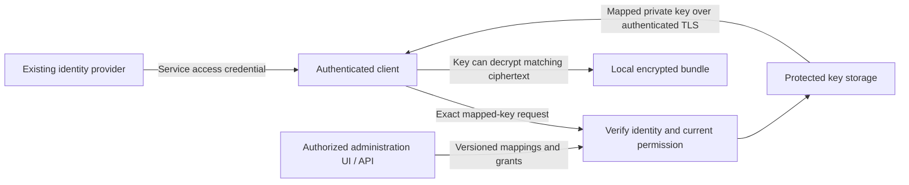
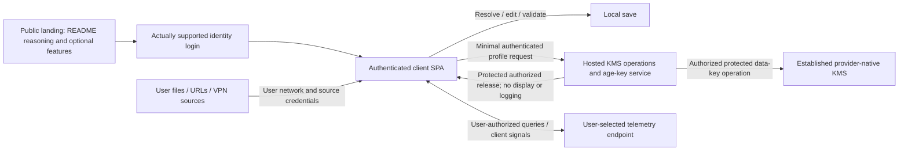

# Managed key service

The latest authorized launch provides **a hosted SOFTWARE crypto/key service
and authenticated age-private-key retrieval**, using only existing minimum-cost
paid Cloudflare/Netlify resources. It does not require paid AWS/GCP/Azure KMS,
new paid identity, upgrades or external services at launch. Authorized profile
enrollment provisions both crypto and age associations; this does not release
an offline key, activate hybrid or grant arbitrary decrypt/billing authority.
Spoken KVM/PVM meant KMS, but the launch custody claim is explicitly **software**.

The user has explicitly accepted the launch tradeoff: a versioned software
wrapping key stays in protected host secrets **outside the database**, with
independently random per-profile DEKs. Vetted maintained crypto performs the
actual wrap/unwrap operations. A secrets store alone is not a key service.
The runtime can access/use its software key; shared KEK or authorized-runtime
compromise can expose all reachable profile DEKs. Random DEKs do not make that
independent non-exportable/HSM custody. This supersedes the earlier requirement
for an external provider-native KMS at launch, without changing core auth,
tenant isolation, secret handling, durable required audit or engineering gates.
Profiles requiring stronger hardware/non-exportability remain unavailable here.

Future managed/HSM custody is retained as an explicit funded migration path,
not silently claimed for the launch. Mode/first-run choices remain explicit;
earlier remote-first recommendations are not a human-selected default. Synthetic/mock functional user, account, operator and administrator UI previews
may be developed separately, including loopback dashboard local-configuration
edits and simulations. They remain non-production: no real backend, operational
key, provider or account access, deployment, purchase or account connection is
authorized.

First run initializes the hosted key service by default, after configuration
selection and authentication, unless specifically disabled on the command line
or in configuration. Resolve either opt-out before any hosted-service network
call; apply documented precedence and enterprise locks without silently
registering through a conflict. Registration and bounded future key-release
windows are enabled for the managed profile. Self-hosted, offline and
hosted-disabled profiles remain supported. [First-run discovery and registration](management-and-discovery.md#first-run-and-minimal-managed-registration)
resolves policy and authenticates before registration; it uploads neither
personal configuration nor secret values by default. The selected policy and
service authorize mappings and future releases, not arbitrary secrets from the
client. Registration alone cannot grant a key.

Expanded custom admin UI/screens remain unapproved for production operation.
The bounded synthetic/mock preview authorization does not change that limit; use
existing platform services and the confirmed first-run CLI/text authentication
flow for actual operations.
The base service needs the user/client/domain association, owner-authorized key
mapping/storage/retrieval, access-window decisions, safe operational records and
metering. Enterprise hierarchy, SCIM, GitHub/GitGuardian gates, provider rotation,
workload federation, posture and OPA are optional CircularQuay capabilities,
not assumed base-subscription components or costs. Exact-bundle remote
authorization and a wider management control plane remain separate explicitly
chosen profiles; genuine hosted KMS itself is now required.
Security, tenant isolation and secret-free diagnostics still apply to the small
service; simplicity does not make authentication or key authorization optional.

The service controls **future private-key release** during its authorized
window. Age gives a private key no intrinsic expiry. A retained private key can
still decrypt matching old ciphertext after registration, subscription or
retrieval access ends; copied keys/ciphertext cannot be remotely revoked.
Application credential rotation, recipient changes and remote unlocking are
separate mechanisms with their own residual limits.

This is the intended product contract, not a deployed endpoint or qualified
release. [Delivery requirements](implementation-plan.md#managed-service-development-and-delivery-contract)
and [revision-bound qualification](qualification.md) establish actual evidence.

## Authorized software launch custody and provider choice

**Preferred low-cost candidate:** existing Workers Paid + D1 + native Workers
secret bindings/Web Crypto, with R2 encrypted recovery/archive only within the
existing authorized Cloudflare footprint. Use a separate custody Worker/service
identity and narrowly bound encrypted key database; account/support runtime must
not receive the KEK or unrestricted crypto binding. Keep the KEK outside DB,
repository, build/client/preview output and logs. Generate independent random
profile DEKs, use maintained crypto and the approved immutable crypto/envelope
profile, unique nonces and authoritative tenant/profile/purpose/key-version AAD.
The standard format/adapter and scoped authenticated API still need implementation;
no bespoke cipher, public-ID derivation or unverified SOPS compatibility.

The documented Workers Paid floor is $5/month before overages/archive. This is
**conditionally feasible**, not proof of the user's existing tier or remaining
capacity. It also needs an actually qualified existing/free customer/workload
issuer; Cloudflare account login/Access alone is not customer identity. Do not
add a paid IdP to make the forecast work. When that identity route is absent,
existing eligible Netlify Personal ($9 base) or Pro with included Identity and
production-scoped Functions/secrets/database is the conditional alternative.
Identity protocol/sender/MFA fit, secret/role/audit controls and current entitlements
must be verified. The gateway has supplied **no verified current paid-tier/project/
issuer metadata**, so no actual deployment can honestly be selected as qualified.
Select the cheapest feasible branch after owner-held readback; do not connect
accounts, purchase a plan/pack or deploy both hosts by implication.

Software launch changes the custody guarantee, not the meaning of authorization.
Exact current tenant/profile/operation/key version/purpose/windows, possession/
replay controls, deny-before-upstream access, bounded retries, durable required
audit and final pre-effect checks remain mandatory. Use separate control-plane,
crypto and customer-support identities with least privilege; separate stores or
bindings count only when access is independently enforced. No plaintext keys in
admin diagnostics, telemetry or generic MCP responses. Rotation/recovery keys
remain protected under explicit custodians; an old backup cannot revive denied
policy or an older key/version. Software storage secrecy does not protect against
an authorized compromised crypto runtime or privileged deployment writer.

Both crypto and age associations remain automatic only inside an authenticated,
authorized idempotent enrollment with durable partial-state reconciliation.
Existing local keys/assets need the separate migration workflow below. Online-only
has no offline recipient bypass. Explicit hybrid activation needs compatible
ciphertext/snapshot, recipient/key versions, window/freshness/audit/fences and
availability-only fallback; denial/TLS-trust/malformed/expiry cannot downgrade.
Retained plaintext/data keys/age keys remain usable and cannot be recalled.

For funded stronger custody, retain logical key IDs, purpose/algorithm/envelope
versions, provenance, grants/windows and protected recovery references. Qualify
an actual managed SOFTWARE/HSM backend, rewrap only where the format and old/new
authority permit, or create a fresh data key and re-encrypt locally as required.
Stage and verify new artifacts, restore/denial generations and permitted hybrid
paths before atomic activation; keep originals until separately approved
retirement. Future provider cost/permission is not preapproved. Neither software
launch nor later migration can claim an earlier copied key never existed.

## Per-profile age and KMS custody

The user explicitly corrected spoken KVM/PVM to **KMS** and requires it configured
in the **user profile**. Treat custody choice and workload availability mode as
separate validated decisions. These names describe contracts, not invented
runtime enum values. Both associations are provisioned by the required hosted enrollment behavior;
selection of active custody/mode remains explicit. This capability is not yet
implemented by the inspected CircularQuay SOPS adapter.

| Profile custody choice | Required configuration and authority | Boundary |
| --- | --- | --- |
| Local age | Exact approved recipient and protected local identity reference; local filesystem/device permissions and recovery policy. | No KMS or hosted key retrieval is implied. Retained age private keys decrypt matching ciphertext offline. |
| Hosted age-private-key retrieval | Exact trusted service, resolved identity, tenant/profile mapping and release window; separately authorized registration/key access. | Original minimal hosted service returns a copyable age private key. It is not remote KMS master-key custody. |
| Future/explicit external KMS | Selected provider, account/project/tenant, region, exact key resource/version policy, permitted encrypt/wrap/decrypt/unwrap operations, declared auth identity, approved endpoints and recovery policy. | Master-key custody belongs to the selected native KMS behind the service, or an explicitly selected third-party provider. Reuse established backends/SDKs; only the authorized provisioning flow may create resources. |

Provider references must be unambiguous: AWS key ARN/account/region and exact
assumed-role/workload identity; GCP project/location/key-ring/key and key-version
policy plus service identity; or Azure tenant/vault/key/version policy plus
managed/workload identity, according to the selected supported adapter. Validate
resource ownership, region/residency, purpose, key state/algorithm and minimum
operation grants; never infer KMS permission from a secret-store reader's role.
Keep bootstrap credentials protected client-side and prefer qualified short-lived
workload identity; no ambient human session or broad provider fallback. A
reference to a provider key is not a key-creation or account-connection grant.

The inspected `internal/source/sops.go` explicitly rejects SOPS `kms`, `gcp_kms`,
`azure_kv`, `huawei_kms` and `key_groups` metadata. It accepts constrained age-only
or Transit-only paths; snapshot creation supplies age recipients only. Its
isolated subprocess environment is not a cloud-KMS identity implementation.
Upstream [SOPS supports cloud KMS backends](https://getsops.io/docs/), but this
does not establish support in CircularQuay. Existing cloud secret-reader SDKs
likewise do not establish a KMS adapter. Require actual schema, source, help,
identity and executable qualification before offering a provider choice.

| Workload availability mode | Required KMS/fallback behavior |
| --- | --- |
| Online-only (`online` in the existing workload model) | Required KMS must succeed; no local age, hosted-age or snapshot bypass. Unsupported KMS configuration fails explicitly. |
| Explicit hybrid (`hybrid`) | Preserve the authorized downgrade: a qualifying availability failure may restore a complete approved encrypted offline snapshot within its policy window. Require explicit offline permission, matching scope/policy, valid freshness and no denial fence; audit-required profiles cannot use the current fallback path. |
| Offline (`offline`) | Use the explicitly approved local ciphertext/identity path. Do not claim that offline use is currently authorized by a remote KMS on every decrypt. |

Current resolver eligibility requires hybrid, a configured snapshot, allowed
fallback, no required provider audit and `Unavailable`; restore performs further
scope/freshness/fence checks. Denied access, TLS/trust failure, malformed response,
expired data and revoked authority are **not qualifying availability failures**.
Do not silently change mode, classify denial as outage, or add an undeclared age
recipient. Test both permitted hybrid downgrade and prohibited downgrade. This
preserves established hybrid behavior; it does not assert the missing cloud-KMS
adapter has been built or qualified.

Ordinary multiple SOPS master-key recipients are **alternative unlock paths**:
one available key can recover the data key. Upstream
[key groups](https://getsops.io/docs/usage/identities/key-groups/) support a
configured threshold across group fragments, but this adapter currently rejects
groups. Do not promise AND/quorum without implementing and verifying the actual
mechanism, threshold and every recovery path. An age fallback that can recover
the data key permits offline decryption. KMS custody keeps its master key remote,
but the client can retain unwrapped data keys/plaintext; a hostile client cannot
be forced to contact KMS for every future decrypt. Policy windows cannot remotely
expire retained keys or erase plaintext.

The same resolved profile, validation, mode/fallback rules, authorization and
safe errors must apply to CLI, API, SDK and MCP. Unknown/unsupported provider
fields must fail, never be ignored. Config/explain shows safe provider/key
references and effective mode, never credentials or key bytes. Intended client
UI exposes the same complete choices and limits locally. Synthetic/mock
previews and loopback local-configuration simulations are authorized separately;
production or real-backend UI implementation remains unapproved. No made-up
command, endpoint or MCP method follows from this contract.

Authorized first-run enrollment now idempotently provisions **both** KMS and
age associations under the resolved user/client/tenant profile. Honor the
established hosted CLI/config opt-out and enterprise locks before network;
provision neither through a conflict. Provisioning can create/reuse actual
provider key resources only in an authorized implemented enrollment flow, under
explicit service budgets/quotas and compensation rules. It grants no offline-key
release or workload access by itself. No account is connected or paid key created
in this documentation assignment.

### Future managed KMS implementation boundary

For a future separately selected/funded managed profile, implement an authenticated
wrapping/unwrapping path backed by a provider-native KMS, separately from the
age-private-key endpoint. This is not a launch dependency. An actual
candidate is AWS KMS symmetric `Encrypt`/`Decrypt` for protected data keys, or
`GenerateDataKey` when that established envelope format is appropriate. AWS
[Encrypt](https://docs.aws.amazon.com/kms/latest/APIReference/API_Encrypt.html)
accepts bounded small payloads; it is not a general configuration upload API.
[Decrypt](https://docs.aws.amazon.com/kms/latest/APIReference/API_Decrypt.html)
returns the permitted plaintext data key; pin the expected key resource rather
than trusting a client-selected ciphertext/key identifier. Provider master-key
custody and key policy are real KMS controls; Workers secrets, Netlify environment
variables and database EAR do not themselves provide this remote KMS capability.
AWS is a researched candidate, **not a selected provider or default**.

Bind each call to the authenticated tenant/profile, operation, logical key ID,
purpose, exact provider key/version and applicable window. Server-side association
lookup supplies the permitted key; reject arbitrary key IDs and cross-profile
ciphertext/context. Use the provider's established ciphertext format and SDK,
not a custom cipher. AWS symmetric
[encryption context](https://docs.aws.amazon.com/kms/latest/developerguide/encrypt_context.html)
is authenticated and also logged in plaintext, so use opaque safe identifiers,
never configuration, credentials or sensitive customer fields. Separate runtime
crypto grants from resource provisioning, deletion and account administration;
restrict provider identity, endpoints, rate/bulk operations, logs and recovery.

All user config/variables/source credentials stay client-side. A KMS call may
process an authorized protected data key; it does not ingest the user's bundle
or become remote config orchestration. Upstream SOPS AWS/GCP/Azure integrations
are not automatically compatible with a custom hosted HTTP endpoint. Qualify a
real supported SOPS/key-service adapter and protected transport, exact key
references and envelope metadata; until implemented, report unsupported. The
current adapter rejects cloud-KMS and key-group metadata, so neither automatic
dual provisioning nor hosted KMS operation support is yet established by source.

Provision dual associations through a durable, tenant-bound idempotency record:
track KMS and age resource state separately, reconcile retries/concurrency and
partial failure, and do not report ready until both required associations exist.
Do not orphan duplicate paid keys or retry-charge customers after uncertain
outcomes. Record logical IDs, provider resources, public age recipients,
versions/status, grant/window references and safe provisioning state only.
Where independent protection/revocation/windows are required, use separate key
IDs and independently enforced custody scopes; a shared master key plus labels
is not cryptographic isolation. Key-sharing strategy and availability mode are
explicit design decisions, not defaults supplied by this document.

An online-only artifact must have no authorized offline recipient path.
Provisioning its age association alone does not add such a path. An explicit
authorized hybrid transition must produce or verify a compatible artifact version
with the intended KMS-wrapped data key and approved age fallback recipient,
using the supported SOPS mechanism. Reconcile recipient/key versions, approved
window, scope and snapshot freshness atomically before activation. Ordinary
recipients are alternatives; do not invent AND semantics. Do not simply assume
AWS KMS symmetric ciphertext can be decrypted with age: the fallback needs its
own valid wrapping of the same intended data key or an explicitly generated
compatible snapshot. Subsequent online-only activation may require a fresh data
key/artifact without offline recipients; copied prior keys/data remain usable.

The authorized software launch deliberately uses native host secrets plus vetted
crypto, not an external native KMS. User-facing crypto operation authority and
internal database KEK custody remain separate purposes. A future managed/HSM
profile is separately funded, selected and qualified, with no launch dependency. This does
not require deploying both Cloudflare and Netlify or buying a second KMS for
unrelated internal storage. Actual provider, key scopes, costs, auth and recovery
remain explicit qualification decisions.

## End-to-end local-to-managed migration

Migration is a required product workflow, **not a mode flag**. No local key
inventory, operational key read/upload, asset conversion or live provider setup
has been performed or authorized here. Start with a client-local, read-only
metadata inventory within explicitly selected paths/providers; never scan
unrelated keychains or secret stores. Keep full configuration, variables and
source credentials on the client throughout.

Inventory protected source references and ownership, public age recipient IDs,
OS/hardware/self-hosted/provider key definitions and export policy, ciphertext
format/tool/version and digest, recipient/key versions, profile/tenant/domain,
grants/windows, approved availability mode, recovery paths and dependent assets.
Do not hash private keys as identifiers or write decrypted values into manifests.
Reconcile duplicates/aliases, missing keys, unknown provenance and conflicting
associations before any migration effect. Produce an exact plan of source,
destination, unchanged originals, proposed new versions, permissions, recovery,
cost and unsupported cases. A metadata inventory is not permission to export.

| Existing material | Safe candidate path and constraints |
| --- | --- |
| Exportable local age identity | Reuse its recipient locally, or explicitly import its protected private identity into the authenticated age service with separate owner consent and verified encrypted transport/storage. An imported key has historical copies; managed custody cannot become retroactively non-exportable. Alternatively create a new managed recipient and migrate assets. |
| OS-protected identity/secret | Verify actual provider API, user/service context and export rights. Protected-file/DPAPI storage is not a portable KMS key export; [DPAPI binds protection to user/computer context](https://learn.microsoft.com/en-us/dotnet/standard/security/how-to-use-data-protection). Where authorized original-host decryption is possible, re-protect through the supported target; never copy an opaque protected blob and claim migration succeeded. |
| Non-exportable hardware or provider master key | Retain its supported remote reference as an explicitly selected external provider, or use an authorized unwrap/re-encrypt operation to create a compatible destination envelope. Do not attempt to extract the master key, relabel a copied public key as private custody or claim arbitrary age keys import into hardware. If no supported recovery/unwrap path exists, report the asset unmigratable until its owner supplies a legitimate route. |
| Exportable self-hosted KMS material | Check source export capability/permission, target algorithm/key-size/import format and loss/recovery semantics before considering BYOK. [AWS import](https://docs.aws.amazon.com/kms/latest/developerguide/importing-keys.html) accepts specified key types, not an arbitrary age identity or self-hosted ciphertext format. Matching raw key material does not make provider ciphertext formats interchangeable. Import is a separate explicitly approved ceremony. |
| Existing encrypted asset | Rewrap the existing data key only if the supported format can update recipients without changing payload semantics and the old authority can authorize unwrap. Otherwise decrypt/re-encrypt locally with vetted tools into a new protected artifact. Use a new data key when removing exposed/retained-key access requires protection for future artifact versions; a recipient metadata edit alone cannot revoke an already learned data key. |

[Google KMS import](https://docs.cloud.google.com/kms/docs/key-import) similarly
requires supported binary symmetric or DER PKCS #8 asymmetric formats, an
authorized wrapped import job and a permitted protection level. These examples
do not choose a destination provider. Exact OS/self-hosted export policy,
hardware restrictions and provider-specific ciphertext compatibility remain
per-adapter acceptance requirements, not assumed migration capabilities.

Upstream [SOPS key management](https://getsops.io/docs/usage/key-management/)
distinguishes updating master-key recipients from rotating the data key and
re-encrypting values. Reuse those actual mechanisms with a pinned supported
adapter; the current CircularQuay adapter still rejects cloud-KMS/key-group
metadata. Neither a hosted KMS endpoint nor a target key reference proves
SOPS/plugin/OS ciphertext compatibility. Maintain per-format migration support
and independent native/provider integration evidence; unsupported cases deny.

Execute only an approved bounded plan under separate source-read/export,
destination-provision/import/wrap, profile-change, offline-export and recovery
grants. Recheck tenant/profile/purpose/version, current permission and approval
after waits and before each effect. The authorized product flow provisions both
KMS and age associations, but neither imports existing local keys nor releases
an offline key by implication. Independent protection/windows need distinct
key IDs/custody authority where required by the selected security profile.

Use a durable migration ID bound to source/destination/artifact digests and
expected revisions: planned → prepared → transformed → destination-verified →
activation-ready → activated → separately-approved retirement. Each asset has
its own state and reconciliation receipt. Preserve originals and provenance;
stage output in protected client-local storage and verify authenticated decrypt,
exact contents, intended recipient/version/mode and recovery before atomic
activation. Do not write plaintext intermediates to general temp files, logs or
model context. Cancellation, partial provider failure and uncertain responses
reconcile existing destination resources, never create duplicate paid keys or
announce a partially migrated estate as complete. Keep plaintext lifetimes short.

Online-only destinations have no offline recipient bypass. Hybrid activation
must be explicitly authorized and validate compatible KMS/age wrapping or an
approved snapshot, grants, window, freshness, audit and denial fences. Availability
failure alone can trigger eligible hybrid fallback; denial, invalid TLS/trust,
malformed response, old/revoked version and expiry cannot. Test restart/resume,
concurrent revisions, revoked permission mid-flight and required-audit failure.
Recovery preserves accepted generations and known denials; an old backup is not
permission to roll policy back. Keep required audit durable before protected
effects, with secret-free opaque references rather than client config uploads.

Rollback restores only an authorized protected prior generation with its still
valid grants and fences; it cannot erase a completed import or copied plaintext.
Retiring/deleting original keys, artifacts or provider resources is a separate
approved action after dependency and restore checks. Historical ciphertext,
exported keys and retained data keys/plaintext remain usable by their holders.
Re-encryption protects new versions, not previously copied data. Record that
residual risk and actual issuer-secret rotation needs without claiming recall.

### Existing high-security assurance applies

KMS, local adapters and migration inherit [SECURITY.md](../SECURITY.md), the
[threat model](threat-model.md), [administration controls](administration-security.md),
[default/strict security profiles](security-profiles.md) and the
[assurance contract](assurance.md). The explicit launch software-custody tradeoff changes the custody claim; it
does not lower engineering, auth/isolation/audit or first-party gates. Stronger
required custody profiles remain unavailable.
Use maintained backends/vetted crypto with immutable crypto profiles, separated
custody and operation identities, scoped authenticated requests, replay/fallback
controls, rotation/recovery and verified non-exportability claims. Required
unknown capabilities deny; a flag or library label is not evidence.

For each existing applicable control ID record the enforcement point, exact
source/artifact/provider identity, positive and negative outcomes, platform scope
and result. Exercise denial before upstream access, cross-tenant/profile/purpose,
wrong/old/revoked versions, replay, cancellation/uncertainty, interrupted migration,
required-audit loss, allowed outage fallback and forbidden downgrade. Real backend
integration, recovery and qualified hardware evidence remain distinct from mocks.
Missing authorized backend is **unqualified**, never a pass. The existing zero
first-party issues/complexity/coverage/mutation and independent-review release
requirements remain unchanged. No certification or production-security pass is
claimed by this design or its static documentation checks.

## Client configuration is outside hosted storage

All configuration is read, resolved, fully validated and saved on the browser/
native client through the user's own local files, URLs, network/VPN and source
credentials. It never enters this hosted backend, a server-side proxy,
analytics or logs; this includes corporate config as well as personal config,
include contents and source credentials. Client-only explain/provenance does
not upload them as metadata. Browser CORS/file permissions remain real; use
explicit native CLI/SDK/local integration when needed, not a backend fetch.
A separate frontend checkout may exercise those options only in synthetic/mock
previews and loopback local-configuration simulations; it does not authorize a
real backend fetch, provider access or production browser service.

Hosted state includes authenticated profile-to-KMS/age associations,
protected keys and necessary enrollment, access-window, metering and billing
records. Key bytes are not displayed or logged. Turning hosted use off via CLI
or config before network leaves a fully client-side operation under its actual
local policy/custody; it creates no hosted config record or subscription.

## Identity and authorization

The identity key is the exact trusted issuer plus stable subject, not a username,
email address, or email-domain match. This follows [OpenID Connect's identity
stability rules](https://openid.net/specs/openid-connect-core-1_0.html#ClaimStability).
An employer's authorization domain and an enrolled application/client further
constrain the mapping. Authentication in domain A never unlocks B or C.

Each configured token profile verifies signature, trusted issuer and keys,
intended service audience, token type, validity, and required client/claim
bindings. The API accepts access credentials for this service; an unrelated ID
token or caller-selected signing URL is not equivalent. Explicit mappings turn
trusted scopes, roles, groups, or delegated authorization into particular
operations. Unsupported profiles fail closed rather than guessing claim meaning.

The effective permission is the intersection of the verified identity grant,
current service authorization, mapping scope, and active time window. A trusted
IdP proves identity; it does not grant every authenticated account a key. UI,
CLI, MCP, and direct API calls use the same server-side checks. A caller-supplied
principal, tenant, mapping ID, or client label cannot establish ownership.

| Authority | Permitted responsibility |
| --- | --- |
| Identity provider | Authentication, MFA, account lifecycle, and its own groups/roles. |
| Mapping administrator | Manage authorized-domain key references and mappings within delegated scope. Administration does not implicitly permit key retrieval. |
| Grant administrator | Manage allowed principals, clients, operations, windows, and revocation within their own authority ceiling. |
| Key reader | Fetch only an explicitly authorized mapped key. Retrieval does not grant administrative authority. |
| Auditor | Read permitted metadata receipts without key or token contents. |

These are configurable capabilities, not fixed organization or environment
names. The UI shows effective access, its issuer/subject and client associations,
its source, policy revision, timing, and revocation state. Updates use version
checks and server validation; browser controls are not the enforcement point.
Administrative audit records actor, recipient, mapping/version, changed scope,
reason, decision, and time. They never contain private keys or bearer tokens.

Service-side revocation fences new key-release decisions using current grant
state and a recheck before release. It does not recall an admitted response.
IdP account/group changes have a separate propagation bound: locally verified
JWTs can remain valid until expiry unless a configured introspection, session
revocation, or authenticated event mechanism establishes fresher state. The UI
reports the applicable freshness bound instead of claiming immediate issuer
revocation from an old token. Strongly consistent permission reads prevent an
outdated replica or cached allow from overriding an acknowledged service deny.

## Provisioning, exposure and issuer response

The following integrations describe optional enterprise capabilities, not
services automatically enrolled or billed by the baseline key-retrieval plan.

The service uses [one governed configuration](configuration-governance.md) for
tenant defaults, locked controls, groups, contexts and effective workload rules.
Its [lifecycle contract](credential-lifecycle.md) includes optional qualified
SCIM provisioning/deprovisioning, independently authorized provider-native
rotation/revocation, GitHub scanning and optional GitGuardian exposure policy.
UI/API/CLI/SDK/MCP mutations use common validation, authorization, approval,
revision guards and required durable audit; an interface cannot widen a grant.

Optional workload OIDC/SPIFFE, device-posture/Conditional Access and external
policy evaluators follow the same [lifecycle profiles](credential-lifecycle.md#workload-identity-posture-and-external-decisions),
authorization ceiling and forward migration contract. They cannot substitute
for tenant isolation, grant approval or required audit.

Directory removal fences future access under the declared freshness profile.
Incident closure cannot remove a known exposure block, and an exposure exception
cannot override issuer revocation. Credential references remain protected and
scanner/provider/directory credentials remain separate. Rotate application
credentials at their issuer when authorized; distributing a new age key alone
does not invalidate credentials or ciphertext already accessible to a recipient.
OTLP exports contain approved metadata only and do not make the audit store
immutable or recall released keys.

Customers can use one self-contained configuration or explicitly compose
trusted departmental sources through a master under the
[canonical policy contract](configuration-governance.md). Both share namespace,
locks, deterministic conflict resolution and complete validated activation.
The [corporate/personal composition case](configuration-repositories.md#corporate-github-and-personal-local-configuration)
does not enroll personal files, grants or decryption keys into the hosted
service. A remote service cannot resolve a client-local source by silently
uploading it, exporting its provenance or treating omission as an authorized
partial policy. Approved local resolution and optional domain-specific
cache/refresh rules retain the same authority ceiling.

## Key lookup and client behavior

The request names a mapping, not an arbitrary secret-store path. The service
checks ownership before storage retrieval and releases one authorized key
version over authenticated TLS. Responses use `Cache-Control: no-store` and
are excluded from CDN caching, request-body capture, traces, and error output.
Durable required audit precedes release; audit failure denies the operation.
Administrative metadata responses do not contain private key bytes.

Clients retain only their configured key profile and protected cache. A refresh
interval determines when a compliant client contacts the service again. Failed
refresh cannot extend an expired service grant or a protected local approval.
A returned private key, however, has no intrinsic expiry: a recipient can copy
it and use it independently. The service cannot prove that a client deleted it.

Service profiles, issuer/client bindings, mapping references, refresh rules,
cache/custody choice, and time bounds are explicit configuration. CLI CRUD
manages those declarations and doctor validates references and trust settings
without displaying or fetching key material as a diagnostic side effect.
Bootstrap and approved workload operations obtain keys through the selected
profile. MCP administration uses the same scoped management operations; normal
agent actions return task results. Age private keys remain bootstrap material,
not ordinary MCP secret aliases or model-visible management output.

## Distribution, local custody, and remote unlocking

The hosted baseline now includes real KMS operations and age-private-key
distribution as distinct capabilities. Protected local custody and exact-bundle
remote authorization still need separately implemented profiles. Do not
substitute one capability for another.

These are different security models. The age endpoint distributes private keys;
the KMS endpoint performs authorized cryptographic operations with remote master-key
custody. Neither alone provides every stronger custody boundary described below.

| Model | Where key material resides | What revocation can stop | Residual boundary |
| --- | --- | --- | --- |
| Private-key distribution | The authorized client receives the age private key. | Future fetches from the service. | A copied key can decrypt old and future ciphertext addressed to that unchanged recipient. Refresh rules do not change this. |
| Protected local custody | An optional local service under a separate OS identity holds the key and performs approved operations. | Future local operations while the service, OS, policy, and clock remain trusted. | Same-user file hiding is insufficient. Root/Administrator, a compromised service, or captured plaintext/unwrapped data keys can bypass the boundary. |
| Remote unlocking | A separate remote custodian retains the private key and authorizes each exact bundle operation. | Future remote unlock requests. | A returned data key or plaintext can be retained. Remote private-key retention alone is not end-to-end recall. Fully offline use needs a separately trusted local enforcement boundary. |

For protected custody, merely downloading a bundle grants no independent
unlocking authority to the ordinary caller. The local service authenticates the
caller using OS or enrolled application identity, checks the exact authorization
domain, signed bundle digest, workload, permitted secrets, policy version, and
window, and refreshes authorization before required key use. It offers bounded
operations rather than a generic private-key export or unrestricted decrypt
oracle. It releases only permitted application values or launches the approved
workload. The service identity, files, IPC, process inspection rights, and
administrative update path form the local boundary.

This custody claim does not apply once the ordinary caller receives a usable
private key, whole-document data key, or plaintext. Hardware can reduce private
key export but does not prevent an authorized process retaining decrypted data.

## Artifact and key isolation

Partition bundles and key authorities along real authorization boundaries.
Secrets for employers A, B, and C do not share one decryptable bundle or one
ordinary age key. Per-field selection after whole-document decryption is
minimization, not cryptographic isolation.

Ordinary age recipients independently wrap the same file key, as specified by
the [age format](https://c2sp.org/age). Every applicable recipient is an alternative
unlock path. SOPS [key groups](https://getsops.io/docs/usage/identities/key-groups/)
can require a threshold of groups, but reconstruct the document data key; they
do not create per-field identity isolation. Recovery, local age, cloud KMS,
Transit, plugins, and all group/threshold combinations belong in the authority
review. A bypass recipient defeats a mandatory online gate even if the normal
client uses the managed service.

| Granularity | Benefit | Revocation and recovery consequence |
| --- | --- | --- |
| Per user/client/domain | Smaller key-sharing scope and independently removable mappings. | More recipients, key versions, and recovery operations; every remaining recipient still authorizes its bundle. |
| Per organization/domain | Fewer key objects and simpler distribution. | Anyone who retained the shared key can decrypt ciphertext addressed to it; removing one mapping does not remove that person's cryptographic access. |

The configuration exposes this choice explicitly. An organization key is not
presented as individually revocable cryptographic custody. Recovery authority
is separately held, audited, and excluded from ordinary workload users.

## Signed windows and offline limits

SOPS and age encrypt data; they do not enforce decryption expiry. A signed
window authenticates a deadline, while a trusted service or local boundary
enforces it. The earliest applicable identity, local approval, offline, and
provider-credential deadline bounds new operations through that boundary.

Protected clocks, rollback state, and monotonic checks support compliant local
execution. They do not mathematically guarantee offline expiry against a
hostile administrator who controls the machine or retained copies. Offline
local receipts are not authoritative central per-read audit.

Revocation stops future authorized operations. It cannot recall plaintext,
unwrapped data keys, a distributed age private key, or historical ciphertext.
Changing an age recipient or rotating its key does not invalidate an old key
plus an old encrypted copy. Fresh encryption/data keys protect future bundles;
the actual application credential needs issuer-side expiry, revocation, or
rotation to contain an already disclosed credential.

## Established integration mechanisms

CircularQuay reuses existing cryptography. These upstream mechanisms have
separate compatibility and custody boundaries; their existence is not a
qualification receipt for a CircularQuay adapter.

| Mechanism | Established capability and boundary |
| --- | --- |
| SOPS age plugin support | Upstream [age identity handling](https://github.com/getsops/sops/blob/main/age/keysource.go) recognizes plugin identities. Plugin executables and identities require explicit trusted installation, not arbitrary commands from downloaded policy. |
| SOPS key command | The same upstream interface can obtain age private keys from a command. Because it returns keys, it is a distribution path, not proof of non-exportable custody. |
| SOPS key service | [SOPS documents](https://getsops.io/docs/usage/advanced/#using-sops-key-service) remote data-key operations without sending the master private key. Its transport has no built-in authentication/encryption; a protected transport and authorization boundary are required. Disable unintended local/key-service fallback. |
| Exact-bundle authorization around a key service | The [upstream protobuf](https://github.com/getsops/sops/blob/main/keyservice/keyservice.proto) carries a key identifier and data-key ciphertext, not a complete bundle/identity policy. A policy boundary must bind the authenticated request to the exact approved artifact before invoking it; bare key-service access is not that check. |
| YubiKey/PIV | [age-plugin-yubikey](https://github.com/str4d/age-plugin-yubikey) keeps identity secret material in the token and supports PIN/touch policy. Presence requirements and caching affect unattended workloads; the token is not a remote revocation authority. |
| Apple Secure Enclave | [age-plugin-se](https://github.com/remko/age-plugin-se) provides device-bound identities and biometric access controls on its supported Macs. It creates a hardware-specific recipient rather than converting any downloaded age private key into the same non-exportable key. |
| TPM | [age-plugin-tpm](https://github.com/Foxboron/age-plugin-tpm) supports TPM-sealed age identities and optional PIN use. Device custody and recovery require their own policy; it does not establish employer revocation by itself. |
| KMS or OpenBao/Vault Transit | SOPS' existing online key backends can enforce provider-side unwrap authority. This is a different custody model from returning an age private key and retains that provider's availability, audit, and lifecycle requirements. |

## Administration UI and hosting preference

Reuse existing Cloudflare/Netlify authentication and administration surfaces
where they fit. Production custom administration UI/screens remain unapproved
while the functional baseline is stabilized. A separate frontend checkout may
build **synthetic/mock functional previews** of user, account, operator and
administrator flows, including loopback dashboard local-configuration edits and
simulations. That narrow authorization is not a real backend, host proxy,
provider/key/account connection, production deployment, purchase or a new test
suite. The confirmed first-run CLI/text interface and authentication remain in
scope. The UI controls below describe intended end-state possibilities, not a
delivered screen or production-operation approval.

Reuse already available paid Netlify or Cloudflare capabilities before building
login, account administration, policy screens, hosting, or observability.
An existing subscription is not assumed to include every identity, seat,
retention, or API feature; enrollment records the actual entitlement and budget.
No additional purchase is implicit in this design.

| Reused platform surface | Responsibility | Application boundary |
| --- | --- | --- |
| Cloudflare Access and its administration console | Existing IdP connections, app access policies, session controls, and authentication audit. | Validate the Access JWT under its declared profile and audience. Cloudflare account administration is not customer key-mapping authorization. See [Access policies](https://developers.cloudflare.com/cloudflare-one/access-controls/policies/) and [JWT validation](https://developers.cloudflare.com/cloudflare-one/access-controls/applications/http-apps/authorization-cookie/validating-json/). |
| Netlify Identity and its managed user administration | Available application login, user/role lifecycle, function verification, and entitled identity audit. | Use provider-managed authentication; do not add an email system. Identity roles gate app operations only after server verification. See [Identity capabilities](https://docs.netlify.com/manage/security/secure-access-to-sites/identity/overview/) and [managed user administration](https://docs.netlify.com/manage/security/secure-access-to-sites/identity/manage-existing-users/). |
| Netlify project protection/team SSO | Protect the deployment and operator/team access where appropriate. | These sessions are distinct from application-user identity and per-key grants; a shared site password cannot implement individual key revocation. See [site access controls](https://docs.netlify.com/manage/security/secure-access-to-sites/overview/). |
| Production-unapproved custom key-specific administration UI | Intended mapping metadata, scoped grants/windows, effective access, versioned changes, revocation and redacted audit. | Synthetic/mock previews and loopback local-configuration simulations are authorized in the separate frontend checkout. They must not connect to a real backend, host proxy, provider, key or account. Production implementation remains unapproved; no key material in client bundles, public build variables or previews. |

The same-origin UI/API pattern avoids an unnecessary cross-cloud identity and
secret path. Split hosting remains possible when a particular custody or
enterprise identity requirement justifies it. Preview deployments use synthetic
keys and separate identities. Browser sessions, CSRF protection, CSP, origin
checks, request limits, abuse budgets, and server authorization protect changes;
the managed login screen alone does not authorize a mapping mutation.

### Explicitly confirmed UI design and bounded preview work

The following is the user's explicit design confirmation, distinct from earlier
author-proposed administration screens. A separate frontend checkout is
authorized to build synthetic/mock functional user, account, operator and
administrator previews, plus loopback dashboard local-configuration edits and
simulations. This does **not** authorize a real backend or host proxy,
operational keys, provider or account access, production deployment, purchase,
account setup, or a new test suite. Production custom UI operation remains
unapproved until the functional baseline and its qualification are complete.

The public landing is a single screen derived from the README's reasoning:
**“The right secrets, ready for your apps.”** Use a concise, broadly appealing
summary of how CircularQuay connects existing secret providers to approved
apps, and a clear functionality diagram. Call out optional official SDKs,
MCP, enterprise integration, SCIM and other independently approved features
without implying that every integration is in the base hosted subscription.
Login offers only identity providers actually supported, configured and entitled
by the chosen Cloudflare/Netlify deployment. A platform name or decorative
provider logo does not establish a working login option.

After login, the client-side SPA reads one or multiple files/URLs through the
user's own network/VPN and credentials, supports all configuration options,
edits/resolves/validates and saves **locally**. Nothing sends config or source
credentials to a hosted backend/proxy/log/analytics path. Browser file grants
and CORS are honored. An explicit authorized native CLI/SDK/local bridge may
supply equivalent access, never a hosted proxy or a silently reduced option set.
The backend provides authenticated profile→KMS/age associations and authorized
crypto operations or private-key retrieval, with enrollment, metering and billing; key values are protected and never
displayed or logged.

The SPA may gather/display **client OpenTelemetry** only as user-configured.
Select the collector and, separately, its supported query/read endpoint,
permissions and authentication. OTLP ingestion is not automatically a query
API, and a browser cannot become a general OTLP receiver or reach a private/VPN
endpoint merely because the URL was entered. Browser transport and exporters
have [platform/CORS limitations](https://opentelemetry.io/docs/languages/js/exporters/).
Use permitted browser fetch, user network access and explicit local/native
integration where supported. A local bridge needs its own enrollment,
authenticated caller/origin checks and bounded scope; it is not an unauthenticated
loopback proxy or authority to inspect unrelated credentials.

No hosted telemetry ingestion or dashboard store is implied. Queries stay on
the user's client; read permissions do not imply collector-write permission or
access to another tenant. Only approved safe telemetry fields may be shown or
emitted: no config content, source credentials, key values, tokens, raw provider
bodies or sensitive error capture. Collector CORS/auth failures return honest
unavailable/permission outcomes, not server relays. OTel export or a visible
chart makes no immutable-audit or complete-history guarantee. Test data-flow,
VPN/CORS/file/native boundaries and redaction before claiming a client feature
implemented; no browser/client qualification is established by this diagram.

## Local development, integration, and controlled delivery

The managed service has one artifact, configuration, storage-migration, and
authorization contract across local development, CI, preview, and production.
A developer instance is a loopback-only isolated deployment of that same
versioned artifact. It uses an independent local data directory, isolated
tenant/domain identifiers, synthetic keys and secrets, and a developer-approved
identity-provider profile. `development` and `production` are labels chosen by
an operator; neither label grants an identity, selects a tenant, or weakens a
policy.

Authentication and authorization remain real in a local instance. A local
browser session, test header, loopback origin, or developer OS account is not a
substitute for a verified service credential and server-side mapping decision.
A self-hosted Keycloak fixture, a constrained wire-compatible identity fixture,
and selected OpenBao scenarios provide repeatable integration inputs where they
exercise their respective protocols. They use fabricated tenants, principals,
recipients, tokens, and encrypted values. They do not turn a test provider into
an implicit production authority or require any particular IdP in a customer
deployment.

Each local instance trusts only its own test certificate authority for its
declared endpoints. Test certificates, issuer metadata, and isolated client
trust are created with the fixture and removed with it. The service never asks a
developer to add a permanent system/browser trust-store exception, disable TLS
verification, or reuse an operational certificate. A trust failure is a test
failure, including on loopback.

The same pinned artifact, policy fixtures, migration sequence, health contract,
and redacted evidence format run locally and in CI. Cleanup removes only the
test instance's data, certificates, and synthetic identities after evidence is
captured; it does not mutate a shared provider, account, or host trust store.
Parallel runs use distinct instance, tenant, database, and audit namespaces.
This permits concurrency, retry, backup/restore, expiry, and revocation testing
without conflating one developer's result with another's.

Netlify Dev and Wrangler local adapters exercise the same authenticated API and
tenant-isolation contract using synthetic inputs. They are adapter tests, not
evidence that a hosted platform has enforced a production policy. Preview
validation is separately scoped: it uses a preview-specific application,
identity audience, storage namespace, and synthetic key set, and it cannot read
or modify production mappings, audit records, or custody material.

The baseline qualification covers minimal registration/idempotency, mapping
storage/retrieval, authorization/windows, metering/no-charge behavior and the
applicable isolation, privacy, durability and recovery controls. Optional
enterprise profiles add their own tests only when selected; their costs and
activation are not assumed part of the subscription. The requirements below
span those separately qualified profiles.

The required managed-service test gates cover exact authentication audience and
issuer binding; tenant and authorization-domain isolation; operation scopes;
mapping version conflicts; expiry and revocation before release; concurrent
grant/mapping updates; idempotent migration and rollback; backup encryption,
restore, and recovery authorization; durable audit-before-release; redaction;
and health/recovery behavior. Provider-specific Keycloak, OpenBao, Netlify, and
Cloudflare routes add their own protocol and entitlement gates. A passing local
fixture never substitutes for a native, provider, preview, or production
qualification receipt; current results are recorded in the
[qualification matrix](qualification.md#managed-service-design-status).

Workload identity can strengthen service-to-service callers without replacing
the end-user/application authorization model. [SPIFFE](https://spiffe.io/docs/latest/spiffe-about/overview/)
and [SPIRE](https://spiffe.io/docs/latest/spire-about/spire-concepts/) can supply
workload identities and short-lived mTLS credentials where an operator runs
them. Their trust domain, selectors, registration authority, workload attestation,
and rotation/revocation behavior are explicit deployment configuration. A
SPIFFE identity proves an enrolled workload identity; it does not itself select
a tenant, mapping, operation, or age key, and it does not replace an IdP access
credential when the policy requires one.

Controlled delivery follows Gitflow: feature work integrates through `develop`,
a release branch stabilizes a candidate, `main` contains approved stable
releases, and a hotfix returns to every affected integration branch. Each v1
release candidate and stable release is one immutable, versioned artifact set
with published digests and provenance. Rebuilding, rebadging, changing build
inputs, or changing a migration produces a new candidate that repeats the
applicable qualification; it cannot inherit approval from bytes that were not
tested.

Promotion uses the exact tested artifact in its approved environment. It
requires migration rehearsal and rollback evidence, health and readiness
evidence, authorization/tenant-isolation verification, backup/restore evidence,
and redacted audit evidence for the selected scope. A production promotion does
not create a broad publisher credential, bypass an environment approval, or
modify an unrelated instance. Publisher accounts, registry steps, and operator
commands are maintained in [RELEASE.md](../RELEASE.md); this document defines
the architecture and acceptance contract rather than an operator procedure.

## Deployment state and prepared security settings

The retained [session handoff](session-handoff.md) records no production
deployment. The inspected repository has no verified hosted-service
Cloudflare Worker/Netlify project identity, deployed endpoint, account-bound
bindings or deployment configuration. That is evidence of **design/source work,
not an inspected secured deployment**; it does not assert that every external
account has been searched. No new account connection or deployment is implied.

| Setting to prepare for an authorized target | Verification required before calling it configured/tested |
| --- | --- |
| TLS-only service origin and exact resource/issuer audiences | Read back actual endpoint/TLS policy, reject wrong issuer/audience/expired/malformed credentials and insecure redirect paths. Provider TLS is inherited only when the selected endpoint actually uses it. |
| Encrypted durable age-key records | Provider encryption at rest plus application-level envelope encryption through a maintained approved library/KMS profile. Bind ciphertext authentication to tenant/profile/key version/purpose; keep wrapping keys outside the database in separately scoped custody. Test wrong-domain decrypt denial and actual restore. |
| Separate signing custody only where needed | Existing issuer signatures are verified; do not create an unnecessary token issuer/signing service. If service receipts require signing, use a distinct key/purpose/identity from encryption wrapping and rotate under explicit scope. |
| Least-privilege runtime/deployment identities | Bind only the selected database and key-wrapping operations, separate runtime/publisher/recovery authority, no public database or broad account token. Read back grants and test cross-tenant/profile/resource denial. |
| Private responses and secret-free operations | `Cache-Control: no-store` on key responses, no public-cache rule, no key/query/body/token capture in request logs/traces/error tools. Verify synthetic key markers never enter CDN/vendor logs, metrics or UI display. |
| Browser controls for future UI | Restrictive CSP (`object-src 'none'`, `frame-ancestors 'none'`, controlled script sources/nonces), exact enrolled CORS origins and authenticated CSRF/session rules where relevant. CLI authentication does not depend on browser Origin. Client-selected config/query endpoints require explicit local origin/network policy, not `*` credentials or a backend proxy. Synthetic/mock previews and loopback
local-configuration simulations are authorized separately; production or
real-backend UI implementation remains unapproved. |
| Backup/restore/rotation and fail behavior | Encrypt/export only necessary hosted records, preserve key/deny/usage versions, independently protect recovery/wrapping material and test restore before release. An application compromise can still use authorized unwrap paths: database encryption alone does not prevent it. Required unavailable custody/auth/ledger/audit denies release. |

Record each control as **inherited**, **explicitly configured** or **actually
tested**, with exact target identity, artifact/profile revision and receipt.
These prepared settings are not proof of any of those states, and no guessed
Worker name, database ID, Netlify site or new deployment file is created to
make the service appear provisioned. The owner must identify an authorized
existing target before reversible live hardening can be performed; otherwise
the concrete settings and tests above remain the deployment preparation.

## End-customer accounts, subscriptions and support

This is the explicitly added **end-customer account service design**, alongside
the small key-delivery API. Authenticated customers can inspect their account,
profile-attributed successful-fetch usage/history, invoices, plans/quotas,
subscription/entitlement status and support history. Customer lifecycle covers
verified onboarding, association updates, suspension/offboarding, retention and
separately authorized financial reconciliation. It does not add hosted config
storage, provider-source credentials or custom UI implementation authority.

| Customer-facing function | Smallest established candidate | What must not be confused with it |
| --- | --- | --- |
| Identity/account login | An actually entitled application-user IdP, for example [Netlify Identity](https://docs.netlify.com/manage/security/secure-access-to-sites/identity/plans-and-pricing/) on supported credit plans, or a qualified B2C/OIDC issuer verified by a Worker. | A Cloudflare/Netlify operator account, team SSO or dashboard token is not customer identity or permission to enumerate another customer's records. |
| Successful-fetch usage/history | The service's durable profile-scoped event ledger and bounded authenticated query DTOs. | Vendor request/compute dashboards and hosting invoices measure operator costs, not the customer's logical successful fetches. Retry attempts and local key reuse have different semantics. |
| Invoices, payment entry and subscription self-service | [Stripe's hosted customer portal](https://docs.stripe.com/customer-management) is one established candidate for customer payment details, invoices and allowed subscription actions; use the selected provider's actually enabled feature set. | Hosting-platform billing APIs charge the operator. They are not customer subscription/CRM services and their admin credentials never reach a customer or agent. |
| Support/customer relationship | Existing authorized support channel for a lean start; a separately selected service such as [Freshdesk](https://www.freshworks.com/freshdesk/pricing/) can supply customer ticket portal/shared inbox/history. | Provider operator support tickets are not an end-customer helpdesk. Agent roles, SSO, history visibility, automation and any enterprise SLA need their exact support-plan entitlements. |

Cloudflare/Netlify can host the authenticated adapter and its necessary account
metadata; neither is assumed to supply customer billing or CRM. Keep provider
customer/subscription/invoice/ticket identifiers bound to the authoritative
tenant/account, with field-scoped visibility. Never accept a client-supplied
provider customer ID as ownership. An account/email change cannot transfer
another tenant's key, usage, subscription or support history. Profile count
is metadata, not the usage unit. Key authorization/windows and billing
entitlement are separate checks; payment never grants an otherwise denied key.

Payment-card entry and sensitive payment-method management stay on the chosen
provider's hosted pages. No card number, CVC, payment credential or provider
admin key is collected by the config client, model, support form or application
logs. Portal sessions are short-lived and created only for the verified
customer; redirect/deliver them through the trusted client rather than logging
bearer-like URLs or dumping them into model-visible diagnostics. Reuse existing
provider portals instead of implementing deferred custom account/payment screens.

CLI/API/SDK/MCP operations share the same current tenant/resource/field scopes,
validation, approvals, idempotency, durable audit and safe errors. Read account,
usage or invoice status only for the authorized customer. Plan changes,
cancellation, refund, invoice/payment action and support/customer mutations are
distinct operations; service capability **never authorizes an automatic charge
or upgrade**. Future unattended financial work needs an explicit user-approved
boundary naming action, account/tenant, plan, currency/amount/budget, period,
expiry and approval/confirmation requirements. Missing, ambiguous or expired
authority denies or requests the applicable confirmation. A standing grant does
not override a required per-action confirmation, nor justify a workaround through
a payment-provider admin API.

Reconcile provider state through authenticated APIs and verified signed events,
not a browser success redirect, a client-provided paid flag or webhook arrival
order. [Stripe webhook guidance](https://docs.stripe.com/webhooks) requires a
qualified signature/event profile; deduplicate deliveries and reconcile current
object state so stale events cannot reactivate old entitlement. Bind local
operation idempotency to the exact customer, intent and parameters; provider
[idempotency semantics](https://docs.stripe.com/api/idempotent_requests) have
API/version/retention limits and do not replace the local durable ledger.
Timeout, duplicate event or provider outage cannot create repeated invoices,
charges, upgrades, grants or meter entries. Return safe operation state and
reconcile uncertain effects before retry.

Keep necessary account/usage/billing/support metadata in protected isolated
storage with declared retention/access/export/deletion rules and a bounded
customer history. Provider invoices and retained financial records are not
arbitrarily erased by ordinary offboarding. Support intake accepts only approved
synthetic/structured diagnostics; no config/source-credential attachments,
private keys, raw environment dumps or automatic log upload. Customer portal,
support SSO/API automation and machine billing actions need synthetic positive/
negative/tenant/duplicate/out-of-order/confirmation tests and real capability
qualification before availability is claimed. Nothing here connects a provider,
creates a live account, purchases a plan or authorizes financial execution.

## Account RBAC and scoped authority

Server-side **account-policy metadata** governs access to account/service
resources; it is distinct from client configuration, which stays local. Model
an auditable human or nonhuman principal, role permissions, a separate scope
assignment, conditions/time bounds and delegation source. Scope can constrain
tenant, organization, customer subset, group, environment, explicitly selected
fleet, key **metadata** and billing objects. A role name or UI persona never
selects a tenant or supplies ownership.

| Role/persona | Permitted responsibilities when assigned | Default scope and exclusions |
| --- | --- | --- |
| One global superuser administrator | Protected global authority over application account policy, roles/scope assignment, product/service administration and recovery control. | **Exactly one active application superuser account.** Global is intentional, not ordinary support. It does not imply plaintext key release, client config access or unrestricted financial execution. |
| Product owner | Product/plan/service policy proposals and approved account-lifecycle administration within assigned authority. | No customer-wide browse, financial action or production change merely from the title. Global tasks need explicit assignment from the superuser's policy. |
| Customer/account owner | Own account metadata, profile usage/history, permitted invoices/subscription and support actions. | Own verified account/tenant; payment changes still need explicit financial authority/confirmation. |
| Customer enterprise administrator | Authorized enterprise account/group associations and profile-bounded client-side group/config/selected-fleet operations below. | Only assigned organization/customer/group/environment/fleet resources; never the provider support plane or a hosted config store. |
| Individually assigned support person | Safe account/key metadata, own-assigned tickets, approved activity/utilization/geography and bounded investigation. | Specified enterprise organizations and/or customer subsets, not all customers by default; no routine key bytes, payment mutation, source credentials or fleet execution. |
| Billing/finance role | Authorized invoice/subscription review and separately approved scoped financial mutations. | Assigned customer/billing objects and action/amount/currency/time; not global provider-admin tokens or automatic charge authority. |
| Service/infrastructure operator | Scoped health/telemetry, safe maintenance, protected deployment/storage operations. | Named service/resources/environments; support authority and financial authority are not inherited. |
| Security auditor | Authorized activity, access-policy and integrity/retention evidence review. | Read-only assigned scopes; audit export has separate permission and no secret/config contents. |
| Recovery custodian | Explicit recovery/rotation ceremony using independently protected material. | Recovery purpose/time; not a second standing global superuser or normal key-reader account. |
| AI agent/service principal | Named nonhuman identity performs the explicitly delegated subset of the above operations. | Bound sponsor, tenant/resources/actions/deadline/budget; no shared human login, implied global role or confirmation bypass. |

Each assignment binds **role + scope + conditions** as one tuple. Evaluate the
requested action/resource against each active matching tuple, then intersect
with verified client/profile/provider/delegation authority and mandatory safety
checks. Do not union permissions from one assignment with scopes from another
and accidentally grant write access to the other's customers. Applicable
explicit denies win; security floors combine restrictively, time bounds
intersect and unresolved conflicts deny. Unknown roles/resources/groups and
ambiguous tenant ownership grant nothing. Explain only viewer-authorized role/
scope provenance, never another customer's metadata or client config.

Support assignments are personal, not shared: a synthetic support principal
assigned to organization A/customers A1/A2 cannot read A3 or B merely because
its role allows support reads. A separate assignment can authorize a different
subset and action. Delegation names grantor/recipient, exact role-action/scope,
reason, approvals, time and parent authority; it cannot widen the grantor,
remove a deny, enable self-approval or become an indefinite group grant.
Changing membership/scope/revocation invalidates affected sessions/approvals/
queued operations and rechecks generation after waits/before effects across
UI/API/CLI/SDK/MCP. Revocation stops future access, not copied key/plaintext recall.

The single global superuser uses a uniquely identified protected application
account with qualified strong MFA/possession, short sessions, step-up and
redacted audit of privileged reads/mutations. Routine work uses separately
scoped identities; credentials are never shared with support or AI agents.
Create/replace/recover that one principal through an explicit controlled
ceremony with independently protected recovery, concurrency/invariant checks
and audit. Recovery cannot leave two active superusers or quietly mint another
standing global administrator. Provider account owners remain separate
infrastructure identities, not customer-facing application superusers.

Global authority is real for account administration but is not a bypass for
signature/tenant/custody/audit/financial-confirmation requirements. No role
assignment, including superuser, automatically grants age-private-key retrieval
or operator plaintext display. A key release still needs its exact authorized
profile/mapping/window; custody recovery is a separate scoped operation.
A privileged application/provider compromise remains a residual risk, not
something a role label makes impossible. No live role, user or privilege is
created by this design.

## Customer enterprise administration and selected fleet

Customer enterprise administrators act **exclusively within the authorizing
profile**, intersected with verified IdP/provider scopes, tenant ownership and
explicit selected-fleet authority. They are not provider support operators.
Their client may inspect/change authorized group associations, client config
and selected fleet actions only through actual qualified provider/agent
capabilities. Group membership or an “enterprise” subscription label alone is
not permission to administer another organization or every host.

All configuration stays on the customer client. A remotely hosted UI executes
configuration/group/source work in its browser/native client through that
user's VPN/network/credentials; it never uploads config/source credentials to
the hosted key service. Browser CORS, file permissions and provider public-client
OAuth capabilities are real constraints. Use an explicitly authorized native
CLI/SDK/local integration when needed; do not proxy VPN/provider credentials
through a backend or invent a provider group-write interface.

Selected fleet operations bind immutable target IDs, action/input constraints,
actor/profile, exact tenant/environment, approvals and time. Require an explicit
bounded selection; no implicit all-fleet wildcard, guessed URL or profile-name
impersonation. Each qualified agent/provider verifies target authorization and
current policy at dispatch/result/cancel, reconciles idempotent jobs and reports
partial host failures without claiming cross-fleet atomicity. Provider support
cannot impersonate this role from a ticket. No deployed fleet-agent/control
entry point was verified in the inspected native source, so this is a design
capability/dependency, not a new working command or permission for live actions.

| Proposed operation | Client-only option / unresolved conflict |
| --- | --- |
| Direct reachable group/config management | Use the user's actually authorized provider endpoint or local native client, validate locally and save locally; verify actual CORS/VPN/auth/API scope. |
| Direct selected-agent operations | Only where an enrolled reachable client/agent capability exists, authenticate target/profile and keep config on the selected customer clients. Agent protocol, local storage, offline handling and permissions require implementation/evidence. |
| Existing customer fleet-management service | Use only explicitly authorized metadata/actions through its actual API; if it requires storing desired config or credentials centrally, expose that conflict and obtain an explicit design decision rather than silently doing it. |
| Always-on fleet broker/inventory or offline convergence | Requires state/connectivity/agent infrastructure beyond the key/account service; not automatically solved by a browser. Prefer customer-owned local state/direct execution or report unavailable. A hosted config/credential store would violate the current boundary and is not authorized. |

Fleet/provider licensing, agent lifecycle/distribution, connectivity, enterprise
IdP scopes, operator oversight and retention are optional separately measured
costs, not hidden in the successful-fetch price. Key fetches remain the usage
unit; an “enterprise volume” fetch bundle does not grant group/fleet management.
The intended UI/API/CLI/SDK/MCP share scoped rules, but expose only actually
implemented, reachable and authorized operations. Production custom UI operation remains unapproved and no fleet/provider action
is authorized by this design. Synthetic/mock frontend previews retain the same
no-backend, no-provider, no-key and no-account boundary.

## Restricted remotely hosted operator administration

The operator console is a **distinct restricted persona/plane**, not the public
landing, customer billing portal or client configuration SPA. It is a confirmed
design for customer/account metadata, safe database operations, support/root-cause
investigation, service monitoring, infrastructure maintenance and telemetry.
Reuse existing hosting, payment, helpdesk and monitoring consoles before building
duplicate screens. A separate frontend checkout may preview the console with
synthetic/mock data and loopback simulations; production console operation
remains unapproved until the baseline is stable. This design authorizes no live
customer-data access, production mutation, deployment, purchase or account
connection.

| Operator view/action | Allowed boundary |
| --- | --- |
| Profile/key support metadata | Authorized tenant/profile scope can inspect key ID, public age recipient, public-recipient fingerprint, version, status and relevant timestamps. No routine plaintext private-key display, decrypted bundle or private-key hash. A public fingerprint is not a secret-value hash or proof of ownership. |
| Account/security activity | Bounded records identify source/channel, UTC time, action, safe result and opaque request correlation; include only necessary authorized actor/resource metadata. Source means service/channel provenance, not a client config URL, source credential or uploaded configuration. Operator reads and exports themselves need scope and audit. |
| Utilization/history | Reconciled successful-fetch events, quota/subscription outcome and duplicate/failed-attempt distinctions, never key contents. Payment-provider state remains independently reconciled. |
| Geography | Coarse country/region or service-edge/processing location only when justified for security/support. Label network-derived context as approximate, not physical-person proof. Minimize precision, restrict access and declare retention/export/privacy controls; raw IP/device/location data is not routine dashboard enrichment. |
| Safe database/maintenance | Read-only metadata by default; approved parameterized/allowlisted operations, bounded scans, dry-run/version guards and audited scoped mutations. Backup/restore/migration/rotation/repair uses separate privileges and tested recovery; no generic SQL/credential shell, secret dump or silent cross-tenant write. |
| Monitoring/infrastructure | Service-owned latency/error/abuse/custody/backup/usage signals and actual resource health. Not an ingestion path for client configuration/source credentials or arbitrary client OTel. Financial and infrastructure changes need their own authority; support access is not permission to change a plan or restart production. |

Require strong operator authentication, least-privilege tenant/resource/field
roles, short sessions, step-up/independent approval where declared, and redacted
audit of changes and privileged reads. Separate ordinary support, billing,
security, infrastructure and recovery authority. Break-glass is explicitly
controlled and audited, not a path to routine key display. Provider dashboards
remain operator-only: [Cloudflare roles](https://developers.cloudflare.com/fundamentals/manage-members/roles/)
and [Stripe team roles](https://docs.stripe.com/get-started/account/teams/roles)
show why “administrator” is too broad for ordinary support. Verify actual
Netlify/hosting/helpdesk role/audit/SSO entitlements before claiming them.

The [database protection and compromise contract](credential-boundaries.md#hosted-database-protection-and-compromise-boundaries)
maps Cloudflare or Netlify native controls, configuration, plan/cost limits and
required tests for key custody **and account/CRM/admin data**. Select one provider
against the actual profile; the authorized launch uses protected software keys
outside DB plus vetted crypto, not paid external KMS. The runtime/shared-key risk
is explicit; future managed/HSM custody needs a separate funded qualification.
Provider at-rest encryption plus correctly implemented application envelope
encryption is the proposed protection for covered stored fields; it is not yet
verified in a hosted implementation. An application/operator compromise with unwrap authority can
still abuse that access. A console label cannot guarantee isolation from a
privileged provider administrator. Restrict and test custody paths, recovery
identities, logging and field-level redaction instead of claiming impossibility.
ISO/IEC 27001 alignment is a design/evidence goal, **not certification**, and a
log view is not immutable audit. No new custom console or live-data test has
been implemented by documenting this design.

## Profile utilization and fair metering

A use in the original age-retrieval meter is one **hosted age-key access event
attributed to a profile**. Genuine KMS operations now need separately typed
logical usage and an explicit quota/tariff decision; automatic dual association
creation is not automatically either billable event. Do not equate native KMS
API attempts with customer logical uses. The original age unit is not
a profile, key slot, configured machine or local decrypt. One daily hosted fetch
is one use that day; twenty hosts making twenty independent hosted fetches are
twenty uses. Reusing an already held local key without contacting the hosted
key service adds zero hosted uses. This metric does not imply that the service
can observe or charge for offline decryption.

| Outcome | Customer utilization | Provider cost / safety treatment |
| --- | --- | --- |
| Authorized logical access reaches the durable key-release decision | One use, committed once with its operation ID. | Current mapping/window checks and required receipt precede release; no key bytes in the meter. |
| Automatic retry/reconnect of that same logical access | No second use. | Same principal/client/profile/key version, request binding and idempotency identity; bounded reconciliation and current authorization still required. |
| Independent fetch by another host, or a new logical access | A separate use on success. | One host cannot reuse another client's operation ID to share a billed authorization. |
| Invalid/denied/expired request or failed access before release commit | Zero customer uses. | Requests/CPU/abuse control and safe denial logging can still cost the operator. |
| Network loss after release commit; delivery uncertain | At most that one committed use, pending reconciliation. | Do not pretend TCP receipt proves client consumption. Reconcile safe operation state; do not charge each retry. Support an audited correction for proven service failure under the eventual billing policy. |
| Local cached-key reuse, registration, usage inspection, offboarding/revocation | Zero hosted retrieval uses. | Keep these operational/security actions separately counted internally; they are not extra retrieval charges. |

Bind the durable event to tenant, profile, verified principal/client, immutable
key version, request scope and finite idempotency window. Reusing an ID with
different binding rejects. Define retention/retry limits in the versioned
contract; no indefinite secret-response cache or arbitrary cross-host replay.
Lost metering/audit state must not yield a free unrecorded release or duplicate
charge. SDK/MCP/API/CLI use the same logical-access semantics. Do not hash the
private key to create a meter or upload personal configuration for attribution.

## Production protection and service objectives

Enterprise production quality applies to the **same small profile-to-key API**,
not a new configuration backend or UI. For the long-term enterprise profile, qualify the exact
infrastructure/entitlements, least-privilege deployment credentials,
headless-compatible abuse controls, encrypted durable state, consistency,
recovery and geography. No plan label, global CDN or published SLA proves this
application meets its objectives. Production custom UI remains unapproved;
synthetic/mock previews retain their no-backend/no-provider/no-key boundary,
and all configuration remains client-side.

| Control | Required behavior and platform evidence |
| --- | --- |
| DDoS/WAF/bot protection | Both vendors document platform DDoS protection. [Cloudflare security phases](https://developers.cloudflare.com/waf/feature-interoperability/) distinguish skippable SBFM from Free Bot Fight Mode, which cannot be selectively skipped. Do not put indiscriminate browser challenges on authenticated CLI/CI fetches. [Netlify WAF](https://docs.netlify.com/manage/security/secure-access-to-sites/web-application-firewall/) requires Enterprise + High-Performance Edge; Pro is not equivalent. Rule tuning, false-positive and abuse tests are mandatory. |
| Rate limits | Apply coarse unauthenticated per-IP cost protection and independently authenticated per-client/profile/tenant limits with finite bursts and retry guidance. NAT/shared-IP users need fair treatment. [Workers limiter](https://developers.cloudflare.com/workers/runtime-apis/bindings/rate-limit/) is approximate/per-location, not a global accounting guarantee. Use qualified strongly consistent admission/ledger state for strict limits. [Netlify limits](https://docs.netlify.com/manage/security/secure-access-to-sites/rate-limiting/) vary by plan; full controls need HP Edge. No unverified request header is an identity. |
| Authentication | Exact issuer/resource/client/profile binding, current windows and revocation before release, short-lived credentials and replay protection. Automated clients receive structured denial/429, not CAPTCHA/JavaScript challenges or a weakened bypass. Operator/site SSO is not key-release authority. |
| Protected state | Platform TLS and encryption at rest are necessary. [D1 security](https://developers.cloudflare.com/d1/reference/data-security/) does not imply application-owner HSM custody. Use approved key wrapping/domain isolation, least-privilege storage access and protected rotations; record wrapping/restore dependencies and costs. Never store client config or source credentials. |
| Consistency | Commit authorization generation, required usage/idempotency/audit outcome and revocation fence before release, with recheck after waits. [D1 replication sessions](https://developers.cloudflare.com/d1/best-practices/read-replication/) do not by themselves make every replica globally current. Critical decisions must use qualified authoritative/transactional state; do not use eventual KV/edge cache for current release grants. |
| Residency and placement | Enroll the supported storage jurisdiction/region and processing/log/backup boundaries, not an inferred CDN location. Placement hints are not contractual residency. Test primary-region latency and failover against those constraints; do not replicate private keys into an undeclared region for speed. |
| Recovery and rotation | Rehearse encrypted backups and independent custody recovery, key-wrapping/signing credential rotation, revocation/meter history preservation and restore fencing. [Netlify backups](https://docs.netlify.com/build/data-and-storage/netlify-database/backup-and-recovery/) have plan-specific retention and restoring loses post-backup changes. Never restore a grant or double-charge by dropping later deny/usage state. |
| Cache and failure | Key responses use `Cache-Control: no-store` and are excluded from public CDN/application caches, request/response capture and debug tools. Fail closed on unavailable required authorization, authoritative quota or audit; no cached key-response fallback. Reconcile uncertain release rather than repeatedly charging or minting credentials. |
| Operations | Secret-free metrics/logs/traces, low-cardinality outcome/duration/limiter-health signals, alerts and bounded operator response. Key values/tokens are neither displayed nor logged; WAF/vendor telemetry also needs payload-capture review. Operational export is not immutable audit. |

Initial **design objectives, not measured results or contractual promises**:
99.9% successful authorized-fetch availability over a rolling 30-day window
(43.2 minutes equivalent error budget), with errors from required storage/IdP/
protection dependencies counted. Track policy/abuse denials separately, and
count erroneous blocking/challenges of valid headless requests as service errors.
Measure both endpoint and synthetic authenticated user-path availability; a
200 health check alone is insufficient. Higher contractual targets require a
qualified priced topology, not an assumed free-tier guarantee.

For warm authenticated fetches with cached valid issuer metadata, target p95
under 500 ms/p99 under 1 second from the enrolled primary geography; across
continents target p95 under 1.2 seconds/p99 under 2 seconds. Report cold start,
interactive login, throttling and dependency-outage results separately. Test
Sydney, Singapore, a US region and a European region, with at least 1,000
synthetic fetches/location under ordinary and burst load, TLS, correct denial,
key-window expiry, rotation and regional/provider failure. Confirm DNS/route/
region/residency and record the actual percentiles, failures and exact artifact.
These targets may need revision from measurements; no low-latency/absolute-HA
claim or geography is established by documentation.

Recovery objectives for qualification are a 60-minute service RTO and at most
15-minute key/mapping RPO, with **no admission of lost/uncertain revocation or
usage history**: fence retrieval until reconciled even if this extends outage.
Daily backups alone cannot meet that RPO. Price the needed incremental
replication/journal/backup retention and independent restore tests before
claiming the objective met. Free tiers are development comparisons, not
interchangeable production guarantees.

## Hosting economics and capacity assumptions

This is **out-of-pocket Cloudflare/Netlify hosting only**, in USD, checked
4 November 2026. **Labor is removed entirely.** No AWS/external KMS, CRM/helpdesk,
payment fees, profit margin or customer tariff is embedded. Prior labor-loaded
review prices are not hosting costs and are superseded. The SAME existing
forecast-calculation.json, plan-proposal-calculation.json and verify-forecast.py
now contain this analysis; historical receipts preserve earlier work only.

Personal, Business and Enterprise below are **customer product-tier workload
examples**, not hosting plans. An Enterprise customer does not require Netlify
Enterprise or a Cloudflare Enterprise contract merely because of its name.
Product limits/prices are not approved here. Actual existing paid tier/project,
remaining included allowances and customer/workload identity are unverified:
these are conditional public-plan examples, not your observed bill or permission
to buy packs, change plans, connect accounts or deploy.

### Hosting-only answer for the three product workloads

One paying customer plus one free owner fits the illustrated $5 Workers Paid
base or $9 Netlify Personal base at 15 active DB unit-hours/month for **all three
product workloads**. If those plans are already paid and sufficient allowances
remain, incremental spend is $0. The key variable on Netlify is how long the DB
stays active, not whether the customer is called Personal or Enterprise.

For a useful scale comparison, this table is **100 paying customers all on the
same product tier, plus 100 free owners**. Per payer: Personal 300, Business
3,000, Enterprise 20,000 combined successful software wrap/unwrap and age fetches
per month; 1/3/10 profiles. Free owner: one profile and 30 combined successes.
Illustrative mix is 75% software crypto, 25% age fetches. Each wrap or unwrap is
one logical operation; creation/retry/local reuse is not automatically another
billable success. These are sizing inputs, not an approved subscription offer.

| Product workload, 100 payers + 100 free | CF total allocated / extra above already-paid $5 | Netlify Personal: total / extra above already-paid $9 | Netlify Pro: total / extra above already-paid $20 |
| --- | --- | --- | --- |
| Personal; DB 15 active unit-hours | $5.00 / $0.00 | $9 / $0 | $20 / $0 |
| Personal; DB 720 active unit-hours | $5.00 / $0.00 | $74 / $65 | $50 / $30 |
| Business; DB 15 active unit-hours | $5.00 / $0.00 | $9 / $0 | $20 / $0 |
| Business; DB 720 active unit-hours | $5.00 / $0.00 | $74 / $65 | $50 / $30 |
| Enterprise product; DB 15 active unit-hours | $5.33 / $0.33 | $19 / $10 | $20 / $0 |
| Enterprise product; DB 720 active unit-hours | $5.33 / $0.33 | $89 / $80 | $60 / $40 |

**All Netlify figures above must add its actual database-storage charge**, whose
current numeric tariff was not supplied on the checked official page. It is
unknown, not assumed free and not replaced with a made-up rate. CF includes D1
and the illustrated encrypted R2 recovery/archive overage. The app is assumed to
have the entire published included allowances unused; other apps' consumption
can increase incremental spend. This is a shared hosting bill for the cohort,
not a per-customer hosting subscription. Do not multiply the $5/$9 base fee by
customer count.

Netlify live storage in the 100-payer examples is **0.058902528 GB Personal,
0.491339264 GB Business, 3.195472384 GB Enterprise product**. The official
[DB billing page](https://docs.netlify.com/build/data-and-storage/netlify-database/billing-and-usage/)
still says storage billing starts no earlier than 1 July 2026 and rates will be
announced, but supplies no current numeric storage rate on this checked date.
The Netlify totals are therefore **bounded partial meter totals**, not all-in
figures. If a later verified quote is r USD/GB-month, the storage sensitivity is
r × those quantities; for example hypothetical r=$1 adds $0.06/$0.49/$3.20.
That $1 is an illustration, **not a Netlify rate**. If storage instead consumes
credits, add its actual credits before pack rounding rather than blindly adding
USD. This unknown must be resolved from authorized official/account evidence.

The 15-hour branch means bursty/scheduled use keeping one DB compute unit active
for 15 hours in the month. The 720-hour branch means one unit continuously active
for a 30-day month. [Netlify DB sleep](https://docs.netlify.com/build/data-and-storage/netlify-database/configure-sleep-on-inactivity/)
defaults to five idle minutes; regular requests or background jobs can keep it
awake. Measure active unit-hours; do not claim the cheap bursty branch for steady
traffic. Other credit plans/legacy terms, actual region/currency and feature
requirements can differ. No exchange-rate conversion is used.

### Current official rates and included limits

| Meter | Published rate/input used | Inflection |
| --- | --- | --- |
| [Workers Paid](https://developers.cloudflare.com/workers/platform/pricing/) | $5/month, 10M requests + 30M CPU-ms included; excess $0.30/M requests and $0.02/M CPU-ms; no Workers bandwidth egress fee. | CPU or requests can add usage charges without buying a higher named hosting tier. |
| [D1 Paid](https://developers.cloudflare.com/d1/platform/pricing/) | 25B reads, 50M writes, 5 GB included; excess $0.001/M reads, $1/M writes, $0.75/GB-month. No hourly DB compute bill. | Physical index writes count; no scans-as-one-read shortcut. 10 GB/database cap needs a qualified sharding design, not just paying storage overage. |
| Workers Logs | On this model date 20M events included, then $0.60/M; operational retention is bounded. | [Announced observability pricing](https://developers.cloudflare.com/observability/pricing/) changes from 1 December 2026; rerun then. Logs do not replace durable required audit. |
| [R2 Standard](https://developers.cloudflare.com/r2/pricing/) | If unused: 10 GB-month, 1M Class A writes, 10M Class B reads included. Excess $0.015/GB-month, $4.50/M Class A, $0.36/M Class B; upward billing-unit rounding, no egress fee. | Included allowance assumed available **only for this conditional example**. Unknown already-used allowance is not free capacity. |
| [Netlify public plans](https://www.netlify.com/pricing/) | USD examples: Personal $9/1,000 credits, extra $5/500; Pro $20/3,000, extra $10/1,500. | Actual existing plan/currency/features must be read back. Packs/auto-recharge/upgrade are not authorized by this model. |
| [Netlify credit meters](https://docs.netlify.com/manage/accounts-and-billing/billing/billing-for-credit-based-plans/how-credits-work/) | 2 credits/10,000 requests; 10/GB-hour Functions compute; 20/GB web + database egress; 15/successful production deploy. Four production deploys/month = 60 credits. | Requests, compute, bandwidth, DB and deployments all consume the same allowance. Published public-plan examples are not actual unused account credits. |
| [Netlify DB](https://docs.netlify.com/build/data-and-storage/netlify-database/billing-and-usage/) | 10 credits/active compute-unit-hour; minimum 1 unit when awake. 20 credits/GB DB egress. Current storage tariff unresolved on checked page. | 720 hours = 7,200 credits **before app traffic**; one unit at 100 h exhausts Personal's 1,000 credits before other uses, 300 h exhausts Pro's 3,000. Personal/Pro DB limits and backup retention still apply. |
| [Netlify Identity](https://docs.netlify.com/manage/security/secure-access-to-sites/identity/plans-and-pricing/) | Included on eligible credit plans, no separate paid IdP assumed. CF requires an actually qualified existing/free issuer. | Validate machine/human/sender/MFA and scoped grants; a dashboard account is not customer key access. Missing entitlement/identity makes a branch unavailable. |

### Inflection points to watch

**Netlify:** under these public pack prices, Personal is cheaper up through
2,000 credits; above 2,000, base Pro plus packs is cheaper than Personal plus
packs, assuming both are feature-eligible. That is a cost comparison, not upgrade
permission; higher Pro credit bundles may alter the cheapest purchase choice.
At 720 active DB unit-hours the minimum starts around **$74 on Personal or $50
on Pro** before significant request traffic and unknown storage. Sleep behavior
can therefore change the bill much more than a few thousand crypto calls.
A minimum-tier launch must bound admission at its actual credit/feature limits;
no automatic recharge or purchase is implied.

**Cloudflare:** first included-allowance crossings under the exact homogeneous
product/cohort assumptions above (one free owner per payer; all unused allowance
assigned to this app) are:

| First crossing, paying product customers | Personal | Business | Enterprise product |
| --- | ---: | ---: | ---: |
| R2 archive/recovery exceeds 10 GB | 1,903 | 213 | 33 |
| Workers CPU exceeds 30M ms | 6,058 | 667 | 102 |
| D1 live storage exceeds 5 GB | 8,489 | 1,018 | 157 |
| D1 physical writes exceed 50M | 14,815 | 1,623 | 246 |
| Workers requests exceed 10M | 27,592 | 3,049 | 462 |
| Operational log events exceed 20M | 28,550 | 3,138 | 476 |
| One D1 database exceeds 10 GB; needs sharding | 16,978 | 2,036 | 313 |

A first crossing usually adds small metered charges, **not an Enterprise-plan
upgrade**. In particular R2's first extra billed GB is $0.015. Storage caps,
identity/role/organization-private-repo needs and required security features can
force architectural/plan changes independently of the bill. Required controls
cannot be dropped to keep a price; unsupported strict/HSM requirements remain
unavailable in the authorized software launch.

### Explicit workload formulas and cost uncertainty

For a cohort, P = payers × (included product profiles + one free profile),
N = payers × (product successes + 30 free successes), A = twice payers. New
profile budget = ceil(10%P); migration assets = 10 × ceil(5%P); rewrap assets =
ceil(2%P). Q = ceil(1.08 × (N + 4 new profiles + migration assets + 2 rewrap assets)
+ 2A). Software crypto work C = ceil(1.02 × (N + 2 new profiles + migration assets
+ 2 rewrap assets)) + 12 restore-drill work items. These include lifecycle/denied/
retry overhead rather than pretending every request is a paid success.

CPU = 9Q + 5C ms. D1 reads = 8Q; physical writes = 8N + 2Q + 20 new profiles
+ 6 migration assets + 6 rewrap assets. Live DB bytes = 1,024N + 32,768P + 512Q;
web egress = 2,048Q bytes; DB egress = 8,192 × (N + migration assets + rewrap
assets). Netlify Functions use 0.075 seconds × 1 GB/request. R2 holds two live DB
copies plus 12 months of 1 KiB logical/control audit events; backup writes =
30 × (D1-sized shards + 1), recovery reads = 2 × shards. DB minimum shard count
uses ceil(live GB/10). This is a sizing model, not a benchmark or actual retention
policy/qualified backup report. Real query/index/payload and identity traffic,
foreground/background frequency, retries/abuse, archives, CPU and memory may differ.

There is **no invented monetary uncertainty/labor reserve in the hosting bill**.
Uncertainty is exposed through workload assumptions, sleeping/continuously active
DB branches, unknown Netlify storage and actual unused allowance/entitlement.
Read back actual meters and replace assumptions before a spend commitment.
The observed price might be lower within existing free allowances or higher
with other apps, larger payloads, more DB units, functions memory or retention.
The existing model includes both 1-payer and 100-payer cases for every product
workload and both DB-active branches; it is not a customer tariff or margin model.

## Free allowance and subscription opportunity

Thirty combined successful hosted software crypto/age operations per verified
free owner is a demand assumption, not an enabled product grant. Metadata,
identity, encrypted storage, abuse admission and required audit still consume
hosting resources. One free owner per payer is explicit; more free owners or
abuse moves the breakpoints. Association creation, software wrap/unwrap, age
fetch and retries retain separate typed usage/idempotency. Local/offline reuse
adds no hosted use. No automatic charge, paid plan or quota downgrade follows.

## Illustrative revenue model

Customer prices and margins are **outside this hosting-only forecast**. Previous
age-only/native-key/labor-loaded price proposals are superseded for this question.
No payment fee, CRM or external KMS is hidden in the hosting subtotal. If later
needed, customer billing, optional paid managed SOFTWARE/HSM custody, payment
fees or premium services require a separate explicit cost/entitlement decision;
they are not launch dependencies and no price is approved here.

Recommendation: use the existing Cloudflare $5-plan branch first **if** its
actual entitlements and a qualified existing/free customer issuer are verified.
Otherwise evaluate existing Netlify included Identity without buying anything,
with DB active-hours and missing storage tariff made explicit. No current
account/project/issuer facts establish a qualified selected deployment. The
software KEK/runtime/shared-domain risk remains the user's explicit launch
tradeoff; keep keys outside DB and enforce fundamental auth/isolation/audit/
recovery/tests. Funded managed/HSM migration stays versioned and staged, not a
silent assumption of present non-exportability. Synthetic/mock previews remain
separate from unapproved production UI.

## Runtime, SDK and agent integration

The service's UI/API, CLI and optional MCP administration apply the same
verified tenant, subject/client, scoped operation and time-window checks.
Official [SDKs](sdks.md) explicitly select a local, workload-MCP or typed
remote-management boundary. A local config write never becomes an implicit
server mutation. Agent/plugin administration is metadata-only and follows the
[client integration contract](agent-integrations.md).

The typed [discovery and management contract](management-and-discovery.md)
provides explicit remote-management API/SDK operations and a distinct optional
management MCP profile. [Administration security](administration-security.md)
requires signed change integrity, scoped authority, independent approval,
anti-replay/rollback and durable audit. [Security profiles](security-profiles.md)
apply these requirements to every deployment and cannot be lowered by a client.

Protected runtime policy supplies [observability and release awareness](operational-configuration.md).
Required administrative/release audit remains durable independently of
best-effort metrics, traces and diagnostics. Managed UI controls present these
same declarations and effective provenance; runtime telemetry does not depend
on a deployed UI. Collector credentials, bootstrap keys and retained age
identities never enter browser bundles or model-visible fields.

Configuration/schema, service/API, SDK and artifact versions are explicit in
migration and compatibility records. Signed or authenticated update metadata
cannot replace artifact provenance, per-environment promotion or local minimum
versions. Incident recovery restores deny/revocation state before admitting
release and does not promise to erase exported keys, data keys or plaintext.

## Operational contract

Operator setup, identity trust, entitlement checks, protected storage, key
import/generation, backup custody, grant migration, rotation, retention, and
removal follow [RELEASE.md](../RELEASE.md) and the
[recovery runbook](operators/recovery.md). Scope changes are reviewed; neither
this design nor a key-fetch request authorizes purchases, production changes,
new broad credentials, or service installation on an existing operational host.
Actual implementation, native/hardware/provider testing, capacity measurements,
and release qualification are recorded separately in
[qualification.md](qualification.md).
