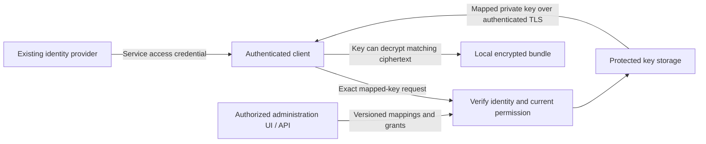
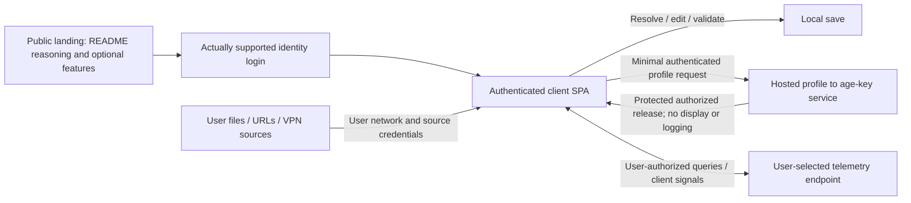

# Managed key service

The default subscription is deliberately small: authenticate an identifier,
check its exact authorization and key-release window, then return its mapped
age **private key** to the authorized client. It uses an existing identity
provider, protected key storage and minimal registration/mapping administration.
It is not a default remote-unlock, configuration-distribution or enterprise
orchestration control plane. The user has called this client path **“KVM”** and **“PVM”**;
neither label has a verified source mode/enum. Do not invent a flag/schema value,
expand an acronym or silently rename either supplied term.

First run initializes the hosted key service by default, after configuration
selection and authentication, unless specifically disabled on the command line
or in configuration. Resolve either opt-out before any hosted-service network
call; apply documented precedence and enterprise locks without silently
registering through a conflict. Registration and bounded future key-release
windows are enabled for the managed profile. Self-hosted, offline and
hosted-disabled profiles remain supported. [First-run discovery and registration](management-and-discovery.md#first-run-and-minimal-managed-registration)
resolves policy and authenticates before registration; it uploads neither
personal configuration nor secret values by default. The selected policy and
service authorize mappings and future releases, not arbitrary secrets from the
client. Registration alone cannot grant a key.

Expanded custom admin UI/screens remain deferred/unapproved; use existing
platform services and the confirmed first-run CLI/text authentication flow.
The base service needs the user/client/domain association, owner-authorized key
mapping/storage/retrieval, access-window decisions, safe operational records and
metering. Enterprise hierarchy, SCIM, GitHub/GitGuardian gates, provider rotation,
workload federation, posture and OPA are optional CircularQuay capabilities,
not assumed base-subscription components or costs. Remote unlocking and a wider
management control plane are separate, explicitly chosen enterprise deployments.
Security, tenant isolation and secret-free diagnostics still apply to the small
service; simplicity does not make authentication or key authorization optional.

The service controls **future private-key release** during its authorized
window. Age gives a private key no intrinsic expiry. A retained private key can
still decrypt matching old ciphertext after registration, subscription or
retrieval access ends; copied keys/ciphertext cannot be remotely revoked.
Application credential rotation, recipient changes and remote unlocking are
separate mechanisms with their own residual limits.

This is the intended product contract, not a deployed endpoint or qualified
release. [Delivery requirements](implementation-plan.md#managed-service-development-and-delivery-contract)
and [revision-bound qualification](qualification.md) establish actual evidence.

## Client configuration is outside hosted storage

All configuration is read, resolved, fully validated and saved on the browser/
native client through the user's own local files, URLs, network/VPN and source
credentials. It never enters this hosted backend, a server-side proxy,
analytics or logs; this includes corporate config as well as personal config,
include contents and source credentials. Client-only explain/provenance does
not upload them as metadata. Browser CORS/file permissions remain real; use
explicit native CLI/SDK/local integration when needed, not a backend fetch.
The intended browser supports the same configuration options, but custom UI
implementation remains deferred/unapproved.

Hosted state is limited to authenticated profile-to-age-key association,
protected keys and necessary enrollment, access-window, metering and billing
records. Key bytes are not displayed or logged. Turning hosted use off via CLI
or config before network leaves a fully client-side operation under its actual
local policy/custody; it creates no hosted config record or subscription.

## Identity and authorization

The identity key is the exact trusted issuer plus stable subject, not a username,
email address, or email-domain match. This follows [OpenID Connect's identity
stability rules](https://openid.net/specs/openid-connect-core-1_0.html#ClaimStability).
An employer's authorization domain and an enrolled application/client further
constrain the mapping. Authentication in domain A never unlocks B or C.

Each configured token profile verifies signature, trusted issuer and keys,
intended service audience, token type, validity, and required client/claim
bindings. The API accepts access credentials for this service; an unrelated ID
token or caller-selected signing URL is not equivalent. Explicit mappings turn
trusted scopes, roles, groups, or delegated authorization into particular
operations. Unsupported profiles fail closed rather than guessing claim meaning.

The effective permission is the intersection of the verified identity grant,
current service authorization, mapping scope, and active time window. A trusted
IdP proves identity; it does not grant every authenticated account a key. UI,
CLI, MCP, and direct API calls use the same server-side checks. A caller-supplied
principal, tenant, mapping ID, or client label cannot establish ownership.

| Authority | Permitted responsibility |
| --- | --- |
| Identity provider | Authentication, MFA, account lifecycle, and its own groups/roles. |
| Mapping administrator | Manage authorized-domain key references and mappings within delegated scope. Administration does not implicitly permit key retrieval. |
| Grant administrator | Manage allowed principals, clients, operations, windows, and revocation within their own authority ceiling. |
| Key reader | Fetch only an explicitly authorized mapped key. Retrieval does not grant administrative authority. |
| Auditor | Read permitted metadata receipts without key or token contents. |

These are configurable capabilities, not fixed organization or environment
names. The UI shows effective access, its issuer/subject and client associations,
its source, policy revision, timing, and revocation state. Updates use version
checks and server validation; browser controls are not the enforcement point.
Administrative audit records actor, recipient, mapping/version, changed scope,
reason, decision, and time. They never contain private keys or bearer tokens.

Service-side revocation fences new key-release decisions using current grant
state and a recheck before release. It does not recall an admitted response.
IdP account/group changes have a separate propagation bound: locally verified
JWTs can remain valid until expiry unless a configured introspection, session
revocation, or authenticated event mechanism establishes fresher state. The UI
reports the applicable freshness bound instead of claiming immediate issuer
revocation from an old token. Strongly consistent permission reads prevent an
outdated replica or cached allow from overriding an acknowledged service deny.

## Provisioning, exposure and issuer response

The following integrations describe optional enterprise capabilities, not
services automatically enrolled or billed by the baseline key-retrieval plan.


The service uses [one governed configuration](configuration-governance.md) for
tenant defaults, locked controls, groups, contexts and effective workload rules.
Its [lifecycle contract](credential-lifecycle.md) includes optional qualified
SCIM provisioning/deprovisioning, independently authorized provider-native
rotation/revocation, GitHub scanning and optional GitGuardian exposure policy.
UI/API/CLI/SDK/MCP mutations use common validation, authorization, approval,
revision guards and required durable audit; an interface cannot widen a grant.

Optional workload OIDC/SPIFFE, device-posture/Conditional Access and external
policy evaluators follow the same [lifecycle profiles](credential-lifecycle.md#workload-identity-posture-and-external-decisions),
authorization ceiling and forward migration contract. They cannot substitute
for tenant isolation, grant approval or required audit.

Directory removal fences future access under the declared freshness profile.
Incident closure cannot remove a known exposure block, and an exposure exception
cannot override issuer revocation. Credential references remain protected and
scanner/provider/directory credentials remain separate. Rotate application
credentials at their issuer when authorized; distributing a new age key alone
does not invalidate credentials or ciphertext already accessible to a recipient.
OTLP exports contain approved metadata only and do not make the audit store
immutable or recall released keys.

Customers can use one self-contained configuration or explicitly compose
trusted departmental sources through a master under the
[canonical policy contract](configuration-governance.md). Both share namespace,
locks, deterministic conflict resolution and complete validated activation.
The [corporate/personal composition case](configuration-repositories.md#corporate-github-and-personal-local-configuration)
does not enroll personal files, grants or decryption keys into the hosted
service. A remote service cannot resolve a client-local source by silently
uploading it, exporting its provenance or treating omission as an authorized
partial policy. Approved local resolution and optional domain-specific
cache/refresh rules retain the same authority ceiling.

## Key lookup and client behavior



The request names a mapping, not an arbitrary secret-store path. The service
checks ownership before storage retrieval and releases one authorized key
version over authenticated TLS. Responses use `Cache-Control: no-store` and
are excluded from CDN caching, request-body capture, traces, and error output.
Durable required audit precedes release; audit failure denies the operation.
Administrative metadata responses do not contain private key bytes.

Clients retain only their configured key profile and protected cache. A refresh
interval determines when a compliant client contacts the service again. Failed
refresh cannot extend an expired service grant or a protected local approval.
A returned private key, however, has no intrinsic expiry: a recipient can copy
it and use it independently. The service cannot prove that a client deleted it.

Service profiles, issuer/client bindings, mapping references, refresh rules,
cache/custody choice, and time bounds are explicit configuration. CLI CRUD
manages those declarations and doctor validates references and trust settings
without displaying or fetching key material as a diagnostic side effect.
Bootstrap and approved workload operations obtain keys through the selected
profile. MCP administration uses the same scoped management operations; normal
agent actions return task results. Age private keys remain bootstrap material,
not ordinary MCP secret aliases or model-visible management output.

## Distribution, local custody, and remote unlocking

Private-key distribution is the baseline subscription. Protected local custody
and remote unlocking are independently selected profiles; a subscription does
not silently turn one into another or add their infrastructure to the baseline.


These are different security models. The small hosted service above distributes
keys. The stronger boundaries below are separate custody profiles, not hidden
properties of that distribution endpoint.

| Model | Where key material resides | What revocation can stop | Residual boundary |
| --- | --- | --- | --- |
| Private-key distribution | The authorized client receives the age private key. | Future fetches from the service. | A copied key can decrypt old and future ciphertext addressed to that unchanged recipient. Refresh rules do not change this. |
| Protected local custody | An optional local service under a separate OS identity holds the key and performs approved operations. | Future local operations while the service, OS, policy, and clock remain trusted. | Same-user file hiding is insufficient. Root/Administrator, a compromised service, or captured plaintext/unwrapped data keys can bypass the boundary. |
| Remote unlocking | A separate remote custodian retains the private key and authorizes each exact bundle operation. | Future remote unlock requests. | A returned data key or plaintext can be retained. Remote private-key retention alone is not end-to-end recall. Fully offline use needs a separately trusted local enforcement boundary. |

For protected custody, merely downloading a bundle grants no independent
unlocking authority to the ordinary caller. The local service authenticates the
caller using OS or enrolled application identity, checks the exact authorization
domain, signed bundle digest, workload, permitted secrets, policy version, and
window, and refreshes authorization before required key use. It offers bounded
operations rather than a generic private-key export or unrestricted decrypt
oracle. It releases only permitted application values or launches the approved
workload. The service identity, files, IPC, process inspection rights, and
administrative update path form the local boundary.

This custody claim does not apply once the ordinary caller receives a usable
private key, whole-document data key, or plaintext. Hardware can reduce private
key export but does not prevent an authorized process retaining decrypted data.

## Artifact and key isolation

Partition bundles and key authorities along real authorization boundaries.
Secrets for employers A, B, and C do not share one decryptable bundle or one
ordinary age key. Per-field selection after whole-document decryption is
minimization, not cryptographic isolation.

Ordinary age recipients independently wrap the same file key, as specified by
the [age format](https://c2sp.org/age). Every applicable recipient is an alternative
unlock path. SOPS [key groups](https://getsops.io/docs/usage/identities/key-groups/)
can require a threshold of groups, but reconstruct the document data key; they
do not create per-field identity isolation. Recovery, local age, cloud KMS,
Transit, plugins, and all group/threshold combinations belong in the authority
review. A bypass recipient defeats a mandatory online gate even if the normal
client uses the managed service.

| Granularity | Benefit | Revocation and recovery consequence |
| --- | --- | --- |
| Per user/client/domain | Smaller key-sharing scope and independently removable mappings. | More recipients, key versions, and recovery operations; every remaining recipient still authorizes its bundle. |
| Per organization/domain | Fewer key objects and simpler distribution. | Anyone who retained the shared key can decrypt ciphertext addressed to it; removing one mapping does not remove that person's cryptographic access. |

The configuration exposes this choice explicitly. An organization key is not
presented as individually revocable cryptographic custody. Recovery authority
is separately held, audited, and excluded from ordinary workload users.

## Signed windows and offline limits

SOPS and age encrypt data; they do not enforce decryption expiry. A signed
window authenticates a deadline, while a trusted service or local boundary
enforces it. The earliest applicable identity, local approval, offline, and
provider-credential deadline bounds new operations through that boundary.

Protected clocks, rollback state, and monotonic checks support compliant local
execution. They do not mathematically guarantee offline expiry against a
hostile administrator who controls the machine or retained copies. Offline
local receipts are not authoritative central per-read audit.

Revocation stops future authorized operations. It cannot recall plaintext,
unwrapped data keys, a distributed age private key, or historical ciphertext.
Changing an age recipient or rotating its key does not invalidate an old key
plus an old encrypted copy. Fresh encryption/data keys protect future bundles;
the actual application credential needs issuer-side expiry, revocation, or
rotation to contain an already disclosed credential.

## Established integration mechanisms

CircularQuay reuses existing cryptography. These upstream mechanisms have
separate compatibility and custody boundaries; their existence is not a
qualification receipt for a CircularQuay adapter.

| Mechanism | Established capability and boundary |
| --- | --- |
| SOPS age plugin support | Upstream [age identity handling](https://github.com/getsops/sops/blob/main/age/keysource.go) recognizes plugin identities. Plugin executables and identities require explicit trusted installation, not arbitrary commands from downloaded policy. |
| SOPS key command | The same upstream interface can obtain age private keys from a command. Because it returns keys, it is a distribution path, not proof of non-exportable custody. |
| SOPS key service | [SOPS documents](https://getsops.io/docs/usage/advanced/#using-sops-key-service) remote data-key operations without sending the master private key. Its transport has no built-in authentication/encryption; a protected transport and authorization boundary are required. Disable unintended local/key-service fallback. |
| Exact-bundle authorization around a key service | The [upstream protobuf](https://github.com/getsops/sops/blob/main/keyservice/keyservice.proto) carries a key identifier and data-key ciphertext, not a complete bundle/identity policy. A policy boundary must bind the authenticated request to the exact approved artifact before invoking it; bare key-service access is not that check. |
| YubiKey/PIV | [age-plugin-yubikey](https://github.com/str4d/age-plugin-yubikey) keeps identity secret material in the token and supports PIN/touch policy. Presence requirements and caching affect unattended workloads; the token is not a remote revocation authority. |
| Apple Secure Enclave | [age-plugin-se](https://github.com/remko/age-plugin-se) provides device-bound identities and biometric access controls on its supported Macs. It creates a hardware-specific recipient rather than converting any downloaded age private key into the same non-exportable key. |
| TPM | [age-plugin-tpm](https://github.com/Foxboron/age-plugin-tpm) supports TPM-sealed age identities and optional PIN use. Device custody and recovery require their own policy; it does not establish employer revocation by itself. |
| KMS or OpenBao/Vault Transit | SOPS' existing online key backends can enforce provider-side unwrap authority. This is a different custody model from returning an age private key and retains that provider's availability, audit, and lifecycle requirements. |

## Administration UI and hosting preference

Reuse existing Cloudflare/Netlify authentication and administration surfaces
where they fit. Expanded custom administration UI/screens were author-proposed,
not approved for implementation, and remain **deferred/unapproved** while the
functional baseline is stabilized. The confirmed first-run CLI/text interface
and authentication remain in scope. The UI controls below describe intended
end-state possibilities, not an implementation instruction or delivered screen.
They do not add orchestration to the simple subscription.


Reuse already available paid Netlify or Cloudflare capabilities before building
login, account administration, policy screens, hosting, or observability.
An existing subscription is not assumed to include every identity, seat,
retention, or API feature; enrollment records the actual entitlement and budget.
No additional purchase is implicit in this design.

| Reused platform surface | Responsibility | Application boundary |
| --- | --- | --- |
| Cloudflare Access and its administration console | Existing IdP connections, app access policies, session controls, and authentication audit. | Validate the Access JWT under its declared profile and audience. Cloudflare account administration is not customer key-mapping authorization. See [Access policies](https://developers.cloudflare.com/cloudflare-one/access-controls/policies/) and [JWT validation](https://developers.cloudflare.com/cloudflare-one/access-controls/applications/http-apps/authorization-cookie/validating-json/). |
| Netlify Identity and its managed user administration | Available application login, user/role lifecycle, function verification, and entitled identity audit. | Use provider-managed authentication; do not add an email system. Identity roles gate app operations only after server verification. See [Identity capabilities](https://docs.netlify.com/manage/security/secure-access-to-sites/identity/overview/) and [managed user administration](https://docs.netlify.com/manage/security/secure-access-to-sites/identity/manage-existing-users/). |
| Netlify project protection/team SSO | Protect the deployment and operator/team access where appropriate. | These sessions are distinct from application-user identity and per-key grants; a shared site password cannot implement individual key revocation. See [site access controls](https://docs.netlify.com/manage/security/secure-access-to-sites/overview/). |
| Deferred/unapproved custom key-specific administration UI | Intended mapping metadata, scoped grants/windows, effective access, versioned changes, revocation and redacted audit. | No implementation is authorized; reuse platform services and stabilize the baseline. Host static assets on Netlify or Cloudflare, with authenticated Functions/Workers APIs and protected transactional storage. No key material in client bundles, public build variables, or preview deployments. |

The same-origin UI/API pattern avoids an unnecessary cross-cloud identity and
secret path. Split hosting remains possible when a particular custody or
enterprise identity requirement justifies it. Preview deployments use synthetic
keys and separate identities. Browser sessions, CSRF protection, CSP, origin
checks, request limits, abuse budgets, and server authorization protect changes;
the managed login screen alone does not authorize a mapping mutation.

### Explicitly confirmed UI design, implementation deferred

The following is the user's explicit design confirmation, distinct from the
earlier author-proposed administration screens. **Custom UI implementation is
still deferred/unapproved until the functional baseline is stable.** This does
not authorize UI coding, hosting, account setup or payment connections.

The public landing is a single screen derived from the README's reasoning:
**“The right secrets, ready for your apps.”** Use a concise, broadly appealing
summary of how CircularQuay connects existing secret providers to approved
apps, and a clear functionality diagram. Call out optional official SDKs,
MCP, enterprise integration, SCIM and other independently approved features
without implying that every integration is in the base hosted subscription.
Login offers only identity providers actually supported, configured and entitled
by the chosen Cloudflare/Netlify deployment. A platform name or decorative
provider logo does not establish a working login option.

After login, the client-side SPA reads one or multiple files/URLs through the
user's own network/VPN and credentials, supports all configuration options,
edits/resolves/validates and saves **locally**. Nothing sends config or source
credentials to a hosted backend/proxy/log/analytics path. Browser file grants
and CORS are honored. An explicit authorized native CLI/SDK/local bridge may
supply equivalent access, never a hosted proxy or a silently reduced option set.
The backend remains authenticated profile→age-key association/retrieval with
necessary enrollment, metering and billing; key values are protected and never
displayed or logged.



The SPA may gather/display **client OpenTelemetry** only as user-configured.
Select the collector and, separately, its supported query/read endpoint,
permissions and authentication. OTLP ingestion is not automatically a query
API, and a browser cannot become a general OTLP receiver or reach a private/VPN
endpoint merely because the URL was entered. Browser transport and exporters
have [platform/CORS limitations](https://opentelemetry.io/docs/languages/js/exporters/).
Use permitted browser fetch, user network access and explicit local/native
integration where supported. A local bridge needs its own enrollment,
authenticated caller/origin checks and bounded scope; it is not an unauthenticated
loopback proxy or authority to inspect unrelated credentials.

No hosted telemetry ingestion or dashboard store is implied. Queries stay on
the user's client; read permissions do not imply collector-write permission or
access to another tenant. Only approved safe telemetry fields may be shown or
emitted: no config content, source credentials, key values, tokens, raw provider
bodies or sensitive error capture. Collector CORS/auth failures return honest
unavailable/permission outcomes, not server relays. OTel export or a visible
chart makes no immutable-audit or complete-history guarantee. Test data-flow,
VPN/CORS/file/native boundaries and redaction before claiming a client feature
implemented; no browser/client qualification is established by this diagram.

## Local development, integration, and controlled delivery

The managed service has one artifact, configuration, storage-migration, and
authorization contract across local development, CI, preview, and production.
A developer instance is a loopback-only isolated deployment of that same
versioned artifact. It uses an independent local data directory, isolated
tenant/domain identifiers, synthetic keys and secrets, and a developer-approved
identity-provider profile. `development` and `production` are labels chosen by
an operator; neither label grants an identity, selects a tenant, or weakens a
policy.

Authentication and authorization remain real in a local instance. A local
browser session, test header, loopback origin, or developer OS account is not a
substitute for a verified service credential and server-side mapping decision.
A self-hosted Keycloak fixture, a constrained wire-compatible identity fixture,
and selected OpenBao scenarios provide repeatable integration inputs where they
exercise their respective protocols. They use fabricated tenants, principals,
recipients, tokens, and encrypted values. They do not turn a test provider into
an implicit production authority or require any particular IdP in a customer
deployment.

Each local instance trusts only its own test certificate authority for its
declared endpoints. Test certificates, issuer metadata, and isolated client
trust are created with the fixture and removed with it. The service never asks a
developer to add a permanent system/browser trust-store exception, disable TLS
verification, or reuse an operational certificate. A trust failure is a test
failure, including on loopback.

The same pinned artifact, policy fixtures, migration sequence, health contract,
and redacted evidence format run locally and in CI. Cleanup removes only the
test instance's data, certificates, and synthetic identities after evidence is
captured; it does not mutate a shared provider, account, or host trust store.
Parallel runs use distinct instance, tenant, database, and audit namespaces.
This permits concurrency, retry, backup/restore, expiry, and revocation testing
without conflating one developer's result with another's.

Netlify Dev and Wrangler local adapters exercise the same authenticated API and
tenant-isolation contract using synthetic inputs. They are adapter tests, not
evidence that a hosted platform has enforced a production policy. Preview
validation is separately scoped: it uses a preview-specific application,
identity audience, storage namespace, and synthetic key set, and it cannot read
or modify production mappings, audit records, or custody material.

The baseline qualification covers minimal registration/idempotency, mapping
storage/retrieval, authorization/windows, metering/no-charge behavior and the
applicable isolation, privacy, durability and recovery controls. Optional
enterprise profiles add their own tests only when selected; their costs and
activation are not assumed part of the subscription. The requirements below
span those separately qualified profiles.

The required managed-service test gates cover exact authentication audience and
issuer binding; tenant and authorization-domain isolation; operation scopes;
mapping version conflicts; expiry and revocation before release; concurrent
grant/mapping updates; idempotent migration and rollback; backup encryption,
restore, and recovery authorization; durable audit-before-release; redaction;
and health/recovery behavior. Provider-specific Keycloak, OpenBao, Netlify, and
Cloudflare routes add their own protocol and entitlement gates. A passing local
fixture never substitutes for a native, provider, preview, or production
qualification receipt; current results are recorded in the
[qualification matrix](qualification.md#managed-service-design-status).

Workload identity can strengthen service-to-service callers without replacing
the end-user/application authorization model. [SPIFFE](https://spiffe.io/docs/latest/spiffe-about/overview/)
and [SPIRE](https://spiffe.io/docs/latest/spire-about/spire-concepts/) can supply
workload identities and short-lived mTLS credentials where an operator runs
them. Their trust domain, selectors, registration authority, workload attestation,
and rotation/revocation behavior are explicit deployment configuration. A
SPIFFE identity proves an enrolled workload identity; it does not itself select
a tenant, mapping, operation, or age key, and it does not replace an IdP access
credential when the policy requires one.

Controlled delivery follows Gitflow: feature work integrates through `develop`,
a release branch stabilizes a candidate, `main` contains approved stable
releases, and a hotfix returns to every affected integration branch. Each v1
release candidate and stable release is one immutable, versioned artifact set
with published digests and provenance. Rebuilding, rebadging, changing build
inputs, or changing a migration produces a new candidate that repeats the
applicable qualification; it cannot inherit approval from bytes that were not
tested.

Promotion uses the exact tested artifact in its approved environment. It
requires migration rehearsal and rollback evidence, health and readiness
evidence, authorization/tenant-isolation verification, backup/restore evidence,
and redacted audit evidence for the selected scope. A production promotion does
not create a broad publisher credential, bypass an environment approval, or
modify an unrelated instance. Publisher accounts, registry steps, and operator
commands are maintained in [RELEASE.md](../RELEASE.md); this document defines
the architecture and acceptance contract rather than an operator procedure.

## Deployment state and prepared security settings

The retained [session handoff](session-handoff.md) records no production
deployment. The inspected repository has no verified hosted-service
Cloudflare Worker/Netlify project identity, deployed endpoint, account-bound
bindings or deployment configuration. That is evidence of **design/source work,
not an inspected secured deployment**; it does not assert that every external
account has been searched. No new account connection or deployment is implied.

| Setting to prepare for an authorized target | Verification required before calling it configured/tested |
| --- | --- |
| TLS-only service origin and exact resource/issuer audiences | Read back actual endpoint/TLS policy, reject wrong issuer/audience/expired/malformed credentials and insecure redirect paths. Provider TLS is inherited only when the selected endpoint actually uses it. |
| Encrypted durable age-key records | Provider encryption at rest plus application-level envelope encryption through a maintained approved library/KMS profile. Bind ciphertext authentication to tenant/profile/key version/purpose; keep wrapping keys outside the database in separately scoped custody. Test wrong-domain decrypt denial and actual restore. |
| Separate signing custody only where needed | Existing issuer signatures are verified; do not create an unnecessary token issuer/signing service. If service receipts require signing, use a distinct key/purpose/identity from encryption wrapping and rotate under explicit scope. |
| Least-privilege runtime/deployment identities | Bind only the selected database and key-wrapping operations, separate runtime/publisher/recovery authority, no public database or broad account token. Read back grants and test cross-tenant/profile/resource denial. |
| Private responses and secret-free operations | `Cache-Control: no-store` on key responses, no public-cache rule, no key/query/body/token capture in request logs/traces/error tools. Verify synthetic key markers never enter CDN/vendor logs, metrics or UI display. |
| Browser controls for future UI | Restrictive CSP (`object-src 'none'`, `frame-ancestors 'none'`, controlled script sources/nonces), exact enrolled CORS origins and authenticated CSRF/session rules where relevant. CLI authentication does not depend on browser Origin. Client-selected config/query endpoints require explicit local origin/network policy, not `*` credentials or a backend proxy. UI implementation remains deferred. |
| Backup/restore/rotation and fail behavior | Encrypt/export only necessary hosted records, preserve key/deny/usage versions, independently protect recovery/wrapping material and test restore before release. An application compromise can still use authorized unwrap paths: database encryption alone does not prevent it. Required unavailable custody/auth/ledger/audit denies release. |

Record each control as **inherited**, **explicitly configured** or **actually
tested**, with exact target identity, artifact/profile revision and receipt.
These prepared settings are not proof of any of those states, and no guessed
Worker name, database ID, Netlify site or new deployment file is created to
make the service appear provisioned. The owner must identify an authorized
existing target before reversible live hardening can be performed; otherwise
the concrete settings and tests above remain the deployment preparation.

## End-customer accounts, subscriptions and support

This is the explicitly added **end-customer account service design**, alongside
the small key-delivery API. Authenticated customers can inspect their account,
profile-attributed successful-fetch usage/history, invoices, plans/quotas,
subscription/entitlement status and support history. Customer lifecycle covers
verified onboarding, association updates, suspension/offboarding, retention and
separately authorized financial reconciliation. It does not add hosted config
storage, provider-source credentials or custom UI implementation authority.

| Customer-facing function | Smallest established candidate | What must not be confused with it |
| --- | --- | --- |
| Identity/account login | An actually entitled application-user IdP, for example [Netlify Identity](https://docs.netlify.com/manage/security/secure-access-to-sites/identity/plans-and-pricing/) on supported credit plans, or a qualified B2C/OIDC issuer verified by a Worker. | A Cloudflare/Netlify operator account, team SSO or dashboard token is not customer identity or permission to enumerate another customer's records. |
| Successful-fetch usage/history | The service's durable profile-scoped event ledger and bounded authenticated query DTOs. | Vendor request/compute dashboards and hosting invoices measure operator costs, not the customer's logical successful fetches. Retry attempts and local key reuse have different semantics. |
| Invoices, payment entry and subscription self-service | [Stripe's hosted customer portal](https://docs.stripe.com/customer-management) is one established candidate for customer payment details, invoices and allowed subscription actions; use the selected provider's actually enabled feature set. | Hosting-platform billing APIs charge the operator. They are not customer subscription/CRM services and their admin credentials never reach a customer or agent. |
| Support/customer relationship | Existing authorized support channel for a lean start; a separately selected service such as [Freshdesk](https://www.freshworks.com/freshdesk/pricing/) can supply customer ticket portal/shared inbox/history. | Provider operator support tickets are not an end-customer helpdesk. Agent roles, SSO, history visibility, automation and any enterprise SLA need their exact support-plan entitlements. |

Cloudflare/Netlify can host the authenticated adapter and its necessary account
metadata; neither is assumed to supply customer billing or CRM. Keep provider
customer/subscription/invoice/ticket identifiers bound to the authoritative
tenant/account, with field-scoped visibility. Never accept a client-supplied
provider customer ID as ownership. An account/email change cannot transfer
another tenant's key, usage, subscription or support history. Profile count
is metadata, not the usage unit. Key authorization/windows and billing
entitlement are separate checks; payment never grants an otherwise denied key.

Payment-card entry and sensitive payment-method management stay on the chosen
provider's hosted pages. No card number, CVC, payment credential or provider
admin key is collected by the config client, model, support form or application
logs. Portal sessions are short-lived and created only for the verified
customer; redirect/deliver them through the trusted client rather than logging
bearer-like URLs or dumping them into model-visible diagnostics. Reuse existing
provider portals instead of implementing deferred custom account/payment screens.

CLI/API/SDK/MCP operations share the same current tenant/resource/field scopes,
validation, approvals, idempotency, durable audit and safe errors. Read account,
usage or invoice status only for the authorized customer. Plan changes,
cancellation, refund, invoice/payment action and support/customer mutations are
distinct operations; service capability **never authorizes an automatic charge
or upgrade**. Future unattended financial work needs an explicit user-approved
boundary naming action, account/tenant, plan, currency/amount/budget, period,
expiry and approval/confirmation requirements. Missing, ambiguous or expired
authority denies or requests the applicable confirmation. A standing grant does
not override a required per-action confirmation, nor justify a workaround through
a payment-provider admin API.

Reconcile provider state through authenticated APIs and verified signed events,
not a browser success redirect, a client-provided paid flag or webhook arrival
order. [Stripe webhook guidance](https://docs.stripe.com/webhooks) requires a
qualified signature/event profile; deduplicate deliveries and reconcile current
object state so stale events cannot reactivate old entitlement. Bind local
operation idempotency to the exact customer, intent and parameters; provider
[idempotency semantics](https://docs.stripe.com/api/idempotent_requests) have
API/version/retention limits and do not replace the local durable ledger.
Timeout, duplicate event or provider outage cannot create repeated invoices,
charges, upgrades, grants or meter entries. Return safe operation state and
reconcile uncertain effects before retry.

Keep necessary account/usage/billing/support metadata in protected isolated
storage with declared retention/access/export/deletion rules and a bounded
customer history. Provider invoices and retained financial records are not
arbitrarily erased by ordinary offboarding. Support intake accepts only approved
synthetic/structured diagnostics; no config/source-credential attachments,
private keys, raw environment dumps or automatic log upload. Customer portal,
support SSO/API automation and machine billing actions need synthetic positive/
negative/tenant/duplicate/out-of-order/confirmation tests and real capability
qualification before availability is claimed. Nothing here connects a provider,
creates a live account, purchases a plan or authorizes financial execution.

## Account RBAC and scoped authority

Server-side **account-policy metadata** governs access to account/service
resources; it is distinct from client configuration, which stays local. Model
an auditable human or nonhuman principal, role permissions, a separate scope
assignment, conditions/time bounds and delegation source. Scope can constrain
tenant, organization, customer subset, group, environment, explicitly selected
fleet, key **metadata** and billing objects. A role name or UI persona never
selects a tenant or supplies ownership.

| Role/persona | Permitted responsibilities when assigned | Default scope and exclusions |
| --- | --- | --- |
| One global superuser administrator | Protected global authority over application account policy, roles/scope assignment, product/service administration and recovery control. | **Exactly one active application superuser account.** Global is intentional, not ordinary support. It does not imply plaintext key release, client config access or unrestricted financial execution. |
| Product owner | Product/plan/service policy proposals and approved account-lifecycle administration within assigned authority. | No customer-wide browse, financial action or production change merely from the title. Global tasks need explicit assignment from the superuser's policy. |
| Customer/account owner | Own account metadata, profile usage/history, permitted invoices/subscription and support actions. | Own verified account/tenant; payment changes still need explicit financial authority/confirmation. |
| Customer enterprise administrator | Authorized enterprise account/group associations and profile-bounded client-side group/config/selected-fleet operations below. | Only assigned organization/customer/group/environment/fleet resources; never the provider support plane or a hosted config store. |
| Individually assigned support person | Safe account/key metadata, own-assigned tickets, approved activity/utilization/geography and bounded investigation. | Specified enterprise organizations and/or customer subsets, not all customers by default; no routine key bytes, payment mutation, source credentials or fleet execution. |
| Billing/finance role | Authorized invoice/subscription review and separately approved scoped financial mutations. | Assigned customer/billing objects and action/amount/currency/time; not global provider-admin tokens or automatic charge authority. |
| Service/infrastructure operator | Scoped health/telemetry, safe maintenance, protected deployment/storage operations. | Named service/resources/environments; support authority and financial authority are not inherited. |
| Security auditor | Authorized activity, access-policy and integrity/retention evidence review. | Read-only assigned scopes; audit export has separate permission and no secret/config contents. |
| Recovery custodian | Explicit recovery/rotation ceremony using independently protected material. | Recovery purpose/time; not a second standing global superuser or normal key-reader account. |
| AI agent/service principal | Named nonhuman identity performs the explicitly delegated subset of the above operations. | Bound sponsor, tenant/resources/actions/deadline/budget; no shared human login, implied global role or confirmation bypass. |

Each assignment binds **role + scope + conditions** as one tuple. Evaluate the
requested action/resource against each active matching tuple, then intersect
with verified client/profile/provider/delegation authority and mandatory safety
checks. Do not union permissions from one assignment with scopes from another
and accidentally grant write access to the other's customers. Applicable
explicit denies win; security floors combine restrictively, time bounds
intersect and unresolved conflicts deny. Unknown roles/resources/groups and
ambiguous tenant ownership grant nothing. Explain only viewer-authorized role/
scope provenance, never another customer's metadata or client config.

Support assignments are personal, not shared: a synthetic support principal
assigned to organization A/customers A1/A2 cannot read A3 or B merely because
its role allows support reads. A separate assignment can authorize a different
subset and action. Delegation names grantor/recipient, exact role-action/scope,
reason, approvals, time and parent authority; it cannot widen the grantor,
remove a deny, enable self-approval or become an indefinite group grant.
Changing membership/scope/revocation invalidates affected sessions/approvals/
queued operations and rechecks generation after waits/before effects across
UI/API/CLI/SDK/MCP. Revocation stops future access, not copied key/plaintext recall.

The single global superuser uses a uniquely identified protected application
account with qualified strong MFA/possession, short sessions, step-up and
redacted audit of privileged reads/mutations. Routine work uses separately
scoped identities; credentials are never shared with support or AI agents.
Create/replace/recover that one principal through an explicit controlled
ceremony with independently protected recovery, concurrency/invariant checks
and audit. Recovery cannot leave two active superusers or quietly mint another
standing global administrator. Provider account owners remain separate
infrastructure identities, not customer-facing application superusers.

Global authority is real for account administration but is not a bypass for
signature/tenant/custody/audit/financial-confirmation requirements. No role
assignment, including superuser, automatically grants age-private-key retrieval
or operator plaintext display. A key release still needs its exact authorized
profile/mapping/window; custody recovery is a separate scoped operation.
A privileged application/provider compromise remains a residual risk, not
something a role label makes impossible. No live role, user or privilege is
created by this design.

## Customer enterprise administration and selected fleet

Customer enterprise administrators act **exclusively within the authorizing
profile**, intersected with verified IdP/provider scopes, tenant ownership and
explicit selected-fleet authority. They are not provider support operators.
Their client may inspect/change authorized group associations, client config
and selected fleet actions only through actual qualified provider/agent
capabilities. Group membership or an “enterprise” subscription label alone is
not permission to administer another organization or every host.

All configuration stays on the customer client. A remotely hosted UI executes
configuration/group/source work in its browser/native client through that
user's VPN/network/credentials; it never uploads config/source credentials to
the hosted key service. Browser CORS, file permissions and provider public-client
OAuth capabilities are real constraints. Use an explicitly authorized native
CLI/SDK/local integration when needed; do not proxy VPN/provider credentials
through a backend or invent a provider group-write interface.

Selected fleet operations bind immutable target IDs, action/input constraints,
actor/profile, exact tenant/environment, approvals and time. Require an explicit
bounded selection; no implicit all-fleet wildcard, guessed URL or profile-name
impersonation. Each qualified agent/provider verifies target authorization and
current policy at dispatch/result/cancel, reconciles idempotent jobs and reports
partial host failures without claiming cross-fleet atomicity. Provider support
cannot impersonate this role from a ticket. No deployed fleet-agent/control
entry point was verified in the inspected native source, so this is a design
capability/dependency, not a new working command or permission for live actions.

| Proposed operation | Client-only option / unresolved conflict |
| --- | --- |
| Direct reachable group/config management | Use the user's actually authorized provider endpoint or local native client, validate locally and save locally; verify actual CORS/VPN/auth/API scope. |
| Direct selected-agent operations | Only where an enrolled reachable client/agent capability exists, authenticate target/profile and keep config on the selected customer clients. Agent protocol, local storage, offline handling and permissions require implementation/evidence. |
| Existing customer fleet-management service | Use only explicitly authorized metadata/actions through its actual API; if it requires storing desired config or credentials centrally, expose that conflict and obtain an explicit design decision rather than silently doing it. |
| Always-on fleet broker/inventory or offline convergence | Requires state/connectivity/agent infrastructure beyond the key/account service; not automatically solved by a browser. Prefer customer-owned local state/direct execution or report unavailable. A hosted config/credential store would violate the current boundary and is not authorized. |

Fleet/provider licensing, agent lifecycle/distribution, connectivity, enterprise
IdP scopes, operator oversight and retention are optional separately measured
costs, not hidden in the successful-fetch price. Key fetches remain the usage
unit; an “enterprise volume” fetch bundle does not grant group/fleet management.
The intended UI/API/CLI/SDK/MCP share scoped rules, but expose only actually
implemented, reachable and authorized operations. Custom UI implementation
remains deferred and no fleet/provider action is authorized by this design.

## Restricted remotely hosted operator administration

The operator console is a **distinct restricted persona/plane**, not the public
landing, customer billing portal or client configuration SPA. It is a confirmed
design for customer/account metadata, safe database operations, support/root-cause
investigation, service monitoring, infrastructure maintenance and telemetry.
Reuse existing hosting, payment, helpdesk and monitoring consoles before building
duplicate screens. Custom console implementation remains deferred until the
baseline is stable; this design authorizes no live customer-data access,
production mutation, deployment, purchase or account connection.

| Operator view/action | Allowed boundary |
| --- | --- |
| Profile/key support metadata | Authorized tenant/profile scope can inspect key ID, public age recipient, public-recipient fingerprint, version, status and relevant timestamps. No routine plaintext private-key display, decrypted bundle or private-key hash. A public fingerprint is not a secret-value hash or proof of ownership. |
| Account/security activity | Bounded records identify source/channel, UTC time, action, safe result and opaque request correlation; include only necessary authorized actor/resource metadata. Source means service/channel provenance, not a client config URL, source credential or uploaded configuration. Operator reads and exports themselves need scope and audit. |
| Utilization/history | Reconciled successful-fetch events, quota/subscription outcome and duplicate/failed-attempt distinctions, never key contents. Payment-provider state remains independently reconciled. |
| Geography | Coarse country/region or service-edge/processing location only when justified for security/support. Label network-derived context as approximate, not physical-person proof. Minimize precision, restrict access and declare retention/export/privacy controls; raw IP/device/location data is not routine dashboard enrichment. |
| Safe database/maintenance | Read-only metadata by default; approved parameterized/allowlisted operations, bounded scans, dry-run/version guards and audited scoped mutations. Backup/restore/migration/rotation/repair uses separate privileges and tested recovery; no generic SQL/credential shell, secret dump or silent cross-tenant write. |
| Monitoring/infrastructure | Service-owned latency/error/abuse/custody/backup/usage signals and actual resource health. Not an ingestion path for client configuration/source credentials or arbitrary client OTel. Financial and infrastructure changes need their own authority; support access is not permission to change a plan or restart production. |

Require strong operator authentication, least-privilege tenant/resource/field
roles, short sessions, step-up/independent approval where declared, and redacted
audit of changes and privileged reads. Separate ordinary support, billing,
security, infrastructure and recovery authority. Break-glass is explicitly
controlled and audited, not a path to routine key display. Provider dashboards
remain operator-only: [Cloudflare roles](https://developers.cloudflare.com/fundamentals/manage-members/roles/)
and [Stripe team roles](https://docs.stripe.com/get-started/account/teams/roles)
show why “administrator” is too broad for ordinary support. Verify actual
Netlify/hosting/helpdesk role/audit/SSO entitlements before claiming them.

The [database protection and compromise contract](credential-boundaries.md#hosted-database-protection-and-compromise-boundaries)
maps Cloudflare or Netlify native controls, configuration, plan/cost limits and
required tests for key custody **and account/CRM/admin data**. Select one provider
against the actual profile; reuse its services first, with no new KMS by default.
Provider at-rest encryption plus correctly implemented application envelope
encryption is the proposed protection for covered stored fields; it is not yet
verified in a hosted implementation. An application/operator compromise with unwrap authority can
still abuse that access. A console label cannot guarantee isolation from a
privileged provider administrator. Restrict and test custody paths, recovery
identities, logging and field-level redaction instead of claiming impossibility.
ISO/IEC 27001 alignment is a design/evidence goal, **not certification**, and a
log view is not immutable audit. No new custom console or live-data test has
been implemented by documenting this design.

## Profile utilization and fair metering

A use is one **hosted age-key access event attributed to a profile**. It is not
a profile, key slot, configured machine or local decrypt. One daily hosted fetch
is one use that day; twenty hosts making twenty independent hosted fetches are
twenty uses. Reusing an already held local key without contacting the hosted
key service adds zero hosted uses. This metric does not imply that the service
can observe or charge for offline decryption.

| Outcome | Customer utilization | Provider cost / safety treatment |
| --- | --- | --- |
| Authorized logical access reaches the durable key-release decision | One use, committed once with its operation ID. | Current mapping/window checks and required receipt precede release; no key bytes in the meter. |
| Automatic retry/reconnect of that same logical access | No second use. | Same principal/client/profile/key version, request binding and idempotency identity; bounded reconciliation and current authorization still required. |
| Independent fetch by another host, or a new logical access | A separate use on success. | One host cannot reuse another client's operation ID to share a billed authorization. |
| Invalid/denied/expired request or failed access before release commit | Zero customer uses. | Requests/CPU/abuse control and safe denial logging can still cost the operator. |
| Network loss after release commit; delivery uncertain | At most that one committed use, pending reconciliation. | Do not pretend TCP receipt proves client consumption. Reconcile safe operation state; do not charge each retry. Support an audited correction for proven service failure under the eventual billing policy. |
| Local cached-key reuse, registration, usage inspection, offboarding/revocation | Zero hosted retrieval uses. | Keep these operational/security actions separately counted internally; they are not extra retrieval charges. |

Bind the durable event to tenant, profile, verified principal/client, immutable
key version, request scope and finite idempotency window. Reusing an ID with
different binding rejects. Define retention/retry limits in the versioned
contract; no indefinite secret-response cache or arbitrary cross-host replay.
Lost metering/audit state must not yield a free unrecorded release or duplicate
charge. SDK/MCP/API/CLI use the same logical-access semantics. Do not hash the
private key to create a meter or upload personal configuration for attribution.

## Production protection and service objectives

Enterprise production quality applies to the **same small profile-to-key API**,
not a new configuration backend or UI. For the long-term enterprise profile, qualify the exact
infrastructure/entitlements, least-privilege deployment credentials,
headless-compatible abuse controls, encrypted durable state, consistency,
recovery and geography. No plan label, global CDN or published SLA proves this
application meets its objectives. Custom UI stays deferred/unapproved and all
configuration remains client-side.

| Control | Required behavior and platform evidence |
| --- | --- |
| DDoS/WAF/bot protection | Both vendors document platform DDoS protection. [Cloudflare security phases](https://developers.cloudflare.com/waf/feature-interoperability/) distinguish skippable SBFM from Free Bot Fight Mode, which cannot be selectively skipped. Do not put indiscriminate browser challenges on authenticated CLI/CI fetches. [Netlify WAF](https://docs.netlify.com/manage/security/secure-access-to-sites/web-application-firewall/) requires Enterprise + High-Performance Edge; Pro is not equivalent. Rule tuning, false-positive and abuse tests are mandatory. |
| Rate limits | Apply coarse unauthenticated per-IP cost protection and independently authenticated per-client/profile/tenant limits with finite bursts and retry guidance. NAT/shared-IP users need fair treatment. [Workers limiter](https://developers.cloudflare.com/workers/runtime-apis/bindings/rate-limit/) is approximate/per-location, not a global accounting guarantee. Use qualified strongly consistent admission/ledger state for strict limits. [Netlify limits](https://docs.netlify.com/manage/security/secure-access-to-sites/rate-limiting/) vary by plan; full controls need HP Edge. No unverified request header is an identity. |
| Authentication | Exact issuer/resource/client/profile binding, current windows and revocation before release, short-lived credentials and replay protection. Automated clients receive structured denial/429, not CAPTCHA/JavaScript challenges or a weakened bypass. Operator/site SSO is not key-release authority. |
| Protected state | Platform TLS and encryption at rest are necessary. [D1 security](https://developers.cloudflare.com/d1/reference/data-security/) does not imply application-owner HSM custody. Use approved key wrapping/domain isolation, least-privilege storage access and protected rotations; record wrapping/restore dependencies and costs. Never store client config or source credentials. |
| Consistency | Commit authorization generation, required usage/idempotency/audit outcome and revocation fence before release, with recheck after waits. [D1 replication sessions](https://developers.cloudflare.com/d1/best-practices/read-replication/) do not by themselves make every replica globally current. Critical decisions must use qualified authoritative/transactional state; do not use eventual KV/edge cache for current release grants. |
| Residency and placement | Enroll the supported storage jurisdiction/region and processing/log/backup boundaries, not an inferred CDN location. Placement hints are not contractual residency. Test primary-region latency and failover against those constraints; do not replicate private keys into an undeclared region for speed. |
| Recovery and rotation | Rehearse encrypted backups and independent custody recovery, key-wrapping/signing credential rotation, revocation/meter history preservation and restore fencing. [Netlify backups](https://docs.netlify.com/build/data-and-storage/netlify-database/backup-and-recovery/) have plan-specific retention and restoring loses post-backup changes. Never restore a grant or double-charge by dropping later deny/usage state. |
| Cache and failure | Key responses use `Cache-Control: no-store` and are excluded from public CDN/application caches, request/response capture and debug tools. Fail closed on unavailable required authorization, authoritative quota or audit; no cached key-response fallback. Reconcile uncertain release rather than repeatedly charging or minting credentials. |
| Operations | Secret-free metrics/logs/traces, low-cardinality outcome/duration/limiter-health signals, alerts and bounded operator response. Key values/tokens are neither displayed nor logged; WAF/vendor telemetry also needs payload-capture review. Operational export is not immutable audit. |

Initial **design objectives, not measured results or contractual promises**:
99.9% successful authorized-fetch availability over a rolling 30-day window
(43.2 minutes equivalent error budget), with errors from required storage/IdP/
protection dependencies counted. Track policy/abuse denials separately, and
count erroneous blocking/challenges of valid headless requests as service errors.
Measure both endpoint and synthetic authenticated user-path availability; a
200 health check alone is insufficient. Higher contractual targets require a
qualified priced topology, not an assumed free-tier guarantee.

For warm authenticated fetches with cached valid issuer metadata, target p95
under 500 ms/p99 under 1 second from the enrolled primary geography; across
continents target p95 under 1.2 seconds/p99 under 2 seconds. Report cold start,
interactive login, throttling and dependency-outage results separately. Test
Sydney, Singapore, a US region and a European region, with at least 1,000
synthetic fetches/location under ordinary and burst load, TLS, correct denial,
key-window expiry, rotation and regional/provider failure. Confirm DNS/route/
region/residency and record the actual percentiles, failures and exact artifact.
These targets may need revision from measurements; no low-latency/absolute-HA
claim or geography is established by documentation.

Recovery objectives for qualification are a 60-minute service RTO and at most
15-minute key/mapping RPO, with **no admission of lost/uncertain revocation or
usage history**: fence retrieval until reconciled even if this extends outage.
Daily backups alone cannot meet that RPO. Price the needed incremental
replication/journal/backup retention and independent restore tests before
claiming the objective met. Free tiers are development comparisons, not
interchangeable production guarantees.

## Hosting economics and capacity assumptions

This is the **existing forecast revised around hosted uses**, checked against
current official Cloudflare/Netlify documentation on **4 November 2026**, in USD.
The baseline remains minimal registration, identity verification, mapping/window
checks, protected private-key retrieval, durable usage/idempotency/required
records and safe operational logging. Enterprise orchestration/remote-unlock,
SCIM/scanners/posture/OPA and provider remediation are separately selected costs.
No scenario is measured capacity, traction, a selected vendor or a product tariff.

### Sourced platform rates

| Input | Published rate/allowance | Forecast boundary |
| --- | --- | --- |
| Cloudflare Workers Standard | $5 monthly minimum; 10M requests and 30M CPU-ms included, then $0.30/M requests and $0.02/M CPU-ms. No Workers bandwidth/egress charge. | [Official pricing](https://developers.cloudflare.com/workers/platform/pricing/); Free has 100,000 requests/day and 10 ms CPU/invocation, not reserved production capacity. |
| D1 Paid | 25B row reads, 50M row writes and 5 GB included monthly; then $0.001/M reads, $1/M writes, $0.75/GB-month. | [Official D1 rates](https://developers.cloudflare.com/d1/platform/pricing/). Indexed changes add physical rows written. Free read/write/storage limits are daily/capped, not equivalent monthly service guarantees. |
| Workers Logs on this model date | 20M events/month included on Paid, then $0.60/M; seven-day retention. | Same [Workers pricing](https://developers.cloudflare.com/workers/platform/pricing/). This is operational logging, not the separate required audit store. The [announced observability change](https://developers.cloudflare.com/observability/pricing/) begins 1 December 2026 and requires repricing then. |
| Netlify credit accounting | 2 credits/10,000 requests; 10/GB-hour function compute; 20/GB web or database bandwidth; 15/successful production deploy. | [Official credit meters](https://docs.netlify.com/manage/accounts-and-billing/billing/billing-for-credit-based-plans/how-credits-work/). Function elapsed time × allocated memory is not Workers CPU time. |
| Netlify plans/packs | Free 300 credits with hard limit; Personal $9/1,000 credits; Pro starts $20/3,000. Pro additional packs: $10/1,500 credits. | [Official plans](https://docs.netlify.com/manage/accounts-and-billing/billing/billing-for-credit-based-plans/credit-based-pricing-plans/). The comparison uses Pro plus whole packs, not necessarily the cheapest tier; no recharge/purchase is authorized. Legacy/Enterprise terms differ. |
| Netlify Database | Compute and database egress add credits; documented examples use 10 credits/compute-unit-hour and 20/GB database egress. | [Database billing](https://docs.netlify.com/build/data-and-storage/netlify-database/billing-and-usage/). The page still says storage billing starts no earlier than July 2026 without a current storage tariff; **storage cost is unresolved, not assumed free**. Reconfirm its actual billing conversion/plan before purchase. |

[Netlify Identity](https://docs.netlify.com/manage/security/secure-access-to-sites/identity/plans-and-pricing/)
is documented as included on credit-based plans with unlimited active users;
its Pro features and protocol fit still need qualification. Using another IdP
or running on Cloudflare does not automatically inherit that entitlement.
[Netlify function logs](https://docs.netlify.com/build/functions/logs/) have
plan-bound retention; external drains/long retention add separately verified
cost and cannot replace durable required records. No custom dashboard is
assumed or approved by these platform comparisons.

Authentication is not priced as “free” merely because JWT validation is local.
The selected IdP's active-user/machine/token/step-up allowances, required external
KMS/wrapping, database storage not quoted above, backups, durable audit retention,
SIEM export, support, security operations and tax remain separately measured cost
inputs. Existing subscriptions may cover some usage but do not establish unused
capacity or authority to spend. Read/write/retention and denied-traffic costs
remain real even when the customer meter records no use.

### Explicit traffic and resource assumptions

These synthetic distributions reuse the earlier 1,000/10,000/100,000 scale
points, with no acquisition or paying-conversion claim. In a 30-day month,
profiles are distributed among 1, 5 and 20 independent daily hosted fetches.
A profile with twenty fetching hosts has twenty uses/day, not one profile unit.
Low batches traffic into a daily window; base/high distribute it throughout the
day. Peak concurrency, jitter, outages and abuse need load tests.

| Assumed input/output | Low | Base | High |
| --- | ---: | ---: | ---: |
| Profiles (context, not billing units) | 1,000 | 10,000 | 100,000 |
| Mix at 1 / 5 / 20 daily accesses | 90% / 9% / 1% | 70% / 25% / 5% | 30% / 40% / 30% |
| Unique successful hosted uses, N | 46,500 | 885,000 | 24,900,000 |
| Provider requests, Q = 1.06N | 49,290 | 938,100 | 26,394,000 |
| D1 indexed row reads including strict admission, 6Q | 295,740 | 5,628,600 | 158,364,000 |
| D1 physical rows written including strict admission, 8.16N | 379,440 | 7,221,600 | 203,184,000 |
| Stored records + key/limit metadata, GB | 0.054 | 0.866 | 20.982 |
| Netlify DB compute-unit-hours | 15 | 720 | 1,440 |

Common assumptions: 2% retry attempts, 1% denied requests and 3% registration/authentication/account/history/support/webhook traffic on top of successful accesses; denied/failed calls
are not customer uses. Each attempt takes 7 ms Workers CPU; the Netlify function
case uses the documented default [1 GB allocation](https://docs.netlify.com/build/functions/usage-and-billing/)
for an assumed 100 ms elapsed. Each response averages 2 KiB
of web egress, and database results total 6 KiB per unique access. Assume four
production deploys/month. Required records/usage/idempotency use three logical
writes plus index effects, modeled as six physical rows/access; denial/admin
adds 0.04N writes and strict admission adds two reads/writes per attempt (2Q),
for total 6Q reads and 8.16N writes. Storage assumes 768 bytes/access retained 30 days plus
2 KiB/profile plus 160 bytes/profile for limiter counters and 16 KiB/profile
of account/subscription/invoice/ticket-ID metadata (not card fields or config). These are tunable sizing assumptions, not verified per-request
measurements or an instruction to retain secret responses.

Low assumes 15 DB active hours/month, including wake/sleep and admin activity;
base one minimum compute unit all month (720 hours); high two tenant-partitioned
units/databases. High needs at least three D1 shards by size alone because the aggregate retained
20.9824 GB exceeds a [single D1 database limit](https://developers.cloudflare.com/d1/platform/limits/).
The separately assumed two-way Netlify split keeps database egress per shard below the
listed Pro per-database cap. Partition routing, transaction boundaries, maximum
tenant size, compute-unit interpretation and the operational capacity of these
assumptions require implementation and qualification; arithmetic does not prove
that two shards suffice for every workload.

### Recomputed baseline platform subtotals

| Modeled subtotal/output | Low | Base | High |
| --- | ---: | ---: | ---: |
| Cloudflare Workers request/CPU minimum + excess | $5.00 | $5.00 | $13.01 |
| D1 excess read/write/storage | $0.00 | $0.00 | $165.17 |
| Workers operational-log excess | $0.00 | $0.00 | $3.84 |
| **Cloudflare listed-platform subtotal** | **$5.00** | **$5.00** | **$182.02** |
| Netlify requests/function compute/web+DB egress/deploy/DB compute credits | 241.28 | 7,855.38 | 31,211.28 |
| **Netlify Pro + whole-pack subtotal** | **$20.00** | **$60.00** | **$210.00** |

Netlify subtotals exclude the unresolved storage tariff and both subtotals
exclude unselected identity/custody, additional required-record retention,
backup/export and operating costs. They are **not all-in bills or profits**.
Free-tier fit is conditional: low's modeled Netlify credits/DB active hours and
Cloudflare daily requests/row writes fit the referenced free usage ceilings,
but do not establish custody, availability or production qualification. Base's
D1 writes already exceed its daily Free allowance, and its modeled Netlify
always-active database cannot be treated as a free suspended instance.

The formulas are:

```text
N = profiles * 30 * weighted_daily_accesses
Q = 1.06 * N
CF = 5 + .30*max(Q-10M,0)/M + .02*max(7Q-30M,0)/M
     + .001*max(6Q-25B,0)/M + max(8.16N-50M,0)/M
     + .75*max((768N+18592*profiles)/1e9-5,0) + .60*max(Q-20M,0)/M
credits = 2Q/10000 + 10*(Q*1*.10/3600)
          + 20*(2048Q/1e9 + 6144N/1e9) + 10*DB_unit_hours + 15*4
Netlify_Pro = 20 + 10*ceil(max(credits-3000,0)/1500)
all_in_cost = listed_platform + identity + custody + unresolved_storage
              + extra_logging_audit_backup_export + support_security_operations + tax
```

Cloudify remains an evaluated, unpriced alternative, not another name for
Cloudflare. Its official [Manager setup](https://docs.cloudify.co/latest/trial_getting_started/set_trial_manager/),
[sizing](https://docs.cloudify.co/latest/install_maintain/installation/prerequisites/)
and [Premium licensing](https://docs.cloudify.co/latest/install_maintain/installation/manager-license/)
describe orchestration plus underlying infrastructure. No comparable current
per-retrieval quote was established; adding a Manager to the minimal subscription
needs its own justified cost, rather than replacing the API bill with zero.
No vendor/account/trial/recharge has been selected or connected.

### Production protection costs and the unit model

The preceding $5/$5/$182.02 and Pro $20/$60/$210 figures are **compute/storage
comparison subtotals**, not the enterprise production configuration. The
[Cloudflare zone plans](https://www.cloudflare.com/plans/) list Pro at $25/month
and Business at $250/month on monthly billing. The costed production candidate
uses a **Business zone ($250)** plus Workers/D1 and a consistent limiter; neither
Pro nor that zone's SLA is automatically a Workers/application SLA. Enterprise
Bot Management, advanced rule characteristics, extra residency/retention,
authentication and key-wrapping entitlements may need an additional quote.

For an explicit limiter sensitivity, assume two authoritative Durable Object
admissions per provider attempt, each active 100 ms including waits, 128 MB
memory, bounded state and two physical counter writes/attempt. [DO pricing](https://developers.cloudflare.com/durable-objects/platform/pricing/)
includes 1M requests and 400,000 GB-seconds/month, then $0.15/M requests and
$12.50/M GB-seconds; storage operations add their published charges. Use its
published upward billing-unit rounding. This is a conservative optional limiter sensitivity, not implemented capacity.
The lean calculation already budgets D1 limiter rows; migrating those counters
to DO replaces that part of D1 cost. The table retains both as an upper-budget
sensitivity rather than claiming two simultaneous limiter stores are required.
Request/duration behavior and the actual atomic ledger design require tests.

| Candidate production budget component | Low | Base | High |
| --- | ---: | ---: | ---: |
| Previously computed Cloudflare subtotal | $5.00 | $5.00 | $182.02 |
| Business zone for protection | $250.00 | $250.00 | $250.00 |
| DO limiter request/duration/write allowance estimate | $0.00 | $0.15 | $23.30 |
| **Conservative premium candidate budget** | **$255.00** | **$255.15** | **$455.32** |

Limiter high estimate is $7.80 requests + $12.50 duration + $3 physical writes;
actual storage/idle behavior may differ. This excludes quoted/unmeasured
key wrapping, required retention/backup/residency, incident response and any
additional WAF/bot/rate-limit entitlement. Paid-zone selection itself is not
authorization to provision or a passing protection/availability test.

For Netlify, **Enterprise + High-Performance Edge WAF/full-limit pricing is
unquoted**. Its Enterprise credit and storage terms may also differ from Pro.
Do not advertise a protected production baseline at the Pro subtotal or assume
“Pro + a known small add-on.” Obtain the actual protection/compute/storage/
auth/log/export/backup quote before a like-for-like cost comparison. No quote,
account or deployment has been requested here. A no-charge included Identity
feature does not establish the required machine-identity protocol by itself.

The premium candidate is a long-term upgrade comparison, not the near-term
launch spend floor. Plan sensitivities below instead use the lean candidate
budgets and explicitly separate per-use/operations/free-user reserves. These
are **budget assumptions**, not all-in verified bills or Netlify quotes. Every unpriced component must fit those reserves or the proposed
allowance/price must change. Production abuse/request amplification, failed
requests, denied attempts and monitoring traffic increase provider cost even
when customer successful-fetch usage stays unchanged.

### Near-term lean launch and explicit upgrade triggers

The near-term priority is the leanest viable **secure** minimal service; some
premium enterprise functionality is deferred until customer demand and revenue
justify it. The long-term design above remains intact. Do not claim that
omitting a premium product means authentication, tenant isolation, protected
key custody, accurate durable metering or basic abuse controls can be omitted.

| Lean candidate | Minimum/comparison costs | Required limitations and fundamental controls |
| --- | --- | --- |
| Workers Paid + D1, no premium zone/bot purchase | $5 monthly Workers minimum; modeled listed costs $5/$5/$182.02 for low/base/high, including transactional admission row budget. | Platform DDoS/available basic rules, bounded per-IP abuse limits and authoritative per-identity/profile/tenant admission in the same transactional state as usage. No indiscriminate headless challenges. No paid-zone SLA, advanced bot score/WAF or multi-region guarantee is claimed. Key wrapping/backup/IdP/retention must fit measured explicit reserves. |
| Netlify Free for a bounded pilot | Modeled low 240.80 credits fits 300 and 15 DB active hours fits the cited 48-unit Free limit, subject to other limits/storage tariff. | Hard caps can pause service; no production availability promise. Must still prove correct auth/custody/tenant/meters/abuse controls. Never silently recharge or weaken checks at the cap. |
| Netlify Personal or Pro when usage requires | Personal $9 includes 1,000 credits; under these cases Personal + packs is $9/$79/$314. Pro + packs is $20/$60/$210. | Use actual account terms and measured billing before selection; Pro becomes cheaper than Personal in base/high under the quoted pack assumptions. No Enterprise WAF or HP Edge entitlement is implied. |

For the lean profile, use an initial monitored **99.5% monthly authorized-fetch
objective**, not an SLA or achieved result; dependency failures and accidental
blocking of valid headless clients count. Track cold starts and warm/cross-ocean
latencies separately; publish observed geography percentiles before promising
a latency target. Region-local authoritative checks may be slower than a public
CDN read and are preferable to stale authorization. Recovery remains fail-closed
for uncertain revocations/usage, with the actual backup RPO/RTO disclosed.

Upgrade when measured request/CPU/database/credit usage approaches its actual
hard allowance or the current budget, bursts trigger valid-client throttling,
backup/residency/latency objectives cannot be met, or a customer explicitly
requires a quoted WAF/bot/SLA/identity/geographic entitlement. The operator
reviews that evidence, customer commitment and funded cost before approving a
purchase. Those are measurement/customer requirements, not fabricated current
customer counts or preapproved thresholds. Use a new exact profile/cost receipt;
do not represent the basic profile as full enterprise functionality.

The release record must name the bounded lean profile, deferred protections,
known limitations and actual tests separately from the complete intended v1
contract. It cannot turn a design change into a passing quality/security gate.
All client config remains local, the host remains profile-to-key, UI remains
deferred and no account connection/provisioning/purchase is authorized here.

### Customer-service and operator cost delta

The [native protection mapping](credential-boundaries.md#native-provider-control-mapping)
uses one selected host's included encryption, secrets, database access, backups
and monitoring first. It does not add a second host or an external KMS by
default. Crypto CPU, enforced isolation boundaries and recovery/export work
must still fit measured reserves; unsupported custody or row-isolation needs
require an explicit design/cost decision before a secure-service claim.

Customer billing/support does not come free with Cloudflare or Netlify hosting.
The updated traffic model includes **3% account/auth/history/support/webhook
traffic** rather than 1% admin traffic, and 16 KiB/profile of necessary account/
provider-reference metadata. This is a sizing assumption, not a billing unit or
a recommendation to keep raw webhook/card/ticket/config payloads. Measure real
query counts, history pagination, event bursts and retention, and add support/
operator audit export/SSO costs where the selected entitlements require them.

The chosen billing portal remains unselected. A Stripe candidate reuses its
customer portal and the sourced Payments + Billing fees already in the model;
it does not require another custom billing UI. A provider's portal, supported
API/version, quotas, tax, SSO and machine-action scope still need qualification.
Only the selected provider's features are exposed to customers, never hosting
admin tokens or operator billing APIs.

For lean support, reuse an existing **authorized** private channel and public
synthetic-only GitHub support where suitable; actual mailbox/labor cost is not
assumed zero. Optional [Freshdesk Growth](https://www.freshworks.com/freshdesk/pricing/)
currently lists **$19/agent/month billed annually** for ticketing/shared inbox
and customer portal/knowledge base. One seat is a **$228 annual commitment**,
not permission for a $19 monthly purchase. Its higher role/SSO/audit/SLA and API
automation requirements must be checked independently. The page also lists
vendor MCP-action and connector-task add-ons: do not treat unattended support
as unlimited/free or assume our CLI/MCP operation is a vendor-billed MCP action.
No AI/connector add-on is selected; quote actual automation volumes before use.

| Listed platform + optional one helpdesk seat | Low | Base | High |
| --- | ---: | ---: | ---: |
| Cloudflare comparison + annual-equivalent support seat | $24.00 | $24.00 | $201.02 |
| Netlify Pro comparison + annual-equivalent support seat | $39.00 | $79.00 | $229.00 |

These are still partial costs, not invoices: encrypted storage/custody,
identity, history/retention, operator permissions/audit/monitoring, tax, support
labor and provider automation may add unquoted charges. Reuse entitled operator
consoles where practical; a custom admin console is not implemented or costed
as “free,” and remains deferred. Add an actual new seat/SSO/monitoring quote to
the release cost receipt before purchase. Financial operations remain subject
to explicit user authority and applicable confirmation, regardless of plan.

## Free allowance and subscription opportunity

Profile utilization is the hosted access event defined above. The **free event
allowance**, period, paid package/usage rate, threshold, payment provider and
hosting choice remain undecided. Earlier five/100-unit quantities and $5/$10/$20
monthly prices were exploratory; they are not settled allowances, key slots or
profile-count tariffs. Registration and local key reuse are not paying conversions.

Use the confirmed CLI/text flow or existing entitled platform surfaces for
usage/upgrade information; expanded custom admin UI remains deferred/unapproved.
Show usage and remaining allowance, then a clear subscription opportunity when
the eventual event allowance is exceeded. No automatic charge, paid enrollment,
trial conversion or provider auto-recharge follows from authentication or excess
usage. Tenant controls govern who may subscribe. Insufficient entitlement returns
an actionable outcome without widening access/windows; security offboarding,
revocation and safe usage inspection remain available. Opted-out/self-hosted/
offline clients do not create a hosted subscription or submit utilization by
implication. Independent host fetches count separately, while retries of one
logical access reconcile the same event and cannot be overcharged.

## Illustrative revenue model

Replace the earlier flat per-account price/conversion forecast with event-based
unit economics. No demand, paying fraction or actual margin is claimed. Let
`b` be the fraction of successful uses left billable after the eventual free
allowance, `U=b*N`, `p` the realized revenue per billable use, `B` monthly payment
transactions, and `C` the **all-in** cost above. For an explicitly hypothetical USD domestic-card subscription, current
[Stripe Payments pricing](https://stripe.com/pricing) shows 2.9% + $0.30 and
[Billing pay-as-you-go](https://stripe.com/billing/pricing) shows 0.7% of Billing
volume. Together these support `f=3.6%` plus `$0.30/payment` for that specific
scenario, not a universal rate or a selected provider/account. International
cards, FX, refunds/disputes, tax and actual merchant-country terms add costs;
reconfirm them before any launched tariff.

```text
revenue R = p * U
contribution = (1-f)*R - .30*B - C
contribution_margin = contribution/R
required_p = (C + .30*B) / (U * (1-f-target_margin))
```

An 80% contribution target with `f=.036` leaves `.164*R` for costs and fixed
payment fees. A 60% target leaves `.364*R`. These are planning targets, not
promised profit. With an illustrative **20% of uses billable**, the 80% target
implies the following **platform-only lower bounds per 1,000 billable uses**:

| Lower bound, not a customer price | Low | Base | High |
| --- | ---: | ---: | ---: |
| Cloudflare listed subtotal only | $3.2783 | $0.1722 | $0.2229 |
| Netlify listed Pro subtotal only | $13.1130 | $2.0670 | $0.2571 |

These bounds deliberately omit unmeasured costs and fixed payment transactions;
charging at them cannot be described as profitable. For base traffic, every
additional $100/month of real operating cost adds **$3.4449 per 1,000 billable
uses** to that 80%-target floor; monthly minimums and payment batch size matter.
A different billable fraction changes the floor inversely: a generous free tier
must be funded by paid utilization, not hidden in the profile count. Select the
allowance and subscription units/rate only after measuring full costs, burst/
abuse budgets and retention, then verify actual margin. Optional enterprise
features require their own incremental cost model and explicit enrollment.

### Plan proposals from costs

These are **proposals for review, not launched tariffs, entitlements or
purchase authorization**. They cover only the minimal hosted key service, not
enterprise configuration/UI/orchestration features. They are derived from the
preceding costs plus explicit reserves; measured costs must fit the reserves
before they can be treated as sustainable prices. Do not ask a user to pick an
arbitrary threshold or assume profile count is consumption.

A free allowance of **30 successful hosted fetches per month** supports one
hosted fetch/day in this 30-day model, with unlimited local reuse adding no
hosted events. Attribute usage to profiles but pool the allowance under a
verified owner so creating more profiles cannot multiply free entitlement.
The free-owner cost assumption is $0.10/month: $0.03 for 30 uses at an extra
$0.001/use reserve plus $0.07 identity/storage/idle/abuse reserve. This is a
budget assumption, not a vendor price. Quotas and measured abuse must bound
it; the paid service funds free utilization explicitly.

For paid proposals, assume 100 paying owners and 100 free owners, one authorized
payment/paid owner/month, a **$29/month lean Cloudflare/support budget** (the prior $10 infrastructure
reserve plus a $19 annual-equivalent support seat), or **$79/month Netlify/support
comparison budget**. Allocate $0.29 or $0.79/paid owner respectively, plus $0.10 to fund one free owner.
Larger measured usage/costs must use the recomputed scenario, not those startup
budgets. Add **$0.001/successful paid fetch** as
an incremental unquoted-cost reserve for key custody/auth/storage/records; it
is added to the platform budget rather than pretending those items are free.
Allow per-paid-owner operations reserves of $0.50/$2/$7 for the three proposals.
These cover no promised support SLA; insurance/engineering/security effort and
actual vendor costs may require larger allocations. The 100/100 cohort is a
sensitivity input, not customers, conversion or traction.

| Proposal for review | Successful hosted fetches/month | Proposed USD/month | CF cost / contribution / margin | Netlify cost / contribution / margin | Payment/Billing fees |
| --- | ---: | ---: | --- | --- | ---: |
| Personal | 300 | $5 | $1.19 / $3.33 / 66.6% | $1.69 / $2.83 / 56.6% | $0.48 |
| Business | 3,000 | $15 | $5.39 / $8.77 / 58.5% | $5.89 / $8.27 / 55.1% | $0.84 |
| Enterprise volume | 20,000 | $65 | $27.39 / $34.97 / 53.8% | $27.89 / $34.47 / 53.0% | $2.64 |

The allowances correspond to 10/100/about 667 hosted fetches/day, not numbers
of profiles or key slots. For example, 20 hosts fetching four times/day consume
2,400 monthly events and fit the business proposal; 100 hosts fetching six
times/day consume 18,000 and fit the enterprise-volume proposal. Neither plan
authorizes remote unlocking, custom UI, server-side configuration or premium
support. Access/windows and offboarding are independent of plan names.

The model uses full included utilization. Margins are before excluded costs
outside the reserves, taxes and acquisition; they are not actual net profits.
At full included usage and one free owner/payer, a 50% contribution target
under the $29 Cloudflare/support budget needs at least **26 personal, 19 business
or 11 enterprise-volume paying owners** in a single-tier cohort; the $79
Netlify/support budget needs **71, 51 or 29** respectively. Mixed cohorts use aggregate costs.
These are arithmetic funding requirements, not traction or guaranteed margins.
The platform budget must actually fit the chosen usage: if a single large
customer exceeds it, recalculate rather than treating a minimum as a flat bill.

More free owners per payer reduce margin. Ten free owners/payer add $0.90 to
each paid-owner cost beyond this one-to-one model; in personal that reduces
CF margin from 66.6% to 48.6% and Netlify margin from 56.6% to 38.6%. At 100
free owners/payer, the personal proposal loses money. Free growth needs its own
funded budget and abuse controls, not assumed paying conversion.
Actual authentication, storage, retention or support exceeding reserves also
reduces margin. Measure and reprice the allowance before launch when a reserve
fails. Exceeding an allowance offers explicit upgrade/prepayment choices; no
automatic overage charge, paid conversion or recharge is proposed. Enterprise
volume is a fetch bundle, not a silently expanded enterprise control plane.

[Payment validation](integration-testing.md#payment-provider-validation-layers)
uses the existing synthetic harness and a future selected official SDK; mocks,
contract fixtures and any separately authorized provider sandbox are not
production qualification. No provider account or live payment is required by
this documentation pass.

## Runtime, SDK and agent integration

The service's UI/API, CLI and optional MCP administration apply the same
verified tenant, subject/client, scoped operation and time-window checks.
Official [SDKs](sdks.md) explicitly select a local, workload-MCP or typed
remote-management boundary. A local config write never becomes an implicit
server mutation. Agent/plugin administration is metadata-only and follows the
[client integration contract](agent-integrations.md).

The typed [discovery and management contract](management-and-discovery.md)
provides explicit remote-management API/SDK operations and a distinct optional
management MCP profile. [Administration security](administration-security.md)
requires signed change integrity, scoped authority, independent approval,
anti-replay/rollback and durable audit. [Security profiles](security-profiles.md)
apply these requirements to every deployment and cannot be lowered by a client.

Protected runtime policy supplies [observability and release awareness](operational-configuration.md).
Required administrative/release audit remains durable independently of
best-effort metrics, traces and diagnostics. Managed UI controls present these
same declarations and effective provenance; runtime telemetry does not depend
on a deployed UI. Collector credentials, bootstrap keys and retained age
identities never enter browser bundles or model-visible fields.

Configuration/schema, service/API, SDK and artifact versions are explicit in
migration and compatibility records. Signed or authenticated update metadata
cannot replace artifact provenance, per-environment promotion or local minimum
versions. Incident recovery restores deny/revocation state before admitting
release and does not promise to erase exported keys, data keys or plaintext.

## Operational contract

Operator setup, identity trust, entitlement checks, protected storage, key
import/generation, backup custody, grant migration, rotation, retention, and
removal follow [RELEASE.md](../RELEASE.md) and the
[recovery runbook](operators/recovery.md). Scope changes are reviewed; neither
this design nor a key-fetch request authorizes purchases, production changes,
new broad credentials, or service installation on an existing operational host.
Actual implementation, native/hardware/provider testing, capacity measurements,
and release qualification are recorded separately in
[qualification.md](qualification.md).
