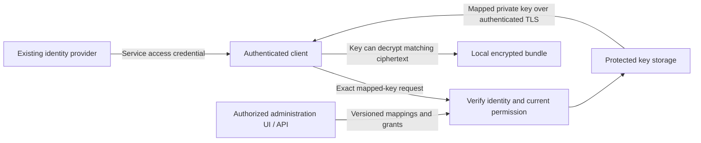

# Managed key service

CircularQuay's optional managed key service answers a small request: authenticate
me, check my authorization, and return my mapped age private key. It uses an
existing identity provider. The service adds key mappings, scoped access
management, and audit; it does not run an email, password-reset, or identity
onboarding system. It can be hosted for customers or operated by an employer.

The administration UI and API let authorized administrators inspect, create,
modify, expire, and revoke access. Existing Netlify or Cloudflare services supply
identity and access-management interfaces wherever they fit. Any remaining
key-specific UI is a thin application hosted within those environments.

This is the complete intended v1 service and custody contract. It is not a
claim of a deployed endpoint, customer enrollment or a qualified release.
[Delivery requirements](implementation-plan.md#managed-service-development-and-delivery-contract)
and [revision-bound qualification](qualification.md) establish those separately.

## Identity and authorization

The identity key is the exact trusted issuer plus stable subject, not a username,
email address, or email-domain match. This follows [OpenID Connect's identity
stability rules](https://openid.net/specs/openid-connect-core-1_0.html#ClaimStability).
An employer's authorization domain and an enrolled application/client further
constrain the mapping. Authentication in domain A never unlocks B or C.

Each configured token profile verifies signature, trusted issuer and keys,
intended service audience, token type, validity, and required client/claim
bindings. The API accepts access credentials for this service; an unrelated ID
token or caller-selected signing URL is not equivalent. Explicit mappings turn
trusted scopes, roles, groups, or delegated authorization into particular
operations. Unsupported profiles fail closed rather than guessing claim meaning.

The effective permission is the intersection of the verified identity grant,
current service authorization, mapping scope, and active time window. A trusted
IdP proves identity; it does not grant every authenticated account a key. UI,
CLI, MCP, and direct API calls use the same server-side checks. A caller-supplied
principal, tenant, mapping ID, or client label cannot establish ownership.

| Authority | Permitted responsibility |
| --- | --- |
| Identity provider | Authentication, MFA, account lifecycle, and its own groups/roles. |
| Mapping administrator | Manage authorized-domain key references and mappings within delegated scope. Administration does not implicitly permit key retrieval. |
| Grant administrator | Manage allowed principals, clients, operations, windows, and revocation within their own authority ceiling. |
| Key reader | Fetch only an explicitly authorized mapped key. Retrieval does not grant administrative authority. |
| Auditor | Read permitted metadata receipts without key or token contents. |

These are configurable capabilities, not fixed organization or environment
names. The UI shows effective access, its issuer/subject and client associations,
its source, policy revision, timing, and revocation state. Updates use version
checks and server validation; browser controls are not the enforcement point.
Administrative audit records actor, recipient, mapping/version, changed scope,
reason, decision, and time. They never contain private keys or bearer tokens.

Service-side revocation fences new key-release decisions using current grant
state and a recheck before release. It does not recall an admitted response.
IdP account/group changes have a separate propagation bound: locally verified
JWTs can remain valid until expiry unless a configured introspection, session
revocation, or authenticated event mechanism establishes fresher state. The UI
reports the applicable freshness bound instead of claiming immediate issuer
revocation from an old token. Strongly consistent permission reads prevent an
outdated replica or cached allow from overriding an acknowledged service deny.

## Provisioning, exposure and issuer response

The service uses [one governed configuration](configuration-governance.md) for
tenant defaults, locked controls, groups, contexts and effective workload rules.
Its [lifecycle contract](credential-lifecycle.md) includes optional qualified
SCIM provisioning/deprovisioning, independently authorized provider-native
rotation/revocation, GitHub scanning and optional GitGuardian exposure policy.
UI/API/CLI/SDK/MCP mutations use common validation, authorization, approval,
revision guards and required durable audit; an interface cannot widen a grant.

Optional workload OIDC/SPIFFE, device-posture/Conditional Access and external
policy evaluators follow the same [lifecycle profiles](credential-lifecycle.md#workload-identity-posture-and-external-decisions),
authorization ceiling and forward migration contract. They cannot substitute
for tenant isolation, grant approval or required audit.

Directory removal fences future access under the declared freshness profile.
Incident closure cannot remove a known exposure block, and an exposure exception
cannot override issuer revocation. Credential references remain protected and
scanner/provider/directory credentials remain separate. Rotate application
credentials at their issuer when authorized; distributing a new age key alone
does not invalidate credentials or ciphertext already accessible to a recipient.
OTLP exports contain approved metadata only and do not make the audit store
immutable or recall released keys.

## Key lookup and client behavior



The request names a mapping, not an arbitrary secret-store path. The service
checks ownership before storage retrieval and releases one authorized key
version over authenticated TLS. Responses use `Cache-Control: no-store` and
are excluded from CDN caching, request-body capture, traces, and error output.
Durable required audit precedes release; audit failure denies the operation.
Administrative metadata responses do not contain private key bytes.

Clients retain only their configured key profile and protected cache. A refresh
interval determines when a compliant client contacts the service again. Failed
refresh cannot extend an expired service grant or a protected local approval.
A returned private key, however, has no intrinsic expiry: a recipient can copy
it and use it independently. The service cannot prove that a client deleted it.

Service profiles, issuer/client bindings, mapping references, refresh rules,
cache/custody choice, and time bounds are explicit configuration. CLI CRUD
manages those declarations and doctor validates references and trust settings
without displaying or fetching key material as a diagnostic side effect.
Bootstrap and approved workload operations obtain keys through the selected
profile. MCP administration uses the same scoped management operations; normal
agent actions return task results. Age private keys remain bootstrap material,
not ordinary MCP secret aliases or model-visible management output.

## Distribution, local custody, and remote unlocking

These are different security models. The small hosted service above distributes
keys. The stronger boundaries below are separate custody profiles, not hidden
properties of that distribution endpoint.

| Model | Where key material resides | What revocation can stop | Residual boundary |
| --- | --- | --- | --- |
| Private-key distribution | The authorized client receives the age private key. | Future fetches from the service. | A copied key can decrypt old and future ciphertext addressed to that unchanged recipient. Refresh rules do not change this. |
| Protected local custody | An optional local service under a separate OS identity holds the key and performs approved operations. | Future local operations while the service, OS, policy, and clock remain trusted. | Same-user file hiding is insufficient. Root/Administrator, a compromised service, or captured plaintext/unwrapped data keys can bypass the boundary. |
| Remote unlocking | A separate remote custodian retains the private key and authorizes each exact bundle operation. | Future remote unlock requests. | A returned data key or plaintext can be retained. Remote private-key retention alone is not end-to-end recall. Fully offline use needs a separately trusted local enforcement boundary. |

For protected custody, merely downloading a bundle grants no independent
unlocking authority to the ordinary caller. The local service authenticates the
caller using OS or enrolled application identity, checks the exact authorization
domain, signed bundle digest, workload, permitted secrets, policy version, and
window, and refreshes authorization before required key use. It offers bounded
operations rather than a generic private-key export or unrestricted decrypt
oracle. It releases only permitted application values or launches the approved
workload. The service identity, files, IPC, process inspection rights, and
administrative update path form the local boundary.

This custody claim does not apply once the ordinary caller receives a usable
private key, whole-document data key, or plaintext. Hardware can reduce private
key export but does not prevent an authorized process retaining decrypted data.

## Artifact and key isolation

Partition bundles and key authorities along real authorization boundaries.
Secrets for employers A, B, and C do not share one decryptable bundle or one
ordinary age key. Per-field selection after whole-document decryption is
minimization, not cryptographic isolation.

Ordinary age recipients independently wrap the same file key, as specified by
the [age format](https://c2sp.org/age). Every applicable recipient is an alternative
unlock path. SOPS [key groups](https://getsops.io/docs/usage/identities/key-groups/)
can require a threshold of groups, but reconstruct the document data key; they
do not create per-field identity isolation. Recovery, local age, cloud KMS,
Transit, plugins, and all group/threshold combinations belong in the authority
review. A bypass recipient defeats a mandatory online gate even if the normal
client uses the managed service.

| Granularity | Benefit | Revocation and recovery consequence |
| --- | --- | --- |
| Per user/client/domain | Smaller key-sharing scope and independently removable mappings. | More recipients, key versions, and recovery operations; every remaining recipient still authorizes its bundle. |
| Per organization/domain | Fewer key objects and simpler distribution. | Anyone who retained the shared key can decrypt ciphertext addressed to it; removing one mapping does not remove that person's cryptographic access. |

The configuration exposes this choice explicitly. An organization key is not
presented as individually revocable cryptographic custody. Recovery authority
is separately held, audited, and excluded from ordinary workload users.

## Signed windows and offline limits

SOPS and age encrypt data; they do not enforce decryption expiry. A signed
window authenticates a deadline, while a trusted service or local boundary
enforces it. The earliest applicable identity, local approval, offline, and
provider-credential deadline bounds new operations through that boundary.

Protected clocks, rollback state, and monotonic checks support compliant local
execution. They do not mathematically guarantee offline expiry against a
hostile administrator who controls the machine or retained copies. Offline
local receipts are not authoritative central per-read audit.

Revocation stops future authorized operations. It cannot recall plaintext,
unwrapped data keys, a distributed age private key, or historical ciphertext.
Changing an age recipient or rotating its key does not invalidate an old key
plus an old encrypted copy. Fresh encryption/data keys protect future bundles;
the actual application credential needs issuer-side expiry, revocation, or
rotation to contain an already disclosed credential.

## Established integration mechanisms

CircularQuay reuses existing cryptography. These upstream mechanisms have
separate compatibility and custody boundaries; their existence is not a
qualification receipt for a CircularQuay adapter.

| Mechanism | Established capability and boundary |
| --- | --- |
| SOPS age plugin support | Upstream [age identity handling](https://github.com/getsops/sops/blob/main/age/keysource.go) recognizes plugin identities. Plugin executables and identities require explicit trusted installation, not arbitrary commands from downloaded policy. |
| SOPS key command | The same upstream interface can obtain age private keys from a command. Because it returns keys, it is a distribution path, not proof of non-exportable custody. |
| SOPS key service | [SOPS documents](https://getsops.io/docs/usage/advanced/#using-sops-key-service) remote data-key operations without sending the master private key. Its transport has no built-in authentication/encryption; a protected transport and authorization boundary are required. Disable unintended local/key-service fallback. |
| Exact-bundle authorization around a key service | The [upstream protobuf](https://github.com/getsops/sops/blob/main/keyservice/keyservice.proto) carries a key identifier and data-key ciphertext, not a complete bundle/identity policy. A policy boundary must bind the authenticated request to the exact approved artifact before invoking it; bare key-service access is not that check. |
| YubiKey/PIV | [age-plugin-yubikey](https://github.com/str4d/age-plugin-yubikey) keeps identity secret material in the token and supports PIN/touch policy. Presence requirements and caching affect unattended workloads; the token is not a remote revocation authority. |
| Apple Secure Enclave | [age-plugin-se](https://github.com/remko/age-plugin-se) provides device-bound identities and biometric access controls on its supported Macs. It creates a hardware-specific recipient rather than converting any downloaded age private key into the same non-exportable key. |
| TPM | [age-plugin-tpm](https://github.com/Foxboron/age-plugin-tpm) supports TPM-sealed age identities and optional PIN use. Device custody and recovery require their own policy; it does not establish employer revocation by itself. |
| KMS or OpenBao/Vault Transit | SOPS' existing online key backends can enforce provider-side unwrap authority. This is a different custody model from returning an age private key and retains that provider's availability, audit, and lifecycle requirements. |

## Administration UI and hosting preference

Reuse already available paid Netlify or Cloudflare capabilities before building
login, account administration, policy screens, hosting, or observability.
An existing subscription is not assumed to include every identity, seat,
retention, or API feature; enrollment records the actual entitlement and budget.
No additional purchase is implicit in this design.

| Reused platform surface | Responsibility | Application boundary |
| --- | --- | --- |
| Cloudflare Access and its administration console | Existing IdP connections, app access policies, session controls, and authentication audit. | Validate the Access JWT under its declared profile and audience. Cloudflare account administration is not customer key-mapping authorization. See [Access policies](https://developers.cloudflare.com/cloudflare-one/access-controls/policies/) and [JWT validation](https://developers.cloudflare.com/cloudflare-one/access-controls/applications/http-apps/authorization-cookie/validating-json/). |
| Netlify Identity and its managed user administration | Available application login, user/role lifecycle, function verification, and entitled identity audit. | Use provider-managed authentication; do not add an email system. Identity roles gate app operations only after server verification. See [Identity capabilities](https://docs.netlify.com/manage/security/secure-access-to-sites/identity/overview/) and [managed user administration](https://docs.netlify.com/manage/security/secure-access-to-sites/identity/manage-existing-users/). |
| Netlify project protection/team SSO | Protect the deployment and operator/team access where appropriate. | These sessions are distinct from application-user identity and per-key grants; a shared site password cannot implement individual key revocation. See [site access controls](https://docs.netlify.com/manage/security/secure-access-to-sites/overview/). |
| Thin key-specific administration UI | Mapping metadata, scoped grants/windows, effective access, versioned changes, revocation, and redacted audit. | Build only the missing domain screens. Host static assets on Netlify or Cloudflare, with authenticated Functions/Workers APIs and protected transactional storage. No key material in client bundles, public build variables, or preview deployments. |

The same-origin UI/API pattern avoids an unnecessary cross-cloud identity and
secret path. Split hosting remains possible when a particular custody or
enterprise identity requirement justifies it. Preview deployments use synthetic
keys and separate identities. Browser sessions, CSRF protection, CSP, origin
checks, request limits, abuse budgets, and server authorization protect changes;
the managed login screen alone does not authorize a mapping mutation.

## Local development, integration, and controlled delivery

The managed service has one artifact, configuration, storage-migration, and
authorization contract across local development, CI, preview, and production.
A developer instance is a loopback-only isolated deployment of that same
versioned artifact. It uses an independent local data directory, isolated
tenant/domain identifiers, synthetic keys and secrets, and a developer-approved
identity-provider profile. `development` and `production` are labels chosen by
an operator; neither label grants an identity, selects a tenant, or weakens a
policy.

Authentication and authorization remain real in a local instance. A local
browser session, test header, loopback origin, or developer OS account is not a
substitute for a verified service credential and server-side mapping decision.
A self-hosted Keycloak fixture, a constrained wire-compatible identity fixture,
and selected OpenBao scenarios provide repeatable integration inputs where they
exercise their respective protocols. They use fabricated tenants, principals,
recipients, tokens, and encrypted values. They do not turn a test provider into
an implicit production authority or require any particular IdP in a customer
deployment.

Each local instance trusts only its own test certificate authority for its
declared endpoints. Test certificates, issuer metadata, and isolated client
trust are created with the fixture and removed with it. The service never asks a
developer to add a permanent system/browser trust-store exception, disable TLS
verification, or reuse an operational certificate. A trust failure is a test
failure, including on loopback.

The same pinned artifact, policy fixtures, migration sequence, health contract,
and redacted evidence format run locally and in CI. Cleanup removes only the
test instance's data, certificates, and synthetic identities after evidence is
captured; it does not mutate a shared provider, account, or host trust store.
Parallel runs use distinct instance, tenant, database, and audit namespaces.
This permits concurrency, retry, backup/restore, expiry, and revocation testing
without conflating one developer's result with another's.

Netlify Dev and Wrangler local adapters exercise the same authenticated API and
tenant-isolation contract using synthetic inputs. They are adapter tests, not
evidence that a hosted platform has enforced a production policy. Preview
validation is separately scoped: it uses a preview-specific application,
identity audience, storage namespace, and synthetic key set, and it cannot read
or modify production mappings, audit records, or custody material.

The required managed-service test gates cover exact authentication audience and
issuer binding; tenant and authorization-domain isolation; operation scopes;
mapping version conflicts; expiry and revocation before release; concurrent
grant/mapping updates; idempotent migration and rollback; backup encryption,
restore, and recovery authorization; durable audit-before-release; redaction;
and health/recovery behavior. Provider-specific Keycloak, OpenBao, Netlify, and
Cloudflare routes add their own protocol and entitlement gates. A passing local
fixture never substitutes for a native, provider, preview, or production
qualification receipt; current results are recorded in the
[qualification matrix](qualification.md#managed-service-design-status).

Workload identity can strengthen service-to-service callers without replacing
the end-user/application authorization model. [SPIFFE](https://spiffe.io/docs/latest/spiffe-about/overview/)
and [SPIRE](https://spiffe.io/docs/latest/spire-about/spire-concepts/) can supply
workload identities and short-lived mTLS credentials where an operator runs
them. Their trust domain, selectors, registration authority, workload attestation,
and rotation/revocation behavior are explicit deployment configuration. A
SPIFFE identity proves an enrolled workload identity; it does not itself select
a tenant, mapping, operation, or age key, and it does not replace an IdP access
credential when the policy requires one.

Controlled delivery follows Gitflow: feature work integrates through `develop`,
a release branch stabilizes a candidate, `main` contains approved stable
releases, and a hotfix returns to every affected integration branch. Each v1
release candidate and stable release is one immutable, versioned artifact set
with published digests and provenance. Rebuilding, rebadging, changing build
inputs, or changing a migration produces a new candidate that repeats the
applicable qualification; it cannot inherit approval from bytes that were not
tested.

Promotion uses the exact tested artifact in its approved environment. It
requires migration rehearsal and rollback evidence, health and readiness
evidence, authorization/tenant-isolation verification, backup/restore evidence,
and redacted audit evidence for the selected scope. A production promotion does
not create a broad publisher credential, bypass an environment approval, or
modify an unrelated instance. Publisher accounts, registry steps, and operator
commands are maintained in [RELEASE.md](../RELEASE.md); this document defines
the architecture and acceptance contract rather than an operator procedure.

## Hosting economics and capacity assumptions

The following is an editable planning model in USD, checked against linked
public rates on **4 November 2026**. It is not a measured capacity result,
production bill, chosen plan, approved price, or customer/revenue claim. It
models simple key retrieval; the added administration UI, entitlement checks,
write volume, IdP integrations, and retention increase total delivery cost.
Existing paid-plan capacity can reduce incremental spend but is not free or
reserved capacity. Netlify credits/usage and Access seats need account-specific
costing before a hosting selection.

| Reference | Planning inputs | Exclusions and interpretation |
| --- | --- | --- |
| Cloudflare Workers Standard | $5/month includes 10M requests and 30M CPU-ms; additional requests $0.30/M and CPU $0.02/M ms. | Assumed 5 ms CPU/request, not measured. At 100M requests: $5 + $27 + $9.40 = **$41.40/month** before database, audit, key wrapping, or other services. [Rates](https://developers.cloudflare.com/workers/platform/pricing/). |
| Cloudflare D1 Paid | 25B rows read, 50M writes, and 5 GB included; overage $0.001/M reads, $1/M writes, $0.75/GB-month. | One audit write per 100M retrievals already adds $50 beyond the write allowance. Index maintenance, administration, denials, and storage add usage. [Rates](https://developers.cloudflare.com/d1/platform/pricing/). |
| AWS retrieval example | US East (N. Virginia), HTTP API, x86 Lambda at 256 MiB for 100 ms, one strongly consistent DynamoDB read of an indexed item up to 4 KiB, one symmetric KMS decrypt, and a log-ingestion allowance of 1 GB per million retrievals. | Approximately **$5.24/M**: API $1 + requests $0.20 + compute $0.4167 + reads $0.125 + KMS $3 + logs $0.50. Excludes free allowances, writes, data/storage, egress, backups, tax, and the KMS key's monthly charge. A key read plus a separate grant read costs more. [API](https://aws.amazon.com/api-gateway/pricing/), [Lambda](https://aws.amazon.com/lambda/pricing/), [DynamoDB](https://aws.amazon.com/dynamodb/pricing/), [KMS](https://aws.amazon.com/kms/pricing/), [logs](https://aws.amazon.com/cloudwatch/pricing/). |
| AWS Secrets Manager | $0.40 per separate secret per month; 100 separate key objects imply $40/month before calls. | Different custody/storage choice, not an extra fee necessarily present in the DynamoDB example. [Rates](https://aws.amazon.com/secrets-manager/pricing/). |
| Small VM comparison | A 1 GiB DigitalOcean Basic VM is $6/month; the listed 512 MiB tier is $4/month. | Neither is a production capacity commitment. Patching, TLS, backups, redundancy, monitoring, and operational labor are additional. [Rates](https://www.digitalocean.com/pricing/droplets). |

Cloudflare's [observability pricing change](https://developers.cloudflare.com/observability/pricing/)
begins **1 December 2026**, not the date of this model. The announced Paid pooled
allowances are 50 GB ingestion and 10 GB-month storage, then $0.25/GB ingestion
and $0.10/GB-month storage; Free has 0.5 GB/day ingestion and seven-day retention.
Enterprise changes at contract renewal; Log Explorer datasets have a separate
rate. Those future byte rates are excluded from the current Workers example.
Audit bytes, retention, and export are separate cost inputs, not zero-cost
consequences of counting key fetches.

Users, throughput, and concurrency are different quantities. With a 30-day
month, 100,000 users fetching once a day produce 3M requests, about 1.16 requests
per second on average. If all fetch together, the burst can be 100,000 requests;
with a ten-minute jitter window it averages about 167 requests/second during
that window. At 100 ms response time, 167 requests/second implies roughly 17
in-flight requests in a stable system, not a 17-user limit. These are arithmetic
scenarios, not benchmarks.

The [Workers Free limit](https://developers.cloudflare.com/workers/platform/limits/)
is 100,000 requests/day. The daily example consumes all of it before retries,
UI calls, or administration, so it does not justify offering 100,000 reliable
users on Free. CPU time, database throughput, KMS quotas, cold starts,
revocation consistency, audit persistence, and synchronized refreshes require
load tests. D1's [example throughput](https://developers.cloudflare.com/d1/platform/limits/)
at 1 ms/query is conditional; it is not an application SLA. A paid plan becomes
necessary when actual feature/usage/availability requirements exceed the free
service, not when a particular unmeasured user count is reached.

## Illustrative revenue model

A five-unit free tier and a larger paid tier such as 100 units are business
ideas only. The managed unit could be a key, identity, client, or organization;
its definition, included usage, tiers, pricing, billing country, and support
commitments remain unsettled. Nothing in this document offers a live paid plan.

| Editable input or output | Low case | Base case | High case |
| --- | ---: | ---: | ---: |
| Active accounts | 1,000 | 10,000 | 100,000 |
| Paid conversion assumption | 2% | 5% | 10% |
| Paying accounts | 20 | 500 | 10,000 |
| Monthly price assumption | $5 | $10 | $20 |
| Fetches per active account/month | 20 | 200 | 1,000 |
| Total monthly fetches | 20,000 | 2,000,000 | 100,000,000 |
| Monthly recurring revenue | $100 | $5,000 | $200,000 |
| Annualized recurring revenue | $1,200 | $60,000 | $2,400,000 |
| Infrastructure budget allowance | $25 | $100 | $1,000 |
| Payment-fee allowance | $9.60 | $330 | $10,200 |
| Support allowance at $1/payer/month | $20 | $500 | $10,000 |
| Illustrative gross contribution | $45.40 | $4,070 | $178,800 |
| Illustrative contribution margin | 45.4% | 81.4% | 89.4% |

Infrastructure allowances are planning inputs, not computed vendor bills. The
payment assumption is a US-based, USD-billing card merchant with a conservative
blended allowance of **3.6% + $0.30 per monthly payer**. It is not a universal
Stripe quote; [published payment rates](https://stripe.com/us/pricing) vary by
country, card, currency, and other services. Taxes, refunds, disputes, additional
subscriptions/billing products, acquisition, engineering, independent security,
insurance, legal, compliance, and general overhead are excluded. Contribution
is not net profit.

The formulas are:

```text
payers = active_accounts * paid_conversion
monthly_fetches = active_accounts * fetches_per_active_account
MRR = payers * monthly_price
ARR = 12 * MRR
fees = 0.036 * MRR + 0.30 * payers
contribution = MRR - infrastructure_allowance - fees - support_allowance
margin = contribution / MRR
next_month_payers = prior_payers * (1 - monthly_paid_churn) + new_paid_conversions
```

Revenue starts with the first actual paying conversion, not account creation.
No acquisition timeline is asserted. For the base price, a fixed $100
infrastructure allowance alone is covered at 12 payers under these variable
cost assumptions; that is not business break-even. Add fixed operating costs
before calculating business break-even. Each additional $1,000/month of fixed
cost needs about 120 more $10 payers at the same assumptions.

At 3% monthly paid churn, the base snapshot needs 15 replacement paid accounts
per month just to retain 500. At 1%/3%/5% churn, simplified expected lifetimes
are 100/33.3/20 months; acquisition economics must use retained contribution,
not headline ARR. A $10 monthly price requires **83,334 payers** to reach at
least $10M annualized revenue. That is an arithmetic scale target, not demand or
traction evidence. Pricing and retention sensitivity, security operating cost,
and customer acquisition determine whether this becomes a viable business.

## Runtime, SDK and agent integration

The service's UI/API, CLI and optional MCP administration apply the same
verified tenant, subject/client, scoped operation and time-window checks.
Official [SDKs](sdks.md) explicitly select a local, workload-MCP or typed
remote-management boundary. A local config write never becomes an implicit
server mutation. Agent/plugin administration is metadata-only and follows the
[client integration contract](agent-integrations.md).

The typed [discovery and management contract](management-and-discovery.md)
provides explicit remote-management API/SDK operations and a distinct optional
management MCP profile. [Administration security](administration-security.md)
requires signed change integrity, scoped authority, independent approval,
anti-replay/rollback and durable audit. [Security profiles](security-profiles.md)
apply these requirements to every deployment and cannot be lowered by a client.

Protected runtime policy supplies [observability and release awareness](operational-configuration.md).
Required administrative/release audit remains durable independently of
best-effort metrics, traces and diagnostics. Managed UI controls present these
same declarations and effective provenance; runtime telemetry does not depend
on a deployed UI. Collector credentials, bootstrap keys and retained age
identities never enter browser bundles or model-visible fields.

Configuration/schema, service/API, SDK and artifact versions are explicit in
migration and compatibility records. Signed or authenticated update metadata
cannot replace artifact provenance, per-environment promotion or local minimum
versions. Incident recovery restores deny/revocation state before admitting
release and does not promise to erase exported keys, data keys or plaintext.

## Operational contract

Operator setup, identity trust, entitlement checks, protected storage, key
import/generation, backup custody, grant migration, rotation, retention, and
removal follow [RELEASE.md](../RELEASE.md) and the
[recovery runbook](operators/recovery.md). Scope changes are reviewed; neither
this design nor a key-fetch request authorizes purchases, production changes,
new broad credentials, or service installation on an existing operational host.
Actual implementation, native/hardware/provider testing, capacity measurements,
and release qualification are recorded separately in
[qualification.md](qualification.md).
