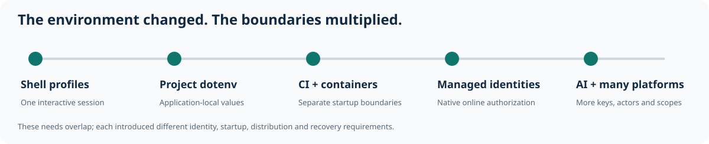

# How CircularQuay works

CircularQuay's v1 North Star is one coherent path from existing secret sources
and client-owned configuration to explicitly authorized application use. The
sections below describe that intended end state; the selected source/artifact
and [qualification record](qualification.md) establish what is implemented and
tested. A synthetic screen or internal Go package is not a live hosted service.

- **Explicit interoperability:** select exact provider resources and string fields; keep existing stores authoritative.
- **Optional enterprise identity:** connect trusted IdP identities and registered applications to configurable contexts, workloads, operations, and exact secret keys.
- **Time-bound access:** respect provider and offline deadlines; with identity integration enabled, also verify signed access grants and client-key possession.
- **Workload isolation:** reject duplicate names and undeclared resource access; keep provider bootstrap credentials out of application environments.
- **Complete generations:** resolve required inputs before activation instead of applying a partial refresh.
- **Portable encryption:** use upstream SOPS and age rather than a new encryption format.
- **Native delivery:** use process environments, protected files, OS credential interfaces, and declared deployment targets.
- **Optional MCP:** expose authorized status and named actions, with a separate permission for each raw secret disclosure.
- **Inspectable assurance:** source, tests, a policy model, release identities, and a reproducible audit route.

## Complete product and its three user surfaces

| User need | Intended product behavior | Boundary and detailed contract |
| --- | --- | --- |
| Prepare an application environment | Select exact variables/fields and provider references, edit local values, inspect inheritance/provenance/locks, set access windows and resolve a complete generation before apply/run. | Client-owned configuration, explicit workload/disclosure grants and honest retained-plaintext limits; [runtime](runtime-boundaries.md), [configuration](configuration-repositories.md) and [identity/expiry](identity-and-expiry.md). |
| Use a local client dashboard | Practical variable workbench and complete typed configuration editing, local import/export/validation, mode/custody/window controls and clearly labeled simulated/native outcomes. | All local configuration, profiles, variables and source credentials remain on the client. Browser file/CORS/VPN limits require actual access or an explicitly authorized native integration, never a hosted fetch proxy. |
| Manage a customer account | Own account, crypto/age associations, usage/history, quotas, invoices/subscription and support; explicit authorized enterprise/group/fleet features where available. | Separate account metadata and scope from client configuration, provider operator APIs and payment consent; [account and administration requirements](managed-key-service.md#end-customer-accounts-subscriptions-and-support). |
| Operate the service | Restricted customer/support/grant/key-metadata/health/audit views, individually scoped support and separately approved recovery/financial/privileged effects. | No routine plaintext key display, arbitrary SQL or all-tenant grant inferred from a role label; [administration security](administration-security.md). |
| Obtain hosted crypto and age access | Authorized enrollment reconciles both associations. Actual wrap/unwrap and deliberate age-private-key retrieval have distinct permissions, versions, windows and logical event identities. | Initial launch uses vetted software crypto, a protected KEK outside the DB and random profile DEKs on the authorized existing Cloudflare/Netlify footprint. Runtime/shared-KEK compromise can expose all reachable DEKs; this is not independent non-exportable/HSM custody. [Launch contract](managed-key-service.md#authorized-software-launch-custody-and-provider-choice). |
| Work online, offline or through an outage | Select availability and custody explicitly; online-only has no offline bypass. Authorized hybrid may use a complete eligible encrypted snapshot within its approved window on qualifying availability failure. | Denial, TLS/trust failure, malformed response and expiry never authorize downgrade. Ordinary recipients are alternatives, not an invented quorum; [profile and hybrid contract](managed-key-service.md#per-profile-age-and-kms-custody). |
| Migrate existing local keys/assets | Inventory selected client-local metadata, verify export/import/format and hardware limits, then explicitly approve reuse, rewrap or re-encryption with staged verification, resumable identity and recovery. | Enrollment/mode changes do not import keys or migrate ciphertext. Preserve originals/provenance; old copies remain usable. Stronger managed/HSM custody is a separately qualified funded path; [migration](managed-key-service.md#end-to-end-local-to-managed-migration). |

Account and operator dashboards are distinct from the local client. A browser's
demo role selector is presentation, not authenticated authority. User-configured
telemetry queries likewise remain client-side, with actual endpoint permissions;
neither a chart nor log export proves immutable audit. Optional enterprise,
provider, SDK and MCP capabilities retain their exact independent grants.

## Implementation and preview evidence

| Surface | What the current development evidence establishes | What still needs separate evidence |
| --- | --- | --- |
| Native runtime and official SDK boundaries | Source implements policy/provider/runtime operations and client-side composition; selected help/catalog and exact qualification determine callable behavior. | No whole-product, platform, provider or release pass follows from source presence. |
| Profile-bound key-service core | `internal/keyservice` separates enrollment, wrap, unwrap and age retrieval through caller-supplied authorization/storage/provisioning; software JWE and constrained Transit adapters are present. | This is not a hosted listener, production store, first-run service enrollment or public CLI/SDK/MCP integration. Native/provider/custody and deployment qualification remain separate. |
| Browser development | A separately assigned frontend checkout contains three interactive synthetic surfaces: local workbench, customer account and operator console. Its own `web/README.md`, `web/coverage.md` and exact browser receipts describe routes, pinned schema and tested interactions. | Rendered schema controls are not every-field mutation coverage. Browser round trips are not native signature/include/provider validation, real key/payment/fleet actions or service authentication. |

Use the documented browser preview process and authenticated phone-forwarding
route. Reported phone access establishes reachability through that route, not a
public deployment or real backend. Do not start a competing server, copy saved
configurations into evidence uploads or select a substitute brand asset. The
selected icon's original raster/provenance and a finished vector are distinct
deliverables. Keep implementation/preview revisions separate until the owner
integrates and requalifies them.

## Optional general UIF harness and project migration

CircularQuay's standalone build, run and delivery do not require UIF or another
subproject. UIF likewise operates without CircularQuay or any particular
subproject. The shared-harness requirements below apply only when that optional
operational lane is selected. UIF owns the shared Stokowski, Windmill, LangChain,
GitHub and Linear integration across Foo-local and durable cloud operation;
selecting that lane retains its ownership, admission and review controls.

| Scope | Purpose and canonical project source | Project-specific boundary |
| --- | --- | --- |
| UIF shared harness | General infrastructure, admitted orchestration and governance for multiple product profiles; [UIF Home](https://linear.app/maldous/document/uif-home-build-first-delivery-model-96eeea3357ee) is the existing canonical navigation/owner map, with any runtime acceptance/routing controlled through the existing UIF integration-owner/Gateway route. | UIF is not the OffMenu product or a replacement CircularQuay coordinator. Multi-project capability and CircularQuay migration remain required/planned until actual profile/job/isolation verification; a qualified candidate is not installed/accepted runtime. |
| CircularQuay product | Connect existing secret providers and client-owned configuration to authorized workloads, software crypto/age access and scoped account/operator/client surfaces. [Canonical repository](https://github.com/maldous/CircularQuay), [implementation plan](implementation-plan.md), [security](../SECURITY.md) and [handoff](session-handoff.md). | Native Go, official Go/TypeScript/Python SDKs and separately owned synthetic Node/browser work require their selected toolchains and evidence. Local config/variables/source credentials stay client-side; secret-bearing state is not a shared harness payload or another project's input. Source review, mock UI, native/backend qualification and production publication are separate. |
| OffMenu product | The household product-to-pantry-to-plate loop: understand products, ingredients, recipes and nutrition; connect menus, stock, serving/consumption/leftovers/history/planning and explicitly authorized shopping/receipt workflows. [Accepted product North Star](https://github.com/maldous/offmenu/blob/3540b2d4d5f4e96a518a63c832ccd6c3db809686/README.md), [documentation](https://github.com/maldous/offmenu/blob/3540b2d4d5f4e96a518a63c832ccd6c3db809686/docs/README.md), [source acceptance](https://github.com/maldous/offmenu/blob/3540b2d4d5f4e96a518a63c832ccd6c3db809686/docs/source-acceptance-contract.md) and [curation boundaries](https://github.com/maldous/offmenu/blob/3540b2d4d5f4e96a518a63c832ccd6c3db809686/docs/curation-architecture.md). | Its canonical docs describe browser/PWA JavaScript, Worker/D1 backend and separate Python/SQLite curation tooling. Retained source-data rights/provenance/publication projections, private household/profile/health state and personal-connection credentials have their own constraints. CircularQuay toolchain, secrets model or passing tests cannot qualify those data/product/release paths. Current config/data fixes and BAU adoption remain the OffMenu owners' work. |

The OffMenu product links pin the owner-confirmed accepted product revision
`3540b2d4d5f4e96a518a63c832ccd6c3db809686` (tree
`62efa45bb564affe4f1f1b2388bbb3447a14482c`). This describes intended outcomes,
not proof the whole loop is delivered. Product acceptance, installed UIF control
and a qualified-but-not-installed successor are different source/runtime states.
Use each owner's actual accepted execution tree, manifests, rights and review/
publication record. Do not duplicate mutable OffMenu requirements in CircularQuay docs,
ingest its corpus to test a harness change or substitute CircularQuay's release route for
OffMenu/UIF's sole integration owner. The current authoritative UIF route remains
its existing Root via Gateway; CircularQuay retains its current coordinator/source owner.

UIF is the **general shared harness**; CircularQuay is a product with its own
project profile and acceptance requirements. Do not classify CircularQuay as
OffMenu, borrow its data/credential/toolchain assumptions or treat another
project's failed job as proof of a shared defect. General multi-project support
is **required/planned for the selected shared lane**, not a verified capability
merely because it is named or a prerequisite for standalone CircularQuay work.

CircularQuay migration work proceeds now in parallel with OffMenu configuration,
data fixes and BAU adoption. Neither project's independent work waits for the
other's completion. Shared contract changes require impact review for **both
affected profiles**, binding the accepted source tree, actual job/configuration,
toolchain and isolation evidence. A blocked affected integration does not stop
unrelated authorized work.

Use the existing authoritative coordinators and the single canonical migration/
impact record. The source owner is the sole Linear writer for this assignment;
verified issue/project/filter bindings belong in that existing record. Their
independently read-back references are [UIF `P-UIF-16`](https://linear.app/maldous/project/uif-21558318e036),
[OffMenu `P-UIF-14`](https://linear.app/maldous/project/offmenu-ccd080f4f6f0) and
[CircularQuay `P-UIF-17`](https://linear.app/maldous/project/circularquay-656f1967b41c)
under the UIF team. The designated existing canonical migration checklist is
[the CircularQuay handoff](session-handoff.md#uif-migration-and-delivery-closure), now
populated by the source owner with the obligation, ownership and harness-gap
checklist. Dynamic all-status/nonarchived view/filter IDs still await
creation/readback. Project creation alone creates no task/lease admission,
implemented profile selector or operational migration. Do not add an issue tree,
planner or dispatcher to fill those gaps. Preserve existing tasks, leases,
review/publication authority and controlled per-unit handover; no abrupt cutover
or expanded production admission follows from this requirement.

The existing UIF Home/shared-project description still shows its earlier
three-project navigation at this readback; the enhanced CircularQuay sibling/multi-project
requirement needs the canonical owner's update there. This CircularQuay guide links that
home rather than replacing it or treating stale navigation as migration proof.

Each project profile must establish its actual repository/accepted tree,
checkout/toolchain/dependencies, operation permissions, privacy and data roots,
isolation from other projects, reviewers, publication destinations and required
evidence. These are acceptance requirements, not new CLI flags or schema fields.
Verify supported selectors/interfaces from the current owner-approved source;
unknown profile/ownership or a required unimplemented isolation boundary denies
the affected operation. Demonstrate multi-project behavior with actual scoped
source/job/isolation evidence before describing the migration as operational.

## Bootstrap, integrate and operate

`cq bootstrap` selects local configuration first, then enrolled discovery;
explicit options override environment settings, local configuration and
verified discovery in that order. Discovery provides a trusted configuration
reference, never authority by itself. `cq flow run` applies the same model
to GitHub Actions, GitLab CI and Azure Pipelines. See the
[configuration and CI guide](configuration-repositories.md).

The [official SDKs](sdks.md) give Go, TypeScript and Python applications the
same policy boundary, safe error categories, cancellation and explicit
secret-disclosure controls. [Operational configuration](operational-configuration.md)
selects remote metrics, traces, diagnostics and release awareness, with bounded
export and no secret-bearing telemetry. Required audit has its own durability
policy. Interactive release notices continue without consuming workload input;
automation remains non-interactive and installation remains explicit.

The [enterprise contract](enterprise-integration.md) defines identity lifecycle,
access review, audit retention/export, version compatibility, recovery and
extension governance for the complete v1 product. CLI and optional MCP
administration share scoped policy checks and audited, time-bound delegation.
The [portable skill and client-plugin guide](agent-integrations.md) explains
agent setup without adding implicit authority. The
[managed key service](managed-key-service.md) has its own linked UI/API
and custody contract. No client can recall plaintext or a copied age private
key; encryption alone does not enforce an access deadline.

The [canonical configuration](configuration-governance.md) combines defaults,
locks and group rules across every interface. [Lifecycle integration](credential-lifecycle.md)
adds supported SCIM provisioning/deprovisioning, authorized provider-native
rotation/revocation, GitHub and optional GitGuardian exposure policy, and
secret-free operational export. An incident's workflow state cannot prove issuer
containment or erase prior exposure; telemetry export cannot guarantee immutable
audit.

The [qualification matrix](qualification.md) records tested platforms,
providers, release artifacts, and operational evidence.

<picture>
  <source media="(prefers-color-scheme: dark)" srcset="assets/environment-evolution-dark.svg">
  
</picture>

Read [identity and expiry](identity-and-expiry.md), [runtime boundaries](runtime-boundaries.md), and [the architecture](architecture.md) for the trust and delivery model.

[Documentation](README.md) · [CircularQuay](../README.md)
